# Green Lantern power battery that pours a shot: build guide

A 3D-printed Green Lantern power battery in the classic shape (rev C), with a hidden pump, a hidden spout and a
twist-to-pour lock. It stands about 45 cm tall to the lid (49 cm with the handle up) and is 22.4 cm across the
sphere. No screws show from outside.

From the bottom up:

- an 80 mm **drum** that holds the removable **cartridge** (the pump and the drink bag);
- a flared **foot** and a short neck;
- the 224 mm **sphere**, with a **lens bell** on the audience side and a **hand bell** on your side;
- a short neck, a flare and the 190 mm **top cap**, which holds the battery and all the electronics;
- the **emblem lid** with its glowing halo;
- a loop **handle** on pivots at the sphere's sides.

Throughout this guide, "your side" means the hand bell (where you stand) and "display side" means the lens bell
opposite it, facing the audience.

**The show in one paragraph.** Push the empty shot glass in under the lock until it clicks. Punch in through the
frosted cover, ring face first, and the ring seats in the lock: the lantern glows faintly. Twist 45 degrees and hold
it while you recite the oath. Behind the lock wall the pump pours about 1 oz into the glass while the light climbs
from 15 % to 90 % over about 11 seconds. Turn back and the light swells to full, then goes dark. Grip the glass, slide
it toward you, lift it and bring it out.

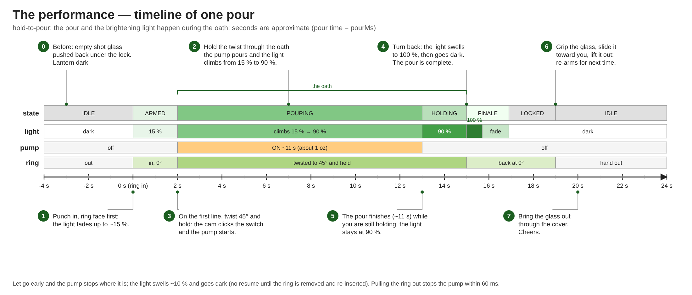

**Status.** Designed, modelled and simulated; not yet built.

- The firmware compiles and passes 20 simulated safety scenarios (`firmware/test`).
- The CAD passes its fit checks (`cad/build.py`, `cad/tests/`). The electronics, the pump and the bag are checked
  against reserved sizes in [CAD fit limits](../cad/README.md#electronics-fit-limits), so measure the real parts before
  printing. The battery and the pump are already measured.
- Every size is parametric (`cad/params.py`): a measured number is a one-line change and a re-run of
  `python3 build.py`.

## Viewer and videos

- **3D assembly viewer:** [open it in the browser](https://raw.githack.com/TheRageKage12/drunk-lantern-power-battery/main/docs/assembly-viewer/index.html)
  (`docs/assembly-viewer/index.html`). Every part is colour-coded, the steps follow the build order in
  [section 7](#7-assembly) (steps 0 to 16), and an exploded view shows how everything stacks. Click a part for its
  name.
- **Videos:** [step-by-step assembly](videos/assembly-guide.mp4) ·
  [exploded assembly](videos/separate-and-assemble.mp4) ·
  [opening for service](videos/service-access.mp4).
  - The step-by-step video follows the same build order and step numbers as this guide.
  - The exploded video shows how the parts fit together; use the step-by-step video for the order.
  - The service video shows how to open the lid, lift the lantern off the cartridge and take the bells and the top
    cap off ([section 13](#13-service-opening-it-up)).
  - Wiring and most screws are described in this guide, not animated.

## Contents

1. [How it works](#1-how-it-works)
2. [What you need](#2-what-you-need)
3. [Print the parts](#3-print-the-parts)
4. [Heat-set inserts](#4-heat-set-inserts)
5. [Electronics (build it on the bench first)](#5-electronics-build-it-on-the-bench-first)
6. [Firmware](#6-firmware)
7. [Assembly](#7-assembly) (build steps 0 to 16)
8. [The hand-side cover](#8-the-hand-side-cover)
9. [The drink bag](#9-the-drink-bag)
10. [Calibration](#10-calibration)
11. [Test before the party](#11-test-before-the-party)
12. [Performing it](#12-performing-it) (on the day, charging, refilling)
13. [Service: opening it up](#13-service-opening-it-up)
14. [Cleaning and storage](#14-cleaning-and-storage)
15. [Troubleshooting](#15-troubleshooting)
16. [What this budget build leaves out](#16-what-this-budget-build-leaves-out-and-how-to-add-it-back)

---

## 1. How it works

```
 0. before: push the empty glass in under the lock until it clicks over the ridge at the stop
 1. punch in, ring face first (6x2 mm magnet hidden in the printed ring) -> Hall sensor sees it -> light fades up to ~15 %
 2. twist 45 deg counterclockwise and HOLD -> a cam clicks the microswitch -> pump starts, light starts climbing
 3. keep holding through the oath: the pump runs ~11 s while the light climbs to ~90 %
 4. let the ring turn back (spring) -> light swells to 100 % and goes dark
 5. grip the front of the glass, slide it 3 cm toward you, lift it ~5 cm out of its slot and bring it out

 Let go early: the pump stops where it is, the light swells ~10 % and goes dark.
 Safety: the pump only runs while the ring is in AND the twist is held, and only once per insertion.
```

| Where | What is there |
|---|---|
| Lid | `halo_ring` (white) with the green `emblem_lid` glued on. Two 12.5 cm pieces of LED strip inside the top cap light the emblem and the halo's glowing band from below. Push down and twist 20 degrees to lock or unlock it; no tools. |
| Top cap | The **cap floor**, a plate on a ledge inside the cap, carries the 12 V battery, the circuit board, the buck converter, the power switch S1 and the charge socket. Everything you do day to day (switch on, charge, USB) happens with the lid off. The battery lies LED face down over a slot: look up through the hand opening to read its charge dots. |
| Sphere, your side | The 140 mm **hand opening** and the **hand bell**, closed by a one-piece frosted cover with 8 cuts from the centre: the flaps fold round your arm and spring back flat. A full ring of LED strip (~45 cm) inside the bell lights it. |
| Sphere, inside | The **lock wall**, 2.5 cm past the centre toward the audience.<br>• **On its face, facing you:** the lock, with a 5 cm LED column either side. The lock is a rotor with the keyed ring pocket, 0 and 45 degree hard stops, a spring plunger that returns it, a cam, the D2F-01L microswitch and the A3144 Hall sensor.<br>• **Under the lock:** the glass, in a slot.<br>• **Behind the wall, out of sight:** the nozzle, over the back third of the glass.<br>• **In front of that:** the white **LED panel** with 4 rows of LED strip facing the lens. It hides the nozzle, the glass and the wires from the audience.<br>• **On top of the wall:** the white `wall_extension`, which braces it against the top cap and hides the wires running up. |
| Sphere, display side | The **lens bell**: a frosted 118 mm white lens, with a 37.5 cm LED ring behind it. |
| Foot | Hollow: the glass slot hangs into its neck; the tube and the pump's wires pass through it. |
| Drum and cartridge | The drum is part of the lantern. The **cartridge** under it is one printed tray with the Kamoer pump and the **drink bag** (a 32 oz spouted pouch, filled to about 22 oz) under a cover. It twist-locks into the drum: to refill, twist the lantern a little anticlockwise and lift it off by the handle. Only the tube and the pump's two wires cross between the lantern and the cartridge. |


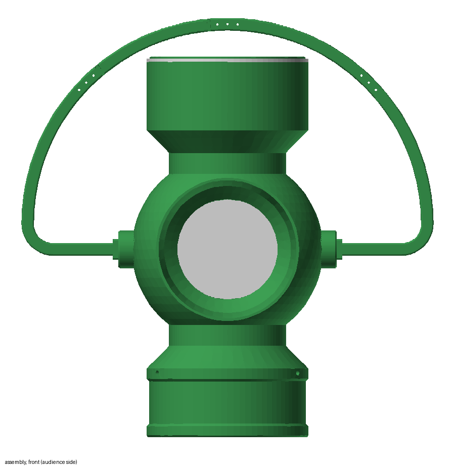 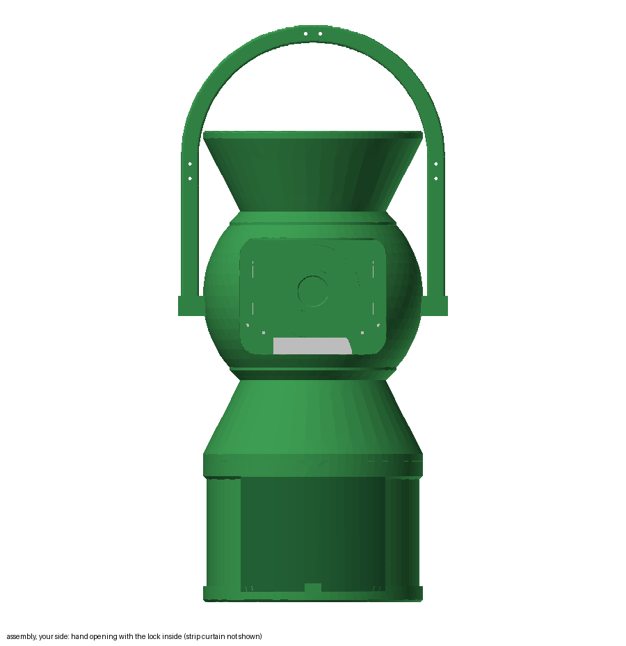


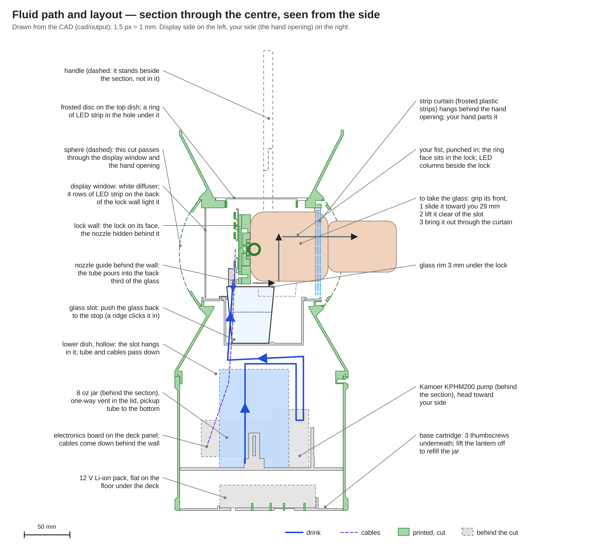

The drink touches only the pouch, the platinum-silicone tube and the glass. No printed part is in the liquid path.

---

## 2. What you need

The shopping list, with prices, who has each item and what is still to get, is the
[shared Google Sheet](https://docs.google.com/spreadsheets/d/17pCjma48U2CBcsrsc3ZVFVb3nuV0KqnQlag0SO8B_yU/edit).
It is the only list: this section summarises what the build uses so you can check it against the Sheet.

### 2.1 Bought parts

**Online (Amazon):**

- Pump: [Kamoer KPHM200, 12 V](https://www.amazon.com/dp/B09HGVLHFV). Run at ~70 % speed it pours about 1 oz in 11 s.
- Tube: [AUBER 1/8" ID x 1/4" OD platinum-cured silicone, 10 ft](https://www.amazon.com/dp/B0DKB1NKB4). The exact size
  the Kamoer head needs; thinner 1/8" x 3/16" tube will not pump. One continuous piece runs from the bag through the
  pump to the nozzle; the rest is spare (the tube is the part that wears).
- Drink bag: [32 oz spouted pouch](https://www.amazon.com/dp/B09WR13XDT). **Still to buy.** It fills the bay to
  about 22 oz under the cover; a 16 oz pouch would stop at 16 oz.
- LED strip: [HAMRVL COB LED strip, green, 12 V, 8 mm, 5 m](https://www.amazon.com/dp/B0CKYFLZFQ). Cuts every 25 mm.
  You use about 158 cm in 10 pieces (section 7, steps 2, 3, 9, 12 and 13).
- Buck converter: [LM2596 step-down module, 5-pack](https://www.amazon.com/dp/B0DBVYP91F), set to 5.0 V.
- Magnets: [6 x 2 mm neodymium, 45-pack](https://www.amazon.com/dp/B0CBRVF4PN). One goes in the ring.
- Microcontroller: [Seeed XIAO RP2040, pre-soldered](https://www.amazon.com/dp/B0DRNTQ338).
- Battery: [TalentCell YB1203000 with charger](https://www.amazon.com/dp/B00MHNQIR2). 3000 mAh, 3 A maximum,
  105 x 65 x 25 mm; output falls from 12.6 to 9 V as it drains. Its one DC5521 port is both input and output, and its
  own switch must be ON to charge. You also use its 12.6 V charger and its 1-female-to-2-male splitter (section 5,
  step 2), which replaces a charge jack.
- Microswitch: [D2F-01L lever microswitch, 4-pack](https://www.amazon.com/dp/B0DBV9JX6L). The 0.1 A hinge-lever
  version (minimum load 1 mA at 5 V). Check the marking, the peg spacing against `switch_bracket`, and that it clicks
  reliably 50 times.
- M3 heat-set inserts: [ruthex RX-M3x5.7, 100-pack](https://www.amazon.com/dp/B08BCRZZS3). 17 used.
- 6-32 heat-set inserts: [initeq #6-32 long, 20-pack](https://www.amazon.com/dp/B076QY9858). **Bought.** 13 used, one
  under every thumbscrew.

**Vetco Electronics (Bellevue):**

- Hall sensor: [A3144, VUPN6596](https://vetco.net/products/vupn6596_hall-effect_sensor_-_allegro_a3144eua_d63).
- Gate buffer: [74AHCT125, DIP-14, VUPN524](https://vetco.net/products/vupn524_quad_level-shifter_-_74ahct125_-_3v_to_5v_d96).
  Must be AHCT, not HC.
- 2 MOSFETs: [IRLZ44NPBF, VUPN1682](https://vetco.net/products/vupn1682_mosfet_mosft_for_micro_controllers_-_30v_-_60a_-_irlb8721pbf_d151).
  The page's URL and title are out of date; its detail table names the IRLZ44NPBF. Check the marking on the part.
- Power switch S1: [30-10005 SPST mini toggle with leads](https://vetco.net/products/30-10005_spst_miniature_toggle_switch_w-wire_leads_on-off_6a)
  (6.5 mm panel hole).
- Inline plugs: [JST PH 4-pin pair](https://vetco.net/products/jst-ph-2-0-4-pin-connector-male-female-pair-pre-wired)
  for the lock cable, and [JST SM 2-pin pairs](https://vetco.net/products/vupn1054_jst_sm_2_pin_m-f_pair_locking_connector)
  for the pump. Rev C uses **one 4-pin pair** (the lock cable, at the cap floor) and **one 2-pin pair** (the pump, at
  the cartridge, so the lantern lifts off). The LED and pump leads at the cap floor and the two bells' LED leads are
  soldered straight through with slack instead (decided 2026-10-23; plugs there are an easy add later, about $1.75 a
  pair).
- Small parts: 2 x NTE585 and 1 x NTE586 (3 A/40 V) diodes; resistors 2 x 10 kΩ, 2 x 4.7 kΩ, 1 x 3.3 kΩ, 1 x 100 kΩ,
  1 x 22 kΩ; 3 x 0.1 µF ceramic and 1 x 2200 µF/25 V capacitors; a DIP-14 socket; a breakaway header and a shunt for
  JP1; the 5 x 7 cm protoboard, 22 AWG stranded wire and 1/8" heat-shrink.

> **Hall sensor alternative (not recommended).** The lock is built for the A3144, on a post that reaches up inside the
> rotor to about 3 mm from the magnet. An Adafruit DRV5032 board (#6051) also works: set `HALL_SENSOR = 'DRV5032'` in
> `cad/params.py` and reprint `rotor` and `socket_base`. It sits under the plate, 7.7 mm from the magnet instead of 3,
> and works on 3.3 V with either magnet pole. Adafruit ships slowly.

**Local, or already owned:**

- Compression spring for the lock: about 0.4-0.5 mm wire, 5 mm outside diameter, ~10 mm long (Ace Hardware, Hillman
  spring drawer; bring calipers). A retractable pen's spring also fits but is softer.
- VELCRO One-Wrap, 3/4" (Kevin has it): **2 straps**, one for the battery on the cap floor and one round the pump's
  motor. The battery strap runs in a 2 mm recess under the cap floor (One-Wrap is about 1 mm thick).
- About 10 small zip ties (2.5 mm wide): the buck module, the charge socket and the cables.
- Frosted polypropylene binder divider (Kevin has one), 0.3-0.5 mm: the one-piece hand-side cover. Not PVC or vinyl,
  which crack at the folds.
- Shot glass, 1.5 oz: up to 52 mm across the top and 62 mm tall (Kevin's is 48 x 60 mm). About 1.3 cm of it stands
  above the slot for your fingers; a heavy base helps.
- Super glue (Kevin's Gorilla Glue), and a little two-part epoxy for the three handle joints.

> **No charge jack.** The battery's splitter is "1 female to 2 male", with all three ends joined. One male plug stays
> in the battery, the other is cut off to make the lead to the board, and the charger plugs into the female end, which
> is tied down on the cap floor. Charge with the lid off (section 12).

### 2.2 Hardware counts

Everything below is already owned except where marked. Nothing shows from outside: every thumbscrew turns from inside
the lantern, and the outside M3 heads and nuts sit under flush green caps.

| Hardware | Used | Where |
|---|---:|---|
| Knurled thumbscrews (6-32, PC-case) | 13 of 23 | bells 4 (2 each), top cap to sphere 3, foot to sphere 3, cap floor 3 |
| 6-32 heat-set inserts (initeq, bought) | 13 | one under each thumbscrew (section 4) |
| M3 heat-set inserts (ruthex) | 17 | sphere flange 4, handle pivots 4, foot spigot 3, cap floor board standoffs 4, guide boss 1, socket housing 1 |
| M3x6 socket | 4 | board on its standoffs |
| M3x8 socket | 13 | drum to foot 3, handle laps 9, nozzle guide 1 |
| M3x8 flat-head (countersunk) | 8 | lock base plate 3, switch bracket 1, curtain clamp ring 4 |
| M3x10 socket | 6 | sphere halves 4, lock ears 2 |
| M3x12 socket | 4 | handle pivots, from inside the sphere |
| M3 nuts | 14 | lock 5 (base plate 3, ears 2), handle laps 9 |
| Green screw caps (printed) | 25 | drum 3, handle laps 18 (9 heads, 9 nuts), pivot screw heads 4 |
| LED strip | ~158 cm, 10 pieces | front bell ring 37.5 cm, rear bell ring ~45 cm, LED panel 4 x 10 cm, lock-face columns 2 x 5 cm, top cap 2 x 12.5 cm |

**Filament.** The parts add up to about 2.8 kg of PETG if printed solid (about 2.6 kg of it green, the rest white:
lens, LED panel, halo ring, lock wall, wall extension), plus under 1 g of white for the ring's emblem outline. At the
settings in section 3 (walls plus partial infill; handle pieces and pivots solid) expect noticeably less: slice
everything first and read the slicer's total before deciding whether you need another green spool (Kevin has about
1.8 kg of green). If
you are short of green, print the hidden parts in white: `cap_floor`, `base_tray` and `bag_cover` never show, and
neither do `bay_floor`, `guide_boss`, `glass_well` and `nozzle_guide`. The tool prints can be any colour.

**Tools:**

- soldering iron and solder (with a heat-set insert tip if you have one), multimeter, calipers, wire strippers, a heat
  gun or lighter;
- a drill with a 3.2 mm bit (board holes) and a 6 mm bit (the pouch's cap), flush cutters, pliers or a small wrench
  for the switch nut;
- a 2.5 mm hex key, long or ball-end (sphere flange, pivots, handle, drum), and a 2 mm hex key for the countersunk
  screws;
- a small flat screwdriver for the LM2596's trimmer, a sharp hobby knife, a ruler, and a 3 mm hole punch or a nail you
  can heat (for the cover);
- a USB-C data cable and a laptop with the Arduino IDE for the XIAO;
- a kitchen scale or measuring cup for calibration (1 g of water = 1 mL).

**Supplies:** a dab of silicone grease or petroleum jelly for the lock's ramp and plunger, a few cm of 1.75 mm
filament (pins that line up the lid), ~220 grit sandpaper.

### 2.3 Seattle-area stores (verified open on 2026-10-11; call before driving for specific stock)

| Store | Address, hours | Buy here |
|---|---|---|
| [Vetco Electronics](https://vetco.net) | 12718 Northup Way STE 100, Bellevue 98005, (425) 641-7275. Mon-Fri 9-6, Sat 10-3:30 | The A3144, MOSFETs, diodes, resistors, capacitors, protoboard, IC socket, wire, heat-shrink, power switch and the JST plugs. Not stocked: XIAO, magnets. |
| [Tacoma Screw Products, Ballard](https://www.tacomascrew.com/LocationFinder) | 3930 Leary Way NW, Seattle 98107, (206) 632-7565. Mon-Fri 7-5, Sat 9-1 | M3 screws and nuts by the piece, springs. Georgetown branch: 1121 S Bailey St, Mon-Fri 7-5. |
| [McLendon Hardware](https://www.mclendons.com/locations) | White Center: 10210 16th Ave SW, Seattle 98146. Renton: 440 Rainier Ave S | Spring drawers, metric screws. |
| Ace Hardware (Magnolia, Maple Leaf, West Seattle Junction), Stoneway Hardware | Seattle neighbourhoods | The lock spring (Hillman spring drawer), fasteners by the piece. |
| Target, Fred Meyer, Office Depot/OfficeMax | Several in Seattle | A spare frosted polypropylene folder or divider (school aisle). Home Depot has no good match. |
| [Bargreen Ellingson](https://www.bargreen.com/locations/seattle) | SoDo showroom, Mon-Fri 10-3 | 1.5 oz shot glasses. |

---

## 3. Print the parts

All files are in `cad/output/` (STL for slicing, STEP for editing).

- **What to print:** every part in the [part list](#part-list) below, 25 `screw_cap`s, and the four tool prints.
  Print `key_cap` only if you use a bought ring instead of `key_ring`. `assembly.stl` and the `*_envelope.stl` files
  are size allowances for bought parts, not parts.
- **Bed size:** everything fits the 230 x 230 x 240 mm Ender 3. The widest parts are the handle end pieces (227 mm)
  and the sphere halves (224 mm); the tallest is `top_cap` (145 mm). Centre the big parts.
- **Adhesion:** a skirt is enough, except for the two sphere halves and the two bells, whose first layer is a thin
  ring: give those a 6 mm brim.
- **Print `thumb_test` first** (section 3, test prints): it confirms the 6-32 insert hole before the big parts.

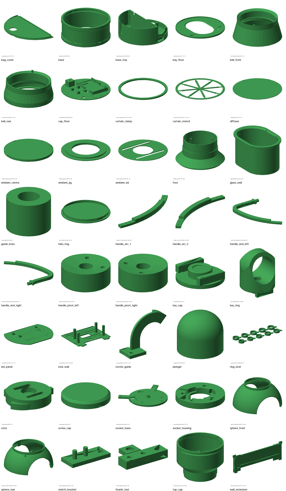

### PETG settings (0.4 mm nozzle)

| Setting | Value |
|---|---|
| Layer height | 0.2 mm |
| Nozzle / bed | 235-245 °C / 75-85 °C |
| Walls | 4 perimeters, 5 top and 5 bottom layers |
| Infill | 25-30 % gyroid; **100 %** for the four handle pieces, the two pivots and the lens |
| Outer wall speed | 40-60 mm/s |
| Fan | off for the first 3 layers, then 30-50 % |
| Bed surface | textured PEI, or glue stick on smooth PEI |
| Elephant-foot compensation | 0.2 mm (Cura: Initial Layer Horizontal Expansion -0.2) |

- **Why the elephant-foot setting matters:** the foot's spigot, the top cap's plug and the cartridge's collar mate
  with 0.3 mm of clearance a side, and a flared first layer eats that. If a fit still binds, sand the smaller part's
  edge.
- Turn "print thin walls" on for `socket_base` (the sensor post's walls).
- Do not anneal.

### Test prints (before any big part)

1. **6-32 insert hole.** Print `cad/output/thumb_test.stl` (~8 g): a block with holes of 4.6, 4.8 and 5.0 mm and a
   2 mm plate like the one each thumbscrew clamps. Melt an initeq insert into each hole, top flush. Pick the hole where
   it goes in straight, sits flush and doesn't spin when a thumbscrew is tightened through the plate. 4.8 mm is
   designed in; if another size wins, set `THUMB_INSERT_HOLE` in `cad/params.py` and re-run `python3 build.py`.
2. **Size the ring.** Print `ring_sizer.stl` (ten labelled test bands, 18.5–23 mm, ~12 g, no supports).
   - Pick the band that slides over the knuckle of your left middle finger with slight resistance.
   - Set `RING_ID` in `cad/params.py` to that size **plus 0.5 mm** (the ring's band is much wider than the test
     bands, so it fits tighter) and re-run `python3 build.py`.
   - Print `key_ring`. It should slide onto your finger past the knuckle; its raised emblem drops into the rotor's
     emblem-shaped pocket (bars level, either way up) and turns the rotor, with a little play. If the finger hole is
     wrong, change `RING_ID` again and reprint (about 9 g).
3. **The lock:** `socket_housing`, `rotor`, `socket_base`, `plunger`. The rotor turns 45 degrees with slight drag
   and the plunger snaps it back. If it binds, raise `FIT` in `cad/params.py` by 0.05 and reprint the rotor.
4. **The glass:** `glass_well` with your real shot glass. The glass slides the length of the slot, clicks over the
   ridge at the far end, and comes back out. If it is wider than 52 mm at the top it won't fit; pick another glass.
5. **Reach check (do this before the sphere and bells).** The lock face is about 16-17 cm in from the hand bell's
   mouth. Cut a 14 cm round hole in a box, tape paper strips over it, and set a target 16-17 cm in. Punch through to
   it, twist, then bring a full shot glass back out. If it is awkward, say so before printing: shortening the hand
   bell is the fallback.
6. **The other sliding fits**, each as soon as both parts exist:
   - the foot's spigot into the top of `base` (the tightest joint);
   - `base_tray` up into `base` and twisted to its click (sand the tray's collar, not the drum, if it binds);
   - `top_cap`'s plug into a sphere half's top collar;
   - each bell over its collar on the sphere;
   - `halo_ring` into the cap rim, twisted to its click;
   - `glass_well` into `bay_floor`'s slot;
   - a handle end piece's axle in a pivot.

### Part list

Sizes are as printed (mm). "Any" means any colour: the part is hidden.

| Part | Size | Orientation on the bed | Supports | Colour |
|---|---|---|---|---|
| `sphere_front` (display side, lens opening) | 224 x 177 x 104 | split face down, dome up | tree supports, inside only: the dome round the opening and the pads under the collar (check the slicer preview) | green |
| `sphere_rear` (your side, hand opening) | 224 x 177 x 95 | split face down, dome up | as `sphere_front` | green |
| `foot` | 190 x 190 x 96 | spigot down | no (45 degree flare) | green |
| `base` (drum) | 190 x 190 x 80 | upright | no | green |
| `top_cap` | 190 x 190 x 145 | plug down | no (45 degree flare and corbels) | green |
| `bell_front` | 168 x 168 x 73 | mouth down | no (the lens ledge is a 2 mm overhang) | green |
| `bell_rear` | 180 x 180 x 73 | mouth down | no | green |
| `emblem_lid` | 182 x 182 x 2 | flat | no | green |
| `emblem_centre` | 51 x 51 x 2 | flat | no | green |
| `curtain_clamp` (full ring) | 173 x 173 x 4 | flat, cover face down | no | green |
| `handle_end_left`, `handle_end_right` | 128 x 227 x 13 | flat, the lap's cut side up, **100 % infill** | no | green |
| `handle_arc_1`, `handle_arc_2` | 205 x 95 x 13 | flat, the lap's cut side up, **100 % infill** | no | green |
| `handle_pivot_left`, `handle_pivot_right` | 44 x 44 x 18 | outer face down, **100 % infill** | no | green |
| `screw_cap` (**print 25**) | 6.5 x 6.5 x 1 | flat | no | green |
| `diffuser` (front lens, full 118 mm disc) | 118 x 118 x 1 | flat, **100 % infill** | no | white |
| `led_panel` | 172 x 122 x 7 | LED face down | no | white |
| `halo_ring` | 190 x 190 x 14 | top (the 1.2 mm skin) down | no | white |
| `lock_wall` | 120 x 102 x 36 | front face down, posts up | no | white |
| `wall_extension` | 119 x 6 x 39 | standing on its legs | no (the channel between the legs is a short bridge) | white |
| `bay_floor` | 131 x 131 x 4 | floor down, drip lip up, as exported | no | any |
| `guide_boss` (glued under `bay_floor`) | 8 x 8 x 6 | bore up, as exported | no | any |
| `glass_well` | 64 x 93 x 52 | floor down, flange up | no | any |
| `nozzle_guide` | 47 x 17 x 34 | foot down, as exported | a small tree support under the end of the bend | any |
| `cap_floor` | 185 x 185 x 25 | plate down | no (the switch box's roof is a short bridge) | any |
| `base_tray` (the cartridge) | 179 x 179 x 66 | floor down | no | any |
| `bag_cover` | 91 x 178 x 5 | top down, as exported | no | any |
| `socket_housing` | 76 x 76 x 10 | ring face down | no | green |
| `rotor` | 44 x 37 x 8 | bottom face down (skirt on the bed, key pocket up) | no | green |
| `socket_base` | 95 x 79 x 7 | bottom face down, sensor post up | no | any |
| `switch_bracket` | 23 x 10 x 6 | flat, pegs up | no | any |
| `plunger` | 5 x 5 x 4 | nose up | no | any |
| `key_ring` | 27 x 27 x 34 | emblem down, as exported | under the head (around the emblem, touching the plate) and inside the finger hole | white for 3 layers, then green (below) |
| `key_cap` (only for a bought ring) | 24 x 24 x 6 | glue face down, emblem up | no | green |

**Tool prints** (not part of the lantern, any colour, no supports):

| Tool | ~g | What it is for |
|---|---:|---|
| `thumb_test` | 8 | picks the 6-32 insert hole (print it first) |
| `ring_sizer` | 12 | picks `RING_ID` for `key_ring` |
| `emblem_jig` | 14 | centres `emblem_centre` in the lid while the glue sets (step 11) |
| `curtain_stencil` | 14 | cutting stencil for the hand-side cover (section 8); the paper template does the same job |

The printed parts the rev 9 build had that rev C retired: `base_deck`, `thumb_knob`, `top_diffuser`, the two dishes,
the handle legs and the old `curtain_clamp` strip. **Reprint `diffuser`:** the rev 9 one had flats; rev C needs the
full round 118 mm disc.

### The ring's white outline

`key_ring` prints emblem down. Its first 0.6 mm (three 0.2 mm layers) are only the faces of the emblem's circle and
bars; the centre disc starts at 0.6 mm. So a filament change after layer 3 gives a white emblem outline on a green
ring:

1. Start the print with **white** PETG loaded.
2. Add a filament change before **layer 4 (Z 0.8 mm)**: in Cura, Extensions > Post Processing > Filament Change at
   layer 4; in PrusaSlicer or Orca, the "+" on the layer slider at 0.8 mm. Both insert `M600`; if your firmware
   lacks it, use "Pause at height" and swap by hand.
3. When the green goes in, push it through until it runs clean green, with no white streaks, and wipe the nozzle:
   the first green layer is the visible centre disc.
4. Three layers of white over green can look pale mint. Let the first ring run about 1.5 mm past the swap, cancel
   it and look at the emblem before printing the whole ring.

The magnet ends up behind green plastic. A plain green ring (no swap) works the same in the lock.

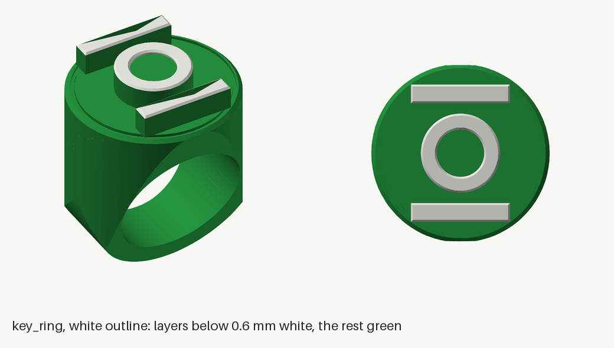


---

## 4. Heat-set inserts

Install every brass insert before assembly, with the soldering iron at the supplier's temperature. Fit each one
flush with its entry face and square to the hole, let it cool, and check that a screw turns freely before mounting
anything. Try one in a scrap print first.

- **M3 (17):** ruthex RX-M3x5.7 (5.7 mm long, 4.6 mm across, made for a 4.0 mm hole). Every M3 hole is
  **4.0 mm across x 6.5 mm deep**. Any plain M3 x 5.7 x 4.6 mm brass insert fits; a 5 mm-wide "M3 x 4 x 5" one does not.
- **6-32 (13):** initeq #6-32 long (6.35 mm long, tapered). Every 6-32 hole is **4.8 mm across x 7.0 mm deep**, or the
  size `thumb_test` picked (section 3).
- The 3.4 mm screw clearance holes, the countersinks, the hex nut pockets and the four small pilots in the hand bell's
  mouth lip (for the curtain clamp's screws) are separate features: no inserts there.

| Printed part | M3 | 6-32 | Where, and which way in |
|---|---:|---:|---|
| `sphere_front` | 4 | | the 4 bosses on the inside, at the split face (the sphere's flange screws) |
| `sphere_rear` | | 6 | 3 round the top collar and 3 round the bottom collar, all on your side: push each in from inside the collar's bore, pointing outward |
| `bell_front` | | 2 | the throat end (the end that meets the sphere), up into the thick throat wall at the top, pointing toward the mouth |
| `bell_rear` | | 2 | as `bell_front` |
| `top_cap` | | 3 | the tops of the 3 bosses inside the cap, just under the cap floor's ledge, from above |
| `foot` | 3 | | the spigot's 3 bosses, from outside (the drum's screws) |
| `handle_pivot_left`, `_right` | 2 each | | the face that goes against the sphere (it is curved: start square and press slowly) |
| `cap_floor` | 4 | | the tops of the 4 board standoffs |
| `bay_floor` + `guide_boss` | 1 | | top face, under the nozzle-guide foot, through the floor into the glued-on boss (below) |
| `socket_housing` | 1 | | open back, beside the switch cavity |
| **Total** | **17** | **13** | |

**The bay floor's insert needs its boss glued on first.** The 2 mm floor is too thin to hold an insert, so its bore
carries on into `guide_boss`, a small separate puck (printed apart so the floor prints flat without supports):

1. Put a thin ring of super glue round the boss's open (bore) face and press it onto the underside of the floor
   (the side without the lip), over the insert hole near the tube hole.
2. Line the two bores up with a 4 mm drill bit pushed through both, and hold it until the glue sets. Pull the bit
   out.
3. Stand the floor on the boss on the bench (prop the far edge level on a book) and set the insert from the top,
   through the floor and into the boss. Pressing pushes the two parts together, and the insert locks them. In the
   lantern the nozzle guide's screw pulls the boss up against the floor too.

---

## 5. Electronics (build it on the bench first)


Build the circuit on the 5 x 7 cm perfboard and test it before anything goes into the lantern.

- Follow the [two-sided perfboard layout](review/protoboard/README.md) and its
  [wire-by-wire solder schedule](review/protoboard/WIRE_SCHEDULE.md). The rear view is mirrored; pad names stay
  the same.
- Check the actual hole-array position and C2 case size before you start.
- Read [USB programming and calibration power](#usb-programming-and-calibration-power) before you plug in USB.

**Where it all lives (rev C).** The board, the battery, the buck, S1 and the charge socket sit on `cap_floor` in the
top cap ([picture](#the-cap-floor)). Only three leads leave the cap floor, through its wire hole: the **lock cable**
(through its 4-pin plug just above the hole), the **LED lead** and the **pump lead** (both soldered straight through,
with about 15 cm of slack coiled on the cap floor so the plate can be lifted out and set on the cap's rim still
connected). They run down the top cap's neck, behind the wall extension and the lock wall. The pump lead carries on
through the bay floor and the foot to the 2-pin plug on the cartridge, so the lantern can be lifted off.

1. **Board, XIAO and U1.**
   - Orient the perfboard 70 mm across and 50 mm tall.
   - Drill four 3.2 mm holes at (x, y) = (18, 17), (55, 15), (15, 45) and (58, 45) mm from the component-side
     top-left corner (the [board layout](review/protoboard/README.md) is the reference). Check them against the
     cap floor's four standoffs first, and keep each 9 x 9 mm mounting area clear. Rear wires must fit in the 10 mm
     under the board, outside those areas.
   - Fit the XIAO and a **DIP-14 socket** for U1; leave U1 out for the first USB flashing.
   - Fit a two-pin 2.54 mm header for JP1 and label it **REMOVE FOR USB**.
2. **Battery lead, charge socket and S1.** The supplied TalentCell splitter is "1 female to 2 male", with all three
   ends joined. With the battery and the charger unplugged:
   - One **male** plug stays as it is: it goes in the battery's port.
   - Cut the other **male** plug off, leaving its lead long: that is the battery lead to the board.
   - The **female** end stays as it is: that is the **charge socket**. The charger plugs in here and charges the
     pack through the splitter, with nothing to unplug (section 12).

   Then:
   - Do not cut or open the pack. Find centre-positive and sleeve-negative with the meter's continuity setting; do
     not trust the wire colours.
   - Plug the splitter into the pack, turn the pack's switch ON, and confirm 9–12.6 V and the polarity on the cut
     lead and at the female end. Unplug again before soldering.
   - Positive goes to S1. S1's other terminal is **VLOAD**, the switched battery rail. Negative goes to the common
     ground. S1 sits in its own box on the cap floor, so leave its leads long enough to reach the board.
   - Solder **C2 2200 µF/25 V** from VLOAD to ground, positive to VLOAD. It smooths short dips; it cannot carry an
     overloaded or stalled motor.
3. **Battery sense.** R1 100 kΩ from VLOAD to D0; R2 22 kΩ and C1 0.1 µF from D0 to ground. At a full 12.6 V pack,
   D0 sees 2.27 V. Keep this wire away from the motor wiring.
4. **Buck converter (set its output first).**
   - Connect only LM2596 IN+ to VLOAD and IN− to ground; leave OUT unloaded.
   - Turn the pack and S1 on. With the meter on DC volts across OUT+/OUT−, turn the trimmer until it reads
     **5.0 V**. Switch off before attaching anything else.
   - OUT+ is **+5V_REG**: U1 and the Hall sensor connect straight to it.
   - The XIAO's 5V pin is fed through **D1 NTE585** (stripe toward the XIAO), then **JP1** in series. Grounds stay
     connected even with JP1 removed.
   - D1 stops current flowing back into the buck, but it does not protect the USB host from battery power:
     **remove JP1 before connecting USB**.
5. **U1 (74AHCT125).** Use **74AHCT125**, not 74HC125.
   - Pin 14 to +5V_REG, pin 7 to ground. Solder **C3 0.1 µF ceramic** straight across those pins with short leads.
   - Ground all four output-enable pins (1, 4, 10, 13) and the unused inputs (9, 12); leave the unused outputs
     (8, 11) unconnected.
   - XIAO D3 goes to pin 2 (pump); D4 goes to pin 5 (light). R3 and R4, **10 kΩ**, go from those two inputs to
     ground.
   - Check the socket notch against the [DIP-14 pinout](https://www.ti.com/lit/ds/symlink/sn74ahct125.pdf) before
     inserting U1, with all power disconnected.
6. **MOSFETs (IRLZ44NPBF).** Label facing you, leads down: pin 1 gate, pin 2 drain (also the tab), pin 3 source.
   - U1 pin 3 goes straight to Q1's gate (pump); U1 pin 6 straight to Q2's gate (light).
   - Both sources go to ground.
   - Pump negative to Q1's drain, strip negative to Q2's drain; both loads' positives to VLOAD.
   - Run the pump and strip returns separately to the common power ground; don't route their current through the
     Hall/XIAO ground wiring.
7. **Pump lead and flyback diode.** The pump lead is VLOAD and Q1's drain, soldered to the board and run down (with
   slack at the cap floor) to the 2-pin plug on the cartridge. Solder D2 **NTE586, 3 A/40 V** straight across the pump's
   own terminals, on the cartridge side: stripe (cathode) to the + terminal (VLOAD), anode to the − terminal (Q1's
   drain). Do not use the 1 A NTE585 here. Twist the pump wires together and keep them away from the Hall and switch
   wires.
8. **Lock wires.**
   - **Hall sensor (A3144)**, printed face toward you, leads down: pin 1 to +5V_REG, pin 2 to ground, pin 3 straight
     to XIAO D1. R5 **4.7 kΩ from D1 to XIAO 3V3**, never to 5 V. Its open-collector output needs no series diode.
   - Fit **C4 0.1 µF across sensor pins 1 and 2, at the sensor**, below its mounting pocket, with insulated leads.
   - **Microswitch (D2F-01L):** COM to ground, NO to the SW wire, NC unused.
   - On the board: R7 **3.3 kΩ** from +5V_REG to SW; R6 **4.7 kΩ** from XIAO 3V3 to D2;
     **D3 NTE585, anode to D2, stripe (cathode) to SW**.
   - How it works: closed contacts pull D2 low; open contacts leave D2 at 3.3 V while the switch side rises to 5 V.
     R7 puts about 1.5 mA through the closed contacts (the D2F-01L needs at least 1 mA) and R6 adds about 0.6 mA.
     The firmware's internal pull-ups can stay on alongside R5 and R6.
   - **Lock cable:** 4 wires, **+5V_REG, HALL, SW, GND**, with the JST PH plug just above the cap floor's wire hole.
     The lantern side runs from the lock up behind the wall to the top cap's neck: measure it on the built lantern and
     leave enough slack to lift the cap floor out. R5–R7 and D3 stay on the board.
   - **Do not solder the Hall sensor to the cable yet:** its leads must first pass through the sensor post's slot
     (step 1). Clip it on temporarily for the bench checks. Solder the switch wires before mounting the switch.
   - **LED lead:** VLOAD (+) and Q2's drain (−), soldered to the board, with slack at the cap floor. Every LED piece
     joins it (section 7, "The light harness").
   - Thread each lead through the cap floor's wire hole before soldering it or fitting the lock cable's plug housing.
9. **Commission it before assembly.** Flash it using the power procedure below.
   - **Without loads** (pump and strip disconnected), in USB calibration mode:
     - +5V_REG at U1 and at the Hall sensor reads 5.0 V;
     - GPIO D1 and D2 read about 3.3 V when open and below 0.8 V when active;
     - `status` follows the magnet and the twist every time, including with the cable moved;
     - the battery reading matches the meter within 0.2 V after `vcal`;
     - both MOSFET gates are low at idle.
   - **With loads:** connect the pump and strip with the power off. With a fully charged pack and the real strip
     length:
     - check full brightness, current and heating (`idle 255` for 100 % PWM, then `idle 0` and `save`);
     - measure current **in series**, with a suitably rated, fused meter; never put a meter in current mode
       across the battery;
     - run short water pours with the LEDs on and measure the combined running current. With about 158 cm of strip
       the estimate is about 1.25 A of LEDs at full and about 2.0 A peak with the pump, inside the battery's 3 A, but
       these are estimates (roughly 0.8 A per metre of strip), not measurements, and a normal meter may miss
       start-up peaks;
     - watch for resets, protection trips and hot wiring or MOSFETs. Stop and investigate overheating, a stall
       or a trip; never stall the pump on purpose.
   - Every power-up must leave the pump off. The brief LED blink at boot is intentional.
   - **Runtime:** the lights are only on during a pour (the idle glow is 0 by default), so a full charge covers
     hundreds of pours. To lower the peak current, cap the brightness with `leds` (for example `leds 200`).

### USB programming and calibration power

Normal operation is battery-only. Everything here happens on the cap floor with the lid off. Two rules always apply:

- **Never attach USB with JP1 fitted.** JP1 isolates only the XIAO's supply.
- **Never move JP1 or insert or remove U1 with power connected.**

There are three power modes:

| Mode | When | Sequence |
|---|---|---|
| **USB-only flashing** | The very first upload, before the buck is set | S1 OFF, pack unplugged, JP1 removed, **U1 out of its socket** (that also disconnects the XIAO's outputs from the unpowered buffer). Connect USB, upload, unplug USB, then refit U1. No load tests in this mode. |
| **USB calibration and testing** | `status`, `cal`, `vcal`, priming, cleaning | With all power off, remove JP1. Turn the pack and S1 ON, check +5V_REG, then connect USB: USB powers only the XIAO and the buck powers U1 and the Hall sensor. To attach the pump and LED leads, power down (USB out first, then S1 OFF), connect them, and repeat. Finish with `stop`, unplug USB, then S1 OFF. Refit JP1 only after USB is unplugged and the power is off. |
| **Battery operation** | Normal use | USB unplugged, U1 in, JP1 fitted. Pack switch ON, then S1 ON. |

- **S1 is the on/off switch.** Its lever sticks up through the roof of its box on the cap floor. The pack's own
  switch stays ON; it is on the battery's end, also reached with the lid off.
- **Storage:** S1 OFF. For more than a few weeks, also turn the pack switch OFF.
- If the pack trips or +5V_REG fails during USB testing, unplug USB at once and find out why before retrying.

An optional PRIME button goes between D6 and ground. Holding it runs the pump only when no ring is in.
It's not in the parts list; the serial `cal` command or a test pour does the same job.

---

## 6. Firmware

Source: `firmware/green_lantern/green_lantern.ino`. Board: Seeed XIAO RP2040 on the "Raspberry Pi
Pico/RP2040" Arduino core by Earle Philhower. No extra libraries. Rev C did not change the firmware.

**First follow section 5's USB power procedure.**

**Arduino IDE.** Boards Manager: install "Raspberry Pi Pico/RP2040" (Earle Philhower). Select "Seeed XIAO
RP2040", open the sketch, upload. If no port appears, hold the XIAO's BOOT button while plugging it in.

**Command line.**

```bash
cd firmware
arduino-cli core install rp2040:rp2040 --additional-urls https://github.com/earlephilhower/arduino-pico/releases/download/global/package_rp2040_index.json
arduino-cli compile --fqbn rp2040:rp2040:seeed_xiao_rp2040 green_lantern
arduino-cli upload  --fqbn rp2040:rp2040:seeed_xiao_rp2040 -p /dev/ttyACM0 green_lantern
cd test && make test     # 20 simulated scenarios, all must PASS
```

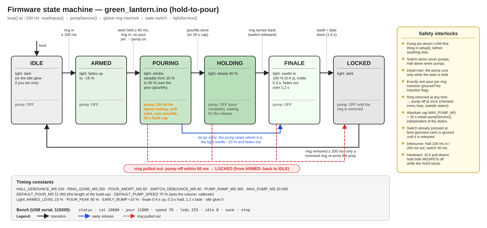

| Pin | Function |
|---|---|
| D0 | Battery sense (100 k / 22 k divider from the switched +12 V) |
| D1 | Hall sensor OUT (LOW = ring present) |
| D2 | Microswitch NO (COM to GND) |
| D3 | Pump, through U1 to Q1 |
| D4 | LED strip, through U1 to Q2 |
| D6 | Optional PRIME button to GND |

Serial console at 115200 baud. Type a command and press Enter:

| Command | What it does |
|---|---|
| `status` | Shows state, ring, switch, pump, pour time, speed, brightness, idle glow, battery voltage. |
| `cal 10000` | Runs the pump 10 s without the ring, for calibration (refused while a pour is running). |
| `pour 11000` | Pour time in ms (500 to 20000): the length of the light build-up. |
| `speed 70` | Pump speed in percent (30 to 100): sets how much is poured in that time. |
| `leds 255` | Maximum LED brightness, 0 to 255. |
| `idle 0` | Glow when idle, 0 to 255 (default dark). |
| `vcal 12.31` | Tells it what your meter reads across the pack, to calibrate the battery reading. |
| `save` | Stores pour time, speed, brightness, idle glow and the `vcal` correction so they survive a power cycle. |
| `stop` | Stops the pump now. |

The light levels live near the top of the sketch: `ARMED_LEVEL` (15 %), `POUR_PEAK` (90 %), `EARLY_BUMP`
(10 %) and the finale timings (0.4 s swell, 0.3 s hold, 1.2 s fade). They are perceived brightness, so the
climb looks steady to the eye.

**Safety interlocks, all tested in simulation:** pump off at boot. The switch alone never pumps; the ring
alone never pumps. The pump runs only while the twist is held. One pour per insertion; letting go early
does not resume. Pulling the ring mid-pour stops the pump within about 60 ms. A
switch already pressed at boot or at insertion is ignored until released. A 20 s hard cap applies to every
pump run.

---

## 7. Assembly

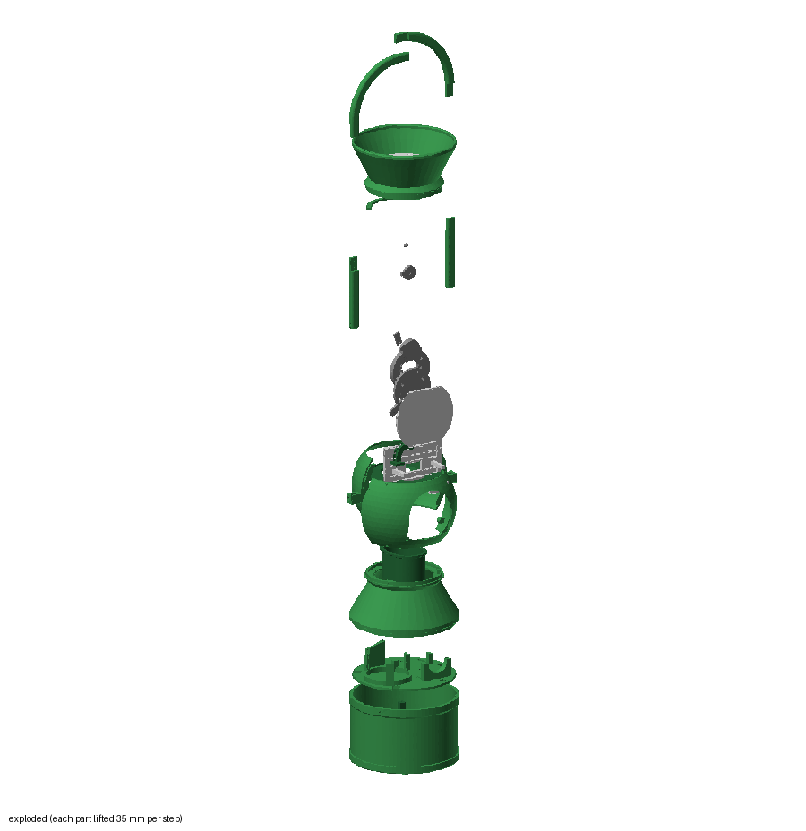

The steps below are the build order the 3D viewer and the step-by-step video use. Directions: "your side" is the
hand opening, "display side" the lens; "left" and "right" are as you see them standing at the hand opening, looking
in, unless a step says otherwise.

**Where every fastener is.** Nothing shows from outside:

| Joint | Fasteners | Turned from |
|---|---|---|
| Each bell to the sphere | 2 thumbscrews, parallel to the bell's axis, 45 degrees either side of the top of the opening | inside the sphere; the heads hide behind the top edge of the opening |
| Top cap to sphere | 3 thumbscrews | inside the top cap's neck (heads in the plug), with the lid and cap floor out |
| Cap floor | 3 thumbscrews, down into the cap's bosses | above, with the lid off |
| Foot to sphere | 3 thumbscrews | inside the foot's neck, reaching up through the open drum |
| Drum to foot | 3 M3x8 through the drum's top band into the foot's spigot | outside, under green caps |
| Handle pivots | 2 M3x12 each, into the pivot | inside the sphere, under green caps |
| Handle laps | 3 M3x8 + nut per lap, 3 laps, plus epoxy | heads on the display-side face, nuts on your side, all under green caps |
| Curtain clamp ring | 4 countersunk M3x8 into pilots in the hand bell's lip | inside the hand bell |
| Sphere halves | 4 M3x10 through the rear half's internal flange into the front half's inserts | inside the sphere |

### Step 0. Print and fit the inserts

Print everything (section 3, `thumb_test` first) and melt in the 17 M3 and 13 6-32 inserts (section 4). Build and
test the board on the bench (sections 5 and 6) before step 10.

### Step 1. The lock

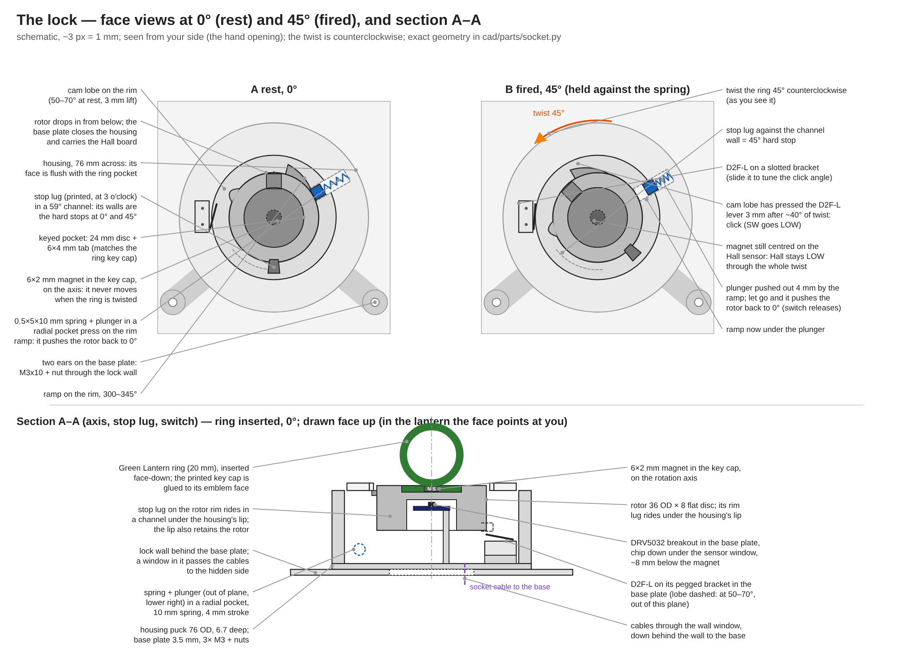

Parts: `socket_housing`, `rotor`, `socket_base`, `switch_bracket`, `plunger`, `key_ring`. Plus 3 x M3x8 flat-head and 3
nuts for the base plate, 1 x M3x8 flat-head for the switch bracket, the spring, the microswitch, the A3144 and one
magnet. The lock is unchanged from rev 9.

The lock is screwed to the face of the lock wall with its ring pocket facing you, so you seat the ring by punching
in. The rotor is a flat 36 mm disc. Under the housing's front lip its edge carries three features: a stop lug in a
channel whose ends are the 0 and 45 degree stops, a cam that presses the switch lever 3 mm from about 30 degrees to
the stop, and a ramp that pushes the spring plunger out so the rotor snaps back when you let go.

1. **Nuts.** Drop M3 nuts into the three hex pockets on the underside of `socket_housing`. A dab of super glue
   holds each.
2. **Ring.** `key_ring` is the ring and the lock's key in one print.
   - **How it keys.** Its raised Green Lantern emblem (the circle and two bars, 4 mm proud, faces printed white:
     section 3) is the key. The rotor's pocket is the emblem's negative, so the bars turn the rotor when you twist.
     There is no tab.
   - **Find the magnet's switching face.** The A3144 reacts to one magnet pole only. With the sensor wired to the
     board (section 5) and `status` running, hold each face of the magnet to the sensor's printed face. The face
     that gives `ring=present` goes **down**, toward the ring's face. Mark it.
   - **Glue the magnet in.** The pocket opens inside the band, so the magnet never shows. Put a drop of super glue
     in the pocket from inside the band, push the magnet to the bottom with a hex key, and let it set before you
     wear the ring. It sits behind the centre disc under 0.6 mm of plastic, about 3.7 mm from the sensor: about
     53 mT at the worst rotor position, against the A3144's 35 mT maximum switch point.
   - **Wear it on your left middle finger.** Make the fist you will punch with, ring face forward, palm down: the
     emblem's bars lie level, which is how the pocket sits at rest, and the twist is counterclockwise as you see it
     (your thumb rolls up). `LOCK_TWIST = 'cw'` in `cad/params.py` gives a clockwise version.
   - **Bought ring instead:** print `key_cap` (a 24 mm disc carrying the same raised emblem). Glue the magnet into
     the pocket in its flat top, switching face toward the emblem, then glue that flat top onto a ring face at
     least 24 mm across, with the bars across the finger.
3. **Hall sensor.** `socket_base` has a short round post in the middle with a small pocket on its tip. Bend the
   A3144's three leads 90 degrees right at the body, toward its unprinted back, so that with the printed face up they
   point straight down; feed them down the slot at the pocket's edge and out through the bottom of the plate, and lay
   the sensor in the pocket **printed face up** (flush with the top). A dot of glue holds it. Cut the three leads to
   different lengths under the plate, solder the cable to them and sleeve each joint: staggered, the sleeves fit side
   by side in the wall's window. The rotor turns around the post; the magnet ends up about 3 mm above the sensor. Fit
   C4 across pins 1 and 2 below the pocket, insulate it and secure it so it cannot obstruct the rotor or the cable
   slot.
4. **Rotor and plunger.** Turn `socket_housing` upside down. Smear a little silicone grease or petroleum jelly on the
   rotor's rim (the ramp and the cam), the plunger's nose and the bore: dry PETG on PETG has about the same friction
   (0.3-0.4) as the ramp's slope (0.26), so an unlubricated rotor can sit at 45 degrees instead of returning; greased
   (about 0.1) it returns. Lay the spring in the open radial trough at the rim, closed end outward, then the
   `plunger` between the spring and the bore, flat end on the spring, rounded nose toward the bore. Hold it with a
   finger and lower the `rotor` into the bore, stop lug down into its channel (it fits one way only). Twist to 45
   degrees and let go: it should snap back every time. If it only creeps back, add grease. It doesn't matter for the
   show either way: you turn the ring back yourself on the last word, and the firmware only watches the switch. Too
   stiff to twist with a finger: use a softer spring (0.4 mm wire).
5. **Switch.** With its two wires already soldered on (section 5, step 8), press the microswitch onto the two pegs
   of `switch_bracket`, lever toward the rotor, and lay the bracket in its recess in `socket_base`, its round hole
   over the slot at the lever end. Lead the two wires out through the notch in the plate's rim at the bottom (the
   plate has a matching notch; in the lantern it faces down).
6. **Close and tune.** Screw `socket_base` onto the housing: 3 x M3x8 flat-head up from below into the nuts, and a
   4th flat-head up through the slot and the bracket into the housing's insert, left loose. All four heads sit flush,
   so the plate lies flat on the lock wall later. Twist slowly: the lever should start to move at about 30 degrees
   and click at about 40, before the stop at 45. To tune, loosen the 4th screw and push it along its slot (it carries
   the bracket, 1 mm either way), then tighten. The switch must never be what stops the rotor.
7. **Cycle it 50 times** and watch `status`: `switch=pressed` only near the end of the twist, `ring=present` for the
   whole twist.

### Step 2. Lock wall

Parts: `lock_wall` (white), the lock, 2 x M3x10 and 2 nuts, two 5 cm pieces of LED strip.

**Cutting the strip.** Cut the COB strip only on its marked cut lines (every 25 mm). You need 10 pieces in all:
four of 10 cm (step 3), two of 5 cm (here), one of 37.5 cm (step 12), one of about 45 cm (step 13) and two of 12.5 cm
(step 9). Every piece is wired in parallel: all + pads together, all − pads together. The 22 AWG wire is fine; mark
the + wires with a dot of paint or a bit of red heat-shrink. Direction doesn't matter on a single-colour strip.
Solder a pair of leads to each piece before you stick it down.

1. **LED columns.** Stick one 5 cm piece in each of the two vertical channels on the wall's face, beside the lock.
   Pass their wires to the back through the small hole at the bottom of each channel.
2. **Mount the lock** on the face of `lock_wall`: the two ears go down, one M3x10 through each ear and the wall, nut
   on the back. The lock cable passes through the wall: the sensor's three joints through the rectangular window
   behind the lock, the switch wires through the small window under it, where the plate's rim notch lands.
3. The 4 LED channels on the back of the wall stay empty in rev C: the rows moved to the LED panel.

### Step 3. LED panel

Parts: `led_panel` (white), four 10 cm pieces of LED strip.

1. Stick one 10 cm piece along each of the 4 shallow channels on the panel's front (the flat face; the collars are on
   the back), LEDs facing out. Pass each piece's wires through the hole at the end of its row to the back.
2. Slip the panel's 4 collars over the 4 posts on the back of the lock wall, LED face away from the wall (toward the
   lens), with a dot of super glue in each collar.
3. Join the 4 rows' leads and the 2 columns' leads behind the wall (see "The light harness" below).

### Step 4. Bay floor, glass well, nozzle

Parts: `bay_floor` with `guide_boss` glued under it (section 4), `glass_well`, `nozzle_guide`, 1 x M3x8, the tube, the
lock wall assembly.

1. **Glass well.** Drop `glass_well` into the floor's long slot, its ridge end toward the display side; it hangs from
   its flange. The long slot points at your side; the two short slots for the wall's tabs sit either side in the far
   half. The tube hole and the 7 mm cable hole are beyond the wall line: tube on the right, cables on the left.
2. **Nozzle.** Cut the tube end square with a sharp blade. Push it up through the hole in `nozzle_guide`'s foot and
   along the channel, pressing it in through the open side where it resists (the slit is a little narrower than the
   tube), so 5 mm sticks out past the end, pointing down. Keep the rest of the tube on the reel side: it is cut to
   length in step 15.
3. Feed the tube's long end down through the tube hole in `bay_floor`, and screw the guide's foot into the bay-floor
   insert (1 x M3x8), open side toward your side, the curve reaching toward the middle. The guide bends the tube up,
   over and **45 degrees down**: the tube end sits about 7 mm above the glass rim, over the back third of the glass,
   so the stream lands about 19 mm from the glass centre and the last drop falls straight in.
4. **Lock wall.** Stand the wall's two tabs in the floor's two short slots, lock facing your side. Its back closes the
   nozzle guide's open side; check the tube sits in the channel and its end still points down into the glass slot.

### Step 5. Drum and foot

Parts: `base` (drum), `foot`, 3 x M3x8, 3 green caps.

Push the foot's spigot down into the top of the drum. Drive 3 x M3x8 from outside through the drum's thickened top
band into the spigot's inserts, then press a green `screw_cap` into each counterbore over the heads (a dot of glue if
one is loose). The drum and the foot stay together from now on.

### Step 6. Sphere

Parts: `sphere_front` and `sphere_rear`, 4 x M3x10, 3 thumbscrews, the bay floor assembly, the drum and foot.

1. **Leads first.** Make the lantern side of the **pump lead** (2 wires, long enough to reach from the cap floor's
   wire hole down to the cartridge, with slack). Feed it down through the bay floor's cable hole so its plug end will
   hang out of the bottom of the foot. Keep the lock cable and the LED harness's ends free behind the wall: they go up.
2. **Bay floor on the foot.** Set the bay floor assembly on top of the foot's riser. The boss under the floor drops
   into a notch in the riser, so it sits one way only: lock facing your side. The tube and the pump lead go down the
   middle of the foot and out of the open drum.
3. **Close the sphere.** Bring `sphere_front` (lens opening) in from the display side and `sphere_rear` (hand
   opening) in from your side, so their bottom collars close round the riser. The internal flange is inside the rear
   half, flush with the split. Drive 4 x M3x10 through it into the front half's inserts from inside, reaching in
   through the hand opening and the open top with a long or ball-end 2.5 mm key.
4. **Foot to sphere.** Lay the lantern on its side on a towel, or lift it, and reach up through the open drum into the
   foot's neck. Drive 3 thumbscrews from inside the neck out into the inserts in the sphere's bottom collar. The holes
   line up only one way (they are all on your side). Finger-tight is enough.

### Step 7. Pivots

Parts: `handle_pivot_left`, `handle_pivot_right`, 4 x M3x12, 4 green caps.

The `_right` parts go on the audience's right as seen from the display side, which is your **left** when you stand at
the hand opening. On each side, hold the pivot against its seat on the sphere's side, over the seam, and drive 2 x
M3x12 from inside the sphere, through the pads and the shell, into the pivot's inserts. Reach in through the hand
opening and the open top. Press a green cap over each head (seen at an angle through the hand opening otherwise).

### Step 8. Wall extension

Stand `wall_extension` (white) on the lock wall's top edge, its legs over the wall. Nothing holds it yet: the top cap's
plug catches its two tabs in step 9. Lead the lock cable and the LED harness up behind it (on the display side of the
wall) so they come out at the top of the sphere.

### Step 9. Top cap

Parts: `top_cap`, 3 thumbscrews, two 12.5 cm pieces of LED strip.

1. **Cap LEDs (before the cap goes on).** Stick the two 12.5 cm pieces on the inside wall of the cap, just under the
   rim, one on the display side and one on your side, LEDs facing in. They light the emblem and the halo from below.
   Run their leads down the cap wall to the neck; they join the LED harness on the lantern side of its plug.
2. Thread the lock cable, the LED harness and the pump lead up through the top cap's neck as you lower it.
3. Push the plug into the sphere's top collar, with the plug's notches over the wall extension's two tabs.
4. Reach down through the open cap into the neck and drive 3 thumbscrews from inside the plug out into the inserts
   in the sphere's top collar. The holes line up only one way.

### Step 10. Cap floor

Parts: `cap_floor`, the battery, the board, the buck, S1, the charge socket, 1 VELCRO strap, 4 x M3x6, zip ties,
3 thumbscrews.

#### The cap floor

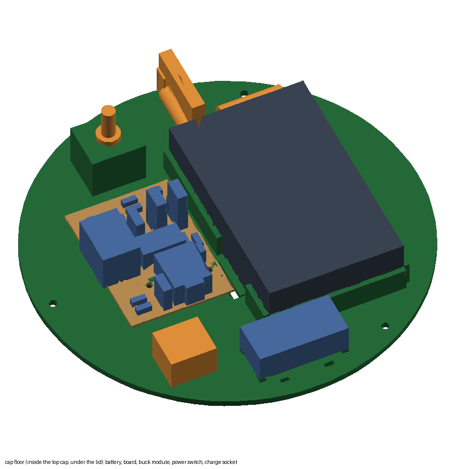

Do this on the bench, then drop the finished plate in. S1's box and the charge socket sit on your side of the plate,
the buck on the display side.

1. **Strap first.** Thread a strap through both battery slots before fitting the pack. Its lower run sits in the
   recess under the plate and must be no thicker than 2 mm.
2. **Battery.** Push the splitter's male plug into the battery's port. Lay the TalentCell on its 1 mm bed between the
   rails:
   - **LED face down**, the five fuel-gauge dots over the slot in the plate;
   - **port end toward your side**, against the low end stop;
   - the plug's cord folded back in a U-turn over the plug.

   Turn the battery's own switch ON (it stays ON), then tighten the strap.
3. **Board.** Screw it to the 4 standoffs, component face up, USB end toward the display side (4 x M3x6). Clipped
   leads and rear wiring must stay within the 10 mm gap under it.
4. **Buck.** The LM2596 sits on its four 2 mm printed corner supports, zip-tied through the slots beside it. Check
   that no solder joint on its underside rests on a support.
5. **S1.** It hangs inside its box, lever up through the hole in the roof, nut tight on top. Its leads leave through
   the opening in the box's side wall.
6. **Charge socket.** Tie the splitter's female end loosely in its spot on your side of the plate, so you can lift it
   out on its cord to charge.
7. **Drop it in.** Lower the plate into the cap with S1 and the charge socket toward your side. Bring the lock cable,
   the LED lead and the pump lead up through the plate's wire hole (display side) and plug each into its partner
   from the board. Rest the plate on its ledge and drive 3 thumbscrews down into the cap's bosses.
8. **Check the charge dots.** Look up through the hand opening (before the hand bell is on): the battery's LEDs
   show through the slot.

### Step 11. Lid

Parts: `halo_ring` (white), `emblem_lid`, `emblem_centre`, `emblem_jig`, two short pieces of 1.75 mm filament.

1. Push a short piece of 1.75 mm filament into each of the two pin holes in the halo ring's flange top. The pins only
   fit the lid's matching holes one way, which centres it and turns it the right way round.
2. Glue `emblem_lid` onto the halo ring's top, over the pins.
3. Drop `emblem_jig` into the lid's round cut-out (its flange rests on the lid), put a little glue in the middle of
   `emblem_centre`'s underside, drop it into the jig's bore and press it down. Lift the jig straight off after half
   a minute.
4. **Fit it.** Turn the lid until its 3 lugs drop into the cap rim's grooves, push down and twist clockwise (seen
   from above) about 20 degrees until it clicks. Locked, the emblem's bars run left to right as seen from the front.
   To open: twist anticlockwise and lift.

### Step 12. Front bell (lens)

Parts: `bell_front`, `diffuser`, the 37.5 cm LED piece, 2 thumbscrews.

1. Stick the 37.5 cm piece round the inside of the bell's collar band, behind the lens ledge, LEDs facing the axis.
2. Press `diffuser` into its pocket in the bell, onto the ledge. A few dots of glue hold it.
3. Lead the ring's wires in through the lens opening and round the top of the LED panel to the back of the wall, and
   solder them into the LED harness. Leave about 20 cm of slack so the bell can slide off and rest beside the
   lantern still connected.
4. Slide the bell straight onto the front collar. The bosses on its throat fill the flat spots on the
   shell, so it only sits one way.
5. **Thumbscrews:** reach in through the hand opening (the hand bell isn't on yet), past the end of the lock wall and
   back behind it, to the top of the lens opening. Drive 2 thumbscrews from inside the sphere, parallel to the bell's
   axis, into the inserts in its throat.

### Step 13. Rear bell (hand side)

Parts: `bell_rear`, the ~45 cm LED piece, the cover, `curtain_clamp`, 4 x M3x8 flat-head,
2 thumbscrews.

1. Stick the ~45 cm piece all the way round the band inside the bell's throat, LEDs facing the axis.
2. Cut the cover and clamp it into the bell's mouth with the ring and 4 countersunk M3x8 ([section 8](#8-the-hand-side-cover)).
3. Lead the ring's wires in through the hand opening, along the inside top of the shell, to the back of the wall, and
   solder them into the LED harness, with about 20 cm of slack. Keep the run tight against the shell (a few dots of
   glue) so it doesn't show; tuck the slack behind the wall.
4. Slide the bell straight onto the hand-opening collar.
5. **Thumbscrews:** reach in through the cover's flaps and up to the top of the hand opening. Drive 2 thumbscrews from
   inside the sphere, parallel to the bell's axis, into the inserts in its throat. The heads hide behind the top
   edge of the opening.

### Step 14. Handle

Parts: `handle_end_left`, `handle_end_right`, `handle_arc_1`, `handle_arc_2`, 9 x M3x8, 9 nuts, epoxy, 18 green caps.

1. Push each end piece's printed axle into its pivot (`_right` into `handle_pivot_right`), the stop tab on its hub in
   the pivot's arc groove. Nothing holds the axles in: the two spokes face each other, so the finished loop can't pull
   off.
2. `handle_arc_1` joins `handle_end_right`, `handle_arc_2` joins `handle_end_left`, and the two arcs join at the top.
   Each joint is a 40 mm half-thickness lap.
3. Dry-fit all three laps first. Then, one lap at a time: epoxy on both faces, 3 x M3x8 from the display-side face
   (heads sink into their counterbores) with a nut in each hex pocket on your side, tightened.
4. Press a green cap over every head and nut (18), flush with the faces.
5. Support the handle level while the epoxy cures.

The handle swings flat either way to lie around the middle for display; the stop tabs stop it just past level. The
printed axles are fine for normal carrying but are the first thing to break if the lantern is yanked or swung by its
handle.

### Step 15. Cartridge

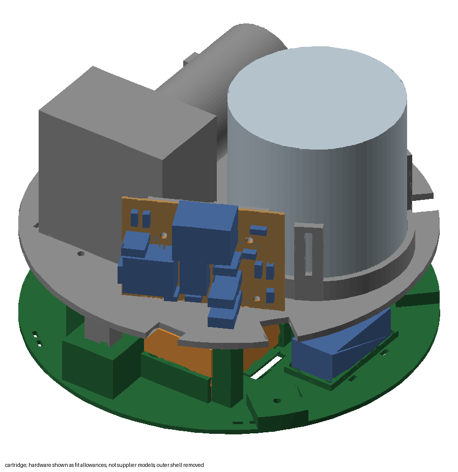

Parts: `base_tray`, `bag_cover`, the pump, 1 VELCRO strap, the tube, the 32 oz pouch.

1. **Pump.** Seat the pump in its saddles, head face (the tube ports) toward your side, head in the U-saddle and the
   silver motor in its round saddle. Strap the motor down with one strap through the floor slots. There is no room for
   a strap round the head: its saddle holds it.
2. **Pump lead.** Solder the cartridge side of the pump's 2-pin plug to the pump's terminals, with D2 across them
   (section 5, step 7).
3. **Tube to the pump.** Open the Kamoer's head cap, lay the tube round the rollers and close the cap. Use one
   continuous piece of tube from the nozzle through the pump to the bag: no joints, nothing to leak. Leave about 30 cm
   of tube between the pump and the bay floor so you can lift the lantern off and set it down beside the cartridge;
   coil it loosely (no tighter than a 5 cm circle, or it kinks) above the cartridge.
4. **Bag.** Rig and fill the bag ([section 9](#9-the-drink-bag)), lay it flat in the bay with its spout in the back
   corner by the splash wall, at the well, and press the tube (inside the bag, bag film and all) into the clip so its
   tip lies in the well. The tube runs from the bag's spout over the splash wall through its notch to the pump's inlet.
5. **Cover.** Lay `bag_cover` on the splash wall and the raised rim, lip down, so the whole bag, spout and all, is
   under it.

### Step 16. Lantern on the cartridge

1. Plug the pump lead's two halves together (the plug sits by the pump's motor end).
2. Lower the lantern over the cartridge, hand opening over the pump's head end. The 3 lugs inside the drum drop into
   the L-slots in the cartridge's collar.
3. Twist the lantern clockwise (seen from above) about 20 degrees until it clicks.

### The light harness

All 10 LED pieces are in parallel on the one light channel (Q2), on one soldered LED lead to the board:

- **Behind the lock wall:** the 2 lock-face columns, the 4 panel rows and the two bells' leads join into one pair that
  runs up behind the wall extension and the top cap's neck.
- **In the top cap:** the two 12.5 cm pieces join that pair below the cap floor, then it goes up through the wire hole
  to the board with its slack.
- Join every + to +, every − to −, with sleeved solder joints. A star or a chain both work.

---

## 8. The hand-side cover

The hand bell is closed by one frosted polypropylene disc, 171 mm across, with 8 cuts 62 mm long from the centre,
each ending in a punched 3 mm hole so it can't tear on. The uncut outer ring keeps it in one piece; the 8 flaps fold
round your arm and the glass and spring back flat, so it looks like the front lens when your hand is out.

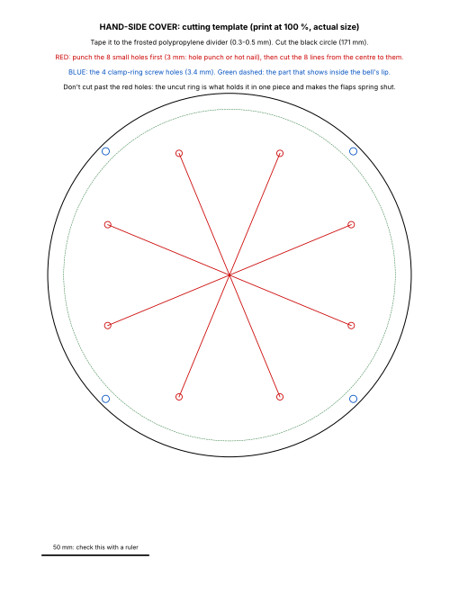

Use either guide; both come from the same CAD numbers:

- the paper template [`docs/images/curtain_template.pdf`](images/curtain_template.pdf): print it at 100 % (actual
  size, letter) and check the 50 mm bar with a ruler; or
- the printed stencil `cad/output/curtain_stencil.stl` (an open 1.6 mm frame with knife slots).

1. Tape the template or the stencil flat on the divider.
2. **Punch the 8 small holes first** (3 mm hole punch, or a heated nail), at the ends of the cut lines.
3. Cut the 8 lines with a sharp hobby knife, from the centre out to each hole. Don't cut past the holes.
4. Punch the 4 clamp-screw holes (3.4 mm, near the edge; blue on the template).
5. Cut round the outside circle.
6. **Clamp it.** Stand the hand bell mouth down on the bench. From the throat side, lay the cover on the inside of the
   mouth lip, then `curtain_clamp` on top of it, countersinks facing you, its 4 holes over the cover's holes and the
   lip's pilots. Drive 4 countersunk M3x8 through the ring and the cover into the pilots. They cut their own thread
   in the plastic: stop when snug. Use M3x8, not longer: only 0.8 mm of plastic is left on the mouth's face.

---

## 9. The drink bag

The drink lives in a 32 oz spouted pouch lying flat in the cartridge's D-shaped bay, beside the pump, under the bag
cover. The bay holds about 0.65 L under the cover, so fill it to about **22 oz** (roughly 20 shots). The floor falls
2 degrees to a small well in the back corner by the splash wall, and a C-clip next to the well holds the tube's tip
in it, so the last of the drink runs to the tube. No vent is needed: the bag collapses as the pump draws it.

**Rig the bag (once):**

1. Drill a 6 mm hole in the pouch's cap and push the tube (1/4" OD) through it; it should be snug.
2. Leave enough tube inside to reach from the spout to the clip and the well.
3. Cut one or two small V-notches (about 3 mm) in the tube's tip, so the bag's film can't seal over the end.

**Fill and fit it:**

1. Fill the pouch to about 22 oz, screw the cap (with the tube through it) on, and squeeze the air out.
2. Lay it flat in the bay with the spout in the back corner by the splash wall, at the well.
3. Press the tube, still inside the bag, down into the clip, bag film and all: the film wraps round the tube and the
   notched tip lies in the well. Nothing on the floor touches the drink.
4. Lead the tube from the spout over the splash wall, through the notch in its top, to the pump's inlet.
5. Put `bag_cover` on. The bag shapes itself to the bay under it.

---

## 10. Calibration

**Reaching the XIAO.** Twist the lid anticlockwise and lift it off. The board is on the cap floor, USB end toward the
display side. The lantern stays on the cartridge, so the glass sits in its slot as usual.

**Follow section 5's USB calibration power sequence: JP1 removed, U1 installed, regulated 5 V present before USB is
connected.** Unplug USB before switching S1 off.

Water in the bag, the shot glass in its slot (only the shot glass fits under the nozzle; weigh what it pours on a
kitchen scale, 1 g = 1 mL, or tip it into a measuring cup).

First the battery reading: measure across the pack (or the rail) with the meter, type `vcal` and that number
(for example `vcal 12.31`), then `status` should show the same. Type `save` to keep it.

The pour time is the length of the show, so set it first and then adjust the pump speed until that time pours the
amount you want.

```
pour 11000       the build-up lasts 11 s (match it to how long you hold the twist)
cal 11000        pours for 11 s at the current speed (70 %): measure the volume
speed 60         too much? lower the speed (too little? raise it) and run cal 11000 again
save             when it pours 30-37 mL (1 to 1.25 oz)
```

Then repeat with the real drink: liqueur is thicker than water and the nozzle is well above the pump, so expect a
little less than with water. A 1.5 oz glass with 30-37 mL in it can be carried without spilling.

---

## 11. Test before the party

- [ ] Power on: dark, pump silent.
- [ ] Twist the empty lock: nothing.
- [ ] Insert the ring: the light fades up to a faint glow, no pump.
- [ ] Twist and hold: the pump runs the calibrated time while the light climbs; it stays bright after the pump stops.
- [ ] Let go: the rotor returns, the light swells to full and goes dark.
- [ ] Twist and hold again with the ring still in: nothing.
- [ ] New insertion, twist, let go after 3 s: the pump stops at once, the light swells a little and goes dark.
- [ ] Remove the ring and reinsert it, twist: one new pour.
- [ ] Pull the ring out mid-pour: the pump stops at once.
- [ ] 20 water pours in a row: every pour lands in the glass, no drips anywhere.
- [ ] Carry and tilt the lantern with water in the bag, then leave it 30 minutes: dry inside, nothing pooled in the
      cartridge.
- [ ] Run the bag nearly empty: the last pours still come (the tip stays in the well).
- [ ] On the day: `status` reads about 11.5 V or more (roughly half charge or better). Below that, charge first.
- [ ] `status` shows the battery voltage. With a pack below 10.5 V (or a bench supply set to 10 V), inserting the ring
      double-blinks before the glow.
- [ ] Lid off, S1 OFF, pack switch ON, charger in the charge socket: the charger's LED shows charging. Look up through
      the hand opening: the battery's LEDs show through the cap floor's slot.
- [ ] Push the empty glass in until it clicks, pour water, then take it out: grip, slide 3 cm toward you, lift, out
      through the cover, without spilling.
- [ ] Your fist goes through the cover and into the lock, and back out, without catching; the flaps close flat again.
- [ ] With the lights on in a dim room, the lens, the hand cover and the emblem all glow, the hand side a little dimmer
      than the lens; you can't see the nozzle or the glass through the lens.
- [ ] Measure the running current with all the strip lit and the pump running (section 5, step 9).
- [ ] Lift the lantern off and put it back: the lugs drop in and click; the pump plug and the tube are not pulled.

---

## 12. Performing it

### On the day

1. Charge if `status` reads below about 11.5 V (section 11).
2. Fill the bag with the real drink (section 9).
3. With the lid off, prime with `cal 8000` into the shot glass until the drink reaches the nozzle (section 5's USB
   calibration sequence). The line is empty after cleaning; empty the glass as needed. Refit JP1 with the power off,
   then the lid.
4. Do one full test pour into the glass: the first pour of the night should not be the one in front of a guest.

### The performance

Set the lantern on a table with the hand opening toward you. Reach in through the cover, lower the empty glass into
the near end of its slot and push it all the way back until it clicks over the ridge: that is the pour position,
under the lock.

1. Make a fist (ring on your left middle finger) and punch in through the cover, ring face first, until the ring
   seats in the lock. The lantern glows faintly.
2. Twist 45 degrees counterclockwise and hold it as you start the oath. The pump starts and the light begins to
   climb.
3. Keep holding through the oath. After about 11 seconds the pour is done; the light sits at 90 % until you turn
   back, so a longer oath is fine.
4. On the last word, turn back. The light swells to full and goes dark.
5. Draw your fist back a little and open your hand: the front of the glass is right under the lock. Grip it, slide
   it about 3 cm toward you, lift it straight up out of the slot and bring it out through the cover.

### Charging

Nothing needs unplugging and the lantern stays on its cartridge.

1. Twist the lid anticlockwise and lift it off. S1 OFF, USB unplugged.
2. Lift the charge socket (the splitter's female end) out on its cord and plug the supplied TalentCell 12.6 V charger
   into it. The battery's own switch must be ON to charge (it stays ON).
3. The charger's LED is red while charging and green when done. A full charge takes about 6 h at 0.5 A.
4. Tuck the socket back in its place and put the lid back on.

**When to charge:** after every party, or whenever `status` reads below about 11.5 V (roughly half); the strip dims as
the pack drains. The battery's own charge-level LEDs show through the slot in the cap floor: look up through the hand
opening. The double blink as you punch in (below 10.5 V) is a late warning. How voltage maps to runtime still needs
checking on the finished prop, so treat 11.5 V as a rough guide, not a precise fuel gauge.

### Refilling (a few minutes)

1. Switch off (lid off, S1 OFF, lid back on).
2. Twist the lantern a little anticlockwise (seen from above) and lift it off by its handle. The cartridge stays on
   the table. The tube runs from the pump up into the lantern, so set the lantern down beside the cartridge; unplug
   the pump plug if you want it free of the wires.
3. Lift the bag cover by its finger hole. Pull the tube, bag film and all, up out of the clip.
4. Lift the bag out by its spout. Hold the cap still and unscrew the bag from it, turning the bag, not the cap, so the
   tube doesn't twist; slide the bag off the tube.
5. Fill the bag to about 22 oz, slide it back over the tube, screw it onto the cap and squeeze the air out.
6. Lay it back in the bay, spout at the well, press the tube into the clip, and put the cover on.
7. Plug the pump plug in, coil the tube's slack, lower the lantern back on and twist it clockwise until it clicks.

---

## 13. Service: opening it up

The [opening for service video](videos/service-access.mp4) shows these.

- **Charge, power switch, USB, JP1:** twist the lid anticlockwise and lift it off. S1, the charge socket, the
  battery's switch and the board are on the cap floor.
- **Refill:** section 12.
- **A bell:** reach in from inside the sphere (for the hand bell, through the cover's flaps; for the lens bell, through
  the hand opening, past the end of the lock wall and back behind it) and undo its 2 thumbscrews at the top of the
  opening. Slide the bell straight off and rest it beside the lantern on its LED lead's slack (no plug; desolder
  the lead if the bell must go away).
- **The cap floor:** lid off, undo the 3 thumbscrews and lift the plate out, still connected, onto the cap's rim
  (unplug the lock cable if you need more room).
- **The top cap:** lid off, cap floor out, then reach down the neck and undo the 3 thumbscrews inside it, and lift
  the cap off the sphere (the wall extension stays on the lock wall).
- **The foot and drum from the sphere:** lift the lantern off the cartridge, lay it on its side or lift it, reach up
  through the open drum into the foot's neck and undo the 3 thumbscrews. The drum and the foot stay screwed together.
- **The pump head or tube:** lift the lantern off the cartridge; the pump head faces your side.

---

## 14. Cleaning and storage

Same night, before the sugar dries:

1. Lid off; connect USB serial using section 5's power procedure.
2. Empty the bag (section 12, refilling, steps 2 to 4), half-fill it with warm water and put it back with the tube in
   the clip. Put the shot glass in its slot and the lantern back on.
3. `cal 8000` pours about 22 mL into the glass. Empty the glass and repeat 4 or 5 times. Only the shot glass fits
   under the nozzle, so keep each run short: `cal 20000` would pour ~55 mL and overflow it.
4. Lift the lantern off, unscrew the bag from the cap so the tube's tip is in the air, put the lantern back and run
   `cal 8000` twice more to push the line empty.
5. Rinse the bag and its cap. Open the pump head and lift the tube off the rollers. Let everything air-dry with the
   bag open and the tube ends open.

**Never leave liqueur in the tube overnight:** the sugar gums up the bore and the rollers.

**Storage:** S1 and the TalentCell switch OFF, USB unplugged, and the pump head open so the tube isn't crushed for
months. Replace the pump tube when it looks cloudy or flattened.

---

## 15. Troubleshooting

| Symptom | Check |
|---|---|
| Ring not detected | Are the plugs on the cap floor connected (easy to forget after taking the cap floor out)? `status` with the ring in. Is the A3144 printed face up on its post? Is the magnet's switching face toward the ring's face (step 1)? Is pin 1 on 5 V? |
| Ring won't seat in the pocket | The rotor is not at rest: turn it back by hand (and grease it, step 1). The emblem's bars must be level (the rotor's rest position) to drop into the pocket. |
| Nothing lights, no response | JP1 fitted with USB unplugged? Pack switch and S1 on? Pack flat: `status` over USB or the meter on the rail; charge it. LED lead's joints at the board and behind the wall intact? |
| One bell stays dark | Its lead's joint at the harness broke (check it after taking the bell off). |
| Pump won't stop | Switch S1 off. The firmware caps every run at 20 s; if it runs again on its own, the switch lever is stuck pressed (bracket slid too far toward the cam, step 1) or D2 is shorted to ground. |
| No pour on the twist | `status` while twisting: the switch must read `pressed` before the hard stop. Slide the switch bracket toward the cam. |
| Pump doesn't run at all | Pump plug at the cartridge and at the cap floor connected (easy to forget after a refill)? Switch on? The rail gives 9–12.6 V (meter)? Check Q1's pins (gate, drain, source) and the 10 k on D3. |
| Pump hums, no flow | Tube not seated under the rollers, head cap open, the tube's slack kinked when the lantern went back on, or the wrong (thin-walled) tube. |
| Pours shrink, or stop before the bag is empty | The bag's film has sealed over the tube's tip: check the V-notches, and that the tip sits in the well and the tube is pressed into the clip. |
| XIAO resets when the pump starts | 12 V sagging: C2 missing, or the pack nearly empty (charge it). |
| LEDs stay dark or stay on | Q2 wiring, U1 supply/input/output wiring, or U1's output-enable pins not grounded. |
| Double blink when the ring goes in | Low battery (below 10.5 V): charge it. If the pack is full, check the reading against your meter and run `vcal`. |
| Pours shrink as the night goes on | The battery reading is off or not connected (`status` says `not sensed`): check the divider on D0, then `vcal`. |
| Rotor sticks | Clean PETG strings out of the bore, sand lightly, or reprint the rotor with `FIT` + 0.05. |
| Rotor doesn't return on its own | Grease the ramp, the plunger nose and the bore (step 1). A stiffer spring doesn't help: it is the ramp's slope against dry friction. Turning the ring back by hand works the same for the firmware. |
| Drips after the pour | Trim the tube end square; make sure 5 mm sticks out of the guide. |
| Pour misses the glass | The glass was not pushed all the way back: it must click over the ridge. |
| The glass catches on the way out | Slide it toward you the full 3 cm before lifting: lifting early hits the lock. |
| Your hand catches on the cover | Check the cuts reach the holes; use a thinner sheet (0.3 mm). |
| The lid or the lantern won't click | Turn it back, lift it a little and find the entry where the lugs drop in, then twist again (clockwise, seen from above). |

---

## 16. What this budget build leaves out, and how to add it back

| Upgrade | Cost | How |
|---|---|---|
| Glowing ring around the lock (24-pixel NeoPixel ring + translucent halo) | ~$17 | Set `LED_RING = True` in `cad/parts/socket.py`; the ring needs addressable-LED code, which is in the git history before the budget change. |
| Fuse | ~$3 | An inline 2 A slow-blow fuse between the pack and S1. The pack's protection board already cuts out on a short. |
| Steady LED brightness on a draining battery | ~$6 | A small buck-boost converter set to 12.0 V between the +12 V rail and the LED strip's + (the pump keeps its firmware compensation). Without it the strip dims as the pack drains: ~70 % of its current at half charge (~11.3 V), a third to a half at 10 V. Charging at half keeps it bright enough. |
| PRIME button | ~$2 | 12 mm momentary button from D6 to ground. Already supported by the firmware. |

**Why these choices.** The Kamoer pump states 200 mL/min as a minimum, so it reliably pours 1 to 1.25 oz in 10-15 s.
Two Adafruit 5 V pumps state 100 mL/min each as a maximum and often miss that window. A green COB LED strip is enough
for a glow that just gets brighter, glows without visible dots, and runs from the same 12 V as the pump. Rev C moved
the battery and the board up into the top cap so almost the whole cartridge holds drink, in a collapsing bag that
needs no vent. The glass sits in a slot under the lock because your fist and the lock need the space above it; that
is also why it slides toward you before it lifts out. The design decisions and their reasons are in
`docs/review/CONTEXT.md`; the current numbers are the ones in this guide and in `cad/params.py`.
