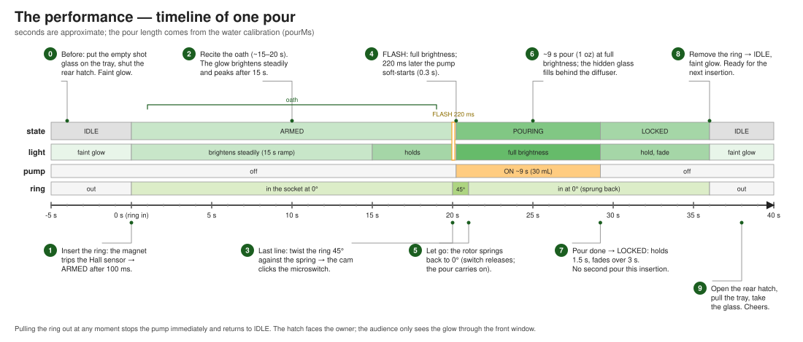
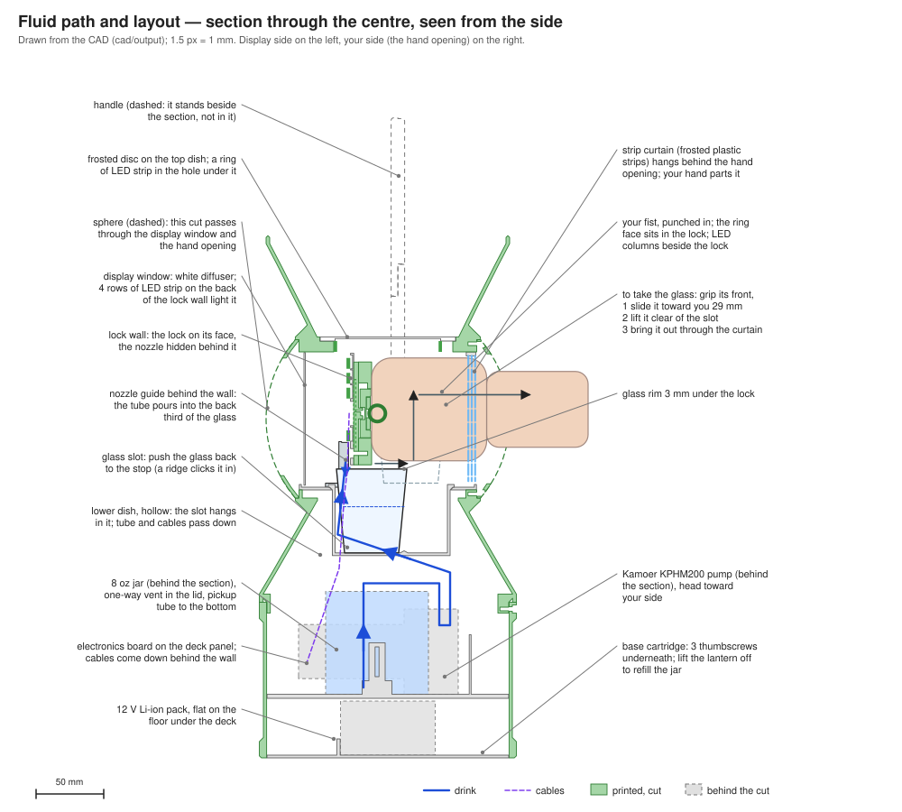
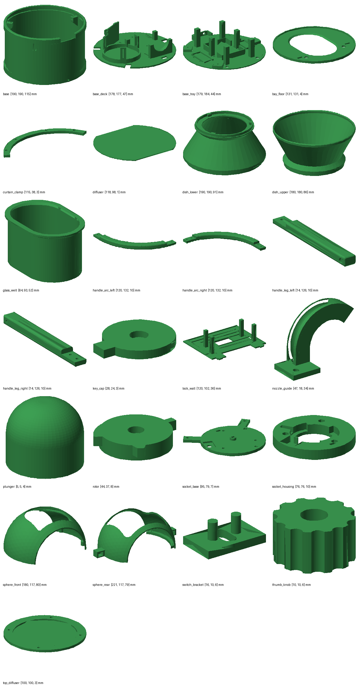
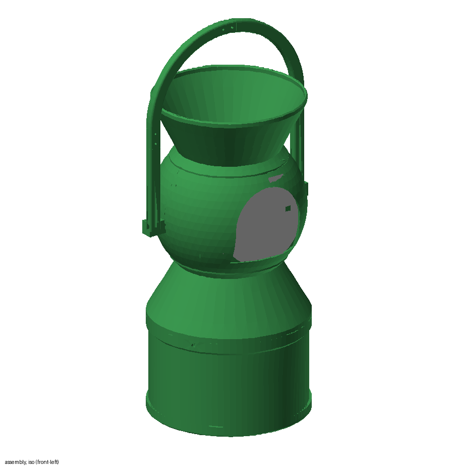
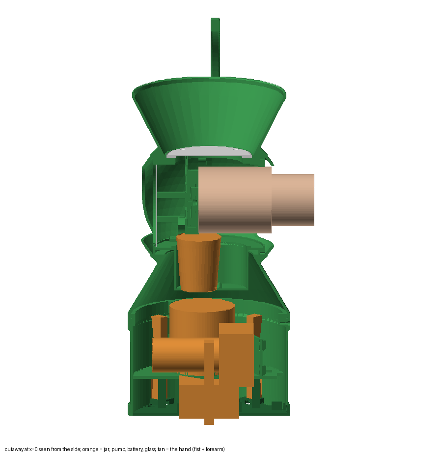
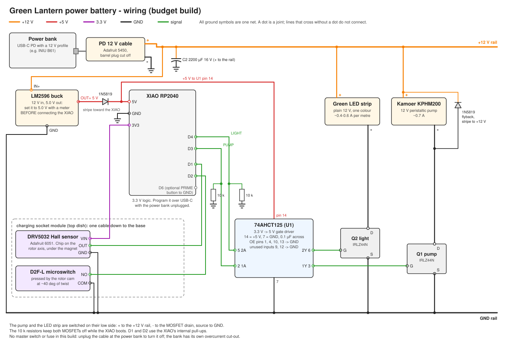
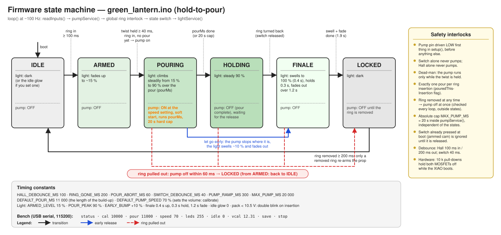
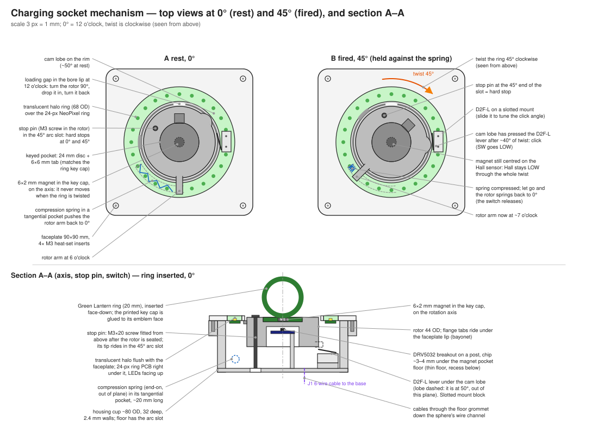

# Green Lantern power battery that pours a shot: build guide (budget build, ~$200)

A 3D-printed Green Lantern power battery, about 47 cm tall and 18 cm across, with a hidden pump, a hidden
nozzle and a twist-to-pour lock. The sphere has two openings: the **hand opening** on your side, closed by a
curtain of frosted plastic strips, and the frosted **display window** on the far side. Push the empty shot
glass in under the lock until it clicks. Punch in, ring face first, and the ring seats in the lock: the lantern
glows faintly. Twist 45 degrees and hold it while you recite the oath. Behind the lock wall the pump pours
about 1 oz into the glass while the light climbs from 15 % to 90 % over about 11 seconds. Turn back and the
light swells to full, then goes dark. Grip the glass, slide it toward you, lift it and bring it out.

"Your side" means the hand opening; "display side" means the window opposite it.



**Status.** Designed, modelled and simulated; not yet built. The firmware compiles and passes 17 simulated
safety scenarios (`firmware/test`). The CAD passes its fit checks. Two things must be measured on the real
parts before you print the big pieces: the Kamoer pump's outline and your jar. Every bay is parametric
(`cad/params.py`), so a measured number is a one-line change and a re-run of `python3 build.py`.

---

## 1. How it works

```
 0. before: push the empty glass in under the lock until it clicks over the ridge at the stop
 1. punch in, ring face first (6x2 mm magnet in a printed key cap) -> Hall sensor sees it -> light fades up to ~15 %
 2. twist 45 deg counterclockwise and HOLD -> a cam clicks the microswitch -> pump starts, light starts climbing
 3. keep holding through the oath: the pump runs ~11 s while the light climbs to ~90 %
 4. let the ring turn back (spring) -> light swells to 100 % and goes dark
 5. grip the front of the glass, slide it 3 cm toward you, lift it ~5 cm out of its slot and bring it out

 Let go early: the pump stops where it is, the light swells ~10 % and goes dark.
 Safety: the pump only runs while the ring is in AND the twist is held, and only once per insertion.
```

| Where | What is there |
|---|---|
| Top dish | A frosted disc in its floor. A ring of LED strip in the hole under it makes the top glow. |
| Sphere, your side | The hand opening (120 x 96 mm), closed by a curtain of frosted plastic strips that your hand and the glass push through. |
| Sphere, inside | The **lock wall**, 2.5 cm in front of the centre. On its face, facing you: the lock (a rotor with the keyed ring pocket, 0 and 45 degree hard stops, a spring plunger that returns it, a cam, the D2F-L microswitch and the A3144 Hall sensor) and a column of LEDs either side. Under the lock: the glass, in a slot. Behind the wall, out of sight: the nozzle, over the back third of the glass, and 4 rows of LEDs facing the display window. |
| Sphere, display side | The white diffuser window. |
| Lower dish | Hollow neck: the glass slot hangs into it; the tube and the cables pass through it. |
| Base | A removable **cartridge**: the 12 V battery pack flat on its floor, a deck above it with the jar, the Kamoer pump and the electronics board, and the buck converter beside the pack. The charge jack and the power switch sit in a small panel at the bottom edge on your side. It slides up into the base drum and is held by 3 thumbscrews underneath, out of sight. To refill: undo them and lift the lantern off; the cartridge stays on the table. To charge: plug the charger into the jack, no need to open it. |



The drink touches only the jar, the platinum-silicone tube and the glass. No printed part is in the liquid path.

---

## 2. Shopping list

The same list grouped by store, with tick boxes: [SHOPPING_LIST.md](SHOPPING_LIST.md).

Prices with "~" are estimates: Amazon hid some prices from my lookups, and the LED strip, buck module and
Vetco parts were not checked listing by listing. Confirm at checkout.

### 2.1 Order online

| # | Item | Buy | Price | Notes |
|---|---|---|---|---|
| 1 | Pump | [Kamoer KPHM200, 12 V (B09HGVLHFV)](https://www.amazon.com/dp/B09HGVLHFV) | $28 | 200 mL/min or more at 12 V, 0.7 A. Run at ~70 % speed it pours about 1 oz in 11 s. |
| 2 | Tubing | [AUBER 1/8" ID x 1/4" OD platinum-cured silicone, 10 ft (B0DKB1NKB4)](https://www.amazon.com/dp/B0DKB1NKB4) | $14 | The exact 3.2 x 6.4 mm size the Kamoer head needs. FDA 21 CFR 177.2600, NSF 51. Thinner 1/8" x 3/16" tube will not pump. |
| 3 | LED strip | [HAMRVL COB LED strip, green, 12 V, 8 mm, 5 m (B0CKYFLZFQ)](https://www.amazon.com/dp/B0CKYFLZFQ) | $14.99 | COB: 320 LEDs/m under one continuous coating, so it glows evenly with no dots. Cuts every 25 mm. You use 75 cm in 7 pieces. Its current isn't listed; COB strips like it draw roughly 0.8 A/m, so ~0.6 A for 75 cm. |
| 4 | Buck converter | [LM2596 step-down module, 5-pack (B0DBVYP91F)](https://www.amazon.com/dp/B0DBVYP91F) | $7.99 | 12 V in, set to 5.0 V out for the XIAO and the level shifter. 43 x 21 mm. |
| 5 | Magnets | [6 x 2 mm neodymium, 45-pack (B0CBRVF4PN)](https://www.amazon.com/dp/B0CBRVF4PN) | ~$7 | 1 in the ring key (the pack is the smallest sensible buy). |
| 5b | Cable plugs | Vetco: [JST PH 4-pin pair](https://vetco.net/products/jst-ph-2-0-4-pin-connector-male-female-pair-pre-wired) ($2.24) for the lock cable, [JST SM 2-pin pair](https://vetco.net/products/vupn1054_jst_sm_2_pin_m-f_pair_locking_connector) ($1.75) for the LED leads | $3.99 | So the lantern unplugs from the base cartridge. |
| 5c | Vent valve | [AQUANEAT aquarium check valves, 10-pack (B086JRH4WS)](https://www.amazon.com/dp/B086JRH4WS) | $4.79 | One goes in the jar lid: lets air in as the pump draws the drink out, but nothing out if the jar tips. Fits 3/16" airline. |
| 5a | Curtain | Office store: one clear-frosted polypropylene binder divider or report cover, letter size | ~$4 | Polypropylene flexes thousands of times, lets the light through and hides the inside. One sheet makes the curtain (13 strips 12 x 97 mm). 0.3-0.5 mm; thinner parts more easily. Not PVC/vinyl, which cracks at the folds. |
| 6 | Microcontroller | [Seeed XIAO RP2040, pre-soldered (B0DRNTQ338)](https://www.amazon.com/dp/B0DRNTQ338) | ~$10 | |
| 8 | 12 V battery pack | [KBT 12 V 2400 mAh Li-ion pack, bare leads, with charger (B0C241NS29)](https://www.amazon.com/dp/B0C241NS29) | $21.99 | 70 x 55 x **40** mm, 6 cells, protection board (over-charge, over-discharge, short circuit), bare leads and its own 12.6 V charger. Full it reads 12.6 V, flat about 9.5 V: the firmware turns the pump up as it drops, so pours stay the same size. |

**Hall sensor alternative.** The lock is built for the A3144 from Vetco (item 7), on a post that reaches up
inside the rotor to about 3 mm from the magnet. If you ever have an Adafruit DRV5032 board (#6051) instead, set
`HALL_SENSOR = 'DRV5032'` in `cad/params.py` and reprint `rotor` and `socket_base`: it then sits under the plate,
works on 3.3 V and either magnet pole.

### 2.2 Pick up locally (or order the Amazon kit in brackets)

| # | Item | Where | Price | Notes |
|---|---|---|---|---|
| 7 | Hall sensor, A3144 | [Vetco, VUPN6596](https://vetco.net/products/vupn6596_hall-effect_sensor_-_allegro_a3144eua_d63) | $1.99 | Runs on 5 V, reacts to one magnet pole. It sits on a post inside the lock, ~3 mm from the magnet: about 90 mT there, 2.5 x its worst-case switch point. |
| 9 | Lever microswitch, D2F-L size | [Amazon 4-pack, B0DBV8XGG4](https://www.amazon.com/dp/B0DBV8XGG4) (Vetco doesn't list sizes for its lever switches) | ~$8 | Body 12.8 x 5.8 x 6.5 mm, two mounting holes 6.5 mm apart, hinge lever. The lock's switch bracket is built for this size: take calipers to the store. |
| 10 | 74AHCT125 quad buffer, DIP-14 | Vetco, VUPN524 | $2.95 | Turns the XIAO's 3.3 V into a clean 5 V gate signal for both MOSFETs. |
| 11 | 2 x logic-level N-MOSFET | Vetco | ~$3 | IRLZ44N or similar, TO-220, at least 3 A at 12 V. |
| 12 | Small parts | Vetco | ~$12 | 3 x 1N5819 diodes, 2 x 10 k, 1 x 100 k and 1 x 22 k resistors, 2 x 0.1 µF ceramic, 1 x 2200 µF 16 V electrolytic, a 5 x 7 cm perfboard (protoboard VUPN2924, $3.49), a 14-pin DIP socket, 22 AWG wire, heat-shrink. |
| 12a | Power switch | [Vetco 30-10005, SPST mini toggle with leads](https://vetco.net/products/30-10005_spst_miniature_toggle_switch_w-wire_leads_on-off_6a) | $4.95 | On-off, 1/4" bushing (6.5 mm panel hole), 6 A at 12 V. |
| 12b | Charge jack | [Vetco 2112, 2.1 mm DC panel jack](https://vetco.net/products/2112_2-1mm_dc_power_panel_mount_jack) | $2.88 | DC5521 (5.5 x 2.1 mm) female, 8 mm panel hole; the battery's charger plugs into it. |
| 13 | M3 screws and nuts | Tacoma Screw, by the piece ([or the M3 kit, B0HKFCTLK8](https://www.amazon.com/dp/B0HKFCTLK8), ~$18) | ~$12 | 5 x M3x6, 11 x M3x8, 4 x M3x8 flat-head (countersunk), 6 x M3x10, 20 x M3x12, 15 nuts. They thread straight into the printed holes, except the 3 thumbscrews, which go into nuts. |
| 14 | Compression spring | Ace Hardware, Hillman spring drawer (bring calipers) | ~$1-2 | About 0.4-0.5 mm wire, 5 mm outside diameter, ~10 mm long (cut a longer one down). A retractable pen's spring also fits but is softer. |
| 15 | Super glue | any cyanoacrylate super glue you have (Gorilla Glue, Loctite) | - | For the magnets, the key cap, the nuts, the Hall sensor and a few dots on the diffuser. |

**Total: about $200, battery included** (see [SHOPPING_LIST.md](SHOPPING_LIST.md) for the store-by-store breakdown). That assumes you already have:

- **PETG filament.** About 0.85 kg of green (buy two 1 kg spools so a failed print doesn't stop you) plus a little white or natural for the two diffusers (~$40 if you need two spools).
- **A food-safe jar no bigger than 73 mm across (lid included) and 76 mm tall** (an 8 oz straight-sided PET jar, ~$8 if you need one).
- **A 1.5 oz shot glass** up to 52 mm across the top and 62 mm tall (Libbey 1.5 oz glasses fit). About 1.3 cm of it stands above the slot for your fingers; a heavy base helps.
- Basic tools: soldering iron, multimeter, calipers, a drill with 2.5 mm and 6 mm bits, flush cutters.

### 2.3 Seattle-area stores (verified open on 2026-10-11; call before driving for specific stock)

| Store | Address, hours | Buy here |
|---|---|---|
| [Vetco Electronics](https://vetco.net) | 12718 Northup Way STE 100, Bellevue 98005, (425) 641-7275. Mon-Fri 9-6, Sat 10-3:30 | Diodes, resistors, capacitors, MOSFETs, the 74AHCT125, microswitches, perfboard, DIP sockets, wire, heat-shrink, A3144, Hillman springs. Not stocked: XIAO, magnets. |
| [Tacoma Screw Products, Ballard](https://www.tacomascrew.com/LocationFinder) | 3930 Leary Way NW, Seattle 98107, (206) 632-7565. Mon-Fri 7-5, Sat 9-1 | M3 screws and nuts by the piece, springs. Georgetown branch: 1121 S Bailey St, Mon-Fri 7-5. |
| [McLendon Hardware](https://www.mclendons.com/locations) | White Center: 10210 16th Ave SW, Seattle 98146. Renton: 440 Rainier Ave S | Spring drawers, metric screws, glue. |
| Stoneway Hardware, Ace stores (Magnolia, Maple Leaf, Junction) | Seattle neighbourhoods | Fasteners by the piece, spring drawers, glue. |
| [Bargreen Ellingson](https://www.bargreen.com/locations/seattle) | SoDo showroom, Mon-Fri 10-3 | 1.5 oz shot glasses. |
| [Micro Homebrew](https://www.microhomebrew.com/) | Kenmore, (425) 892-8425 | Small food-safe bottles and jars. They do not stock the 1/8" pump tubing. |

Hardwick's in the U-District closed in 2020. Sound Homebrew Supply could not be confirmed open.

---

## 3. Print the parts

All files are in `cad/output/` (STL for slicing, STEP for editing). Everything fits your 230 x 230 x 240 mm
Ender 3. The widest part is the rear sphere half at 221 mm (because of the handle bosses), the tallest is the
base at 115 mm. Centre the big parts and use a skirt, not a brim.

**PETG settings (0.4 mm nozzle):** 0.2 mm layers, nozzle 235-245 C, bed 75-85 C, 4 perimeters, 5 top and
bottom layers, 25-30 % gyroid infill, outer walls 40-60 mm/s, fan off for the first 3 layers then 30-50 %.
Textured PEI, or glue stick on smooth PEI. Do not anneal.

**Screws go straight into the plastic.** Every screw hole is a 2.7 mm pilot. Drive each M3 in slowly the
first time so it cuts its own thread, and don't over-tighten. If a hole strips, a heat-set insert rescues it
(see section 15).

Print these first, before any big part, and check them:

1. `socket_housing`, `rotor`, `socket_base`, `plunger`: the rotor turns 45 degrees with slight drag and the
   plunger snaps it back. If it binds, raise `FIT` in `cad/params.py` by 0.05 and reprint the rotor.
2. `key_cap`: drops into the rotor pocket one way only, with a little play.
3. `glass_well` with your real shot glass: it slides the length of the slot, clicks over the ridge at the far
   end, and comes back out. If your glass is wider than 52 mm at the top it won't fit; pick another glass.
4. **Optional hand check.** The CAD clears a fist 106 x 76 mm (yours is under 4 x 3 in). If you want to be
   sure before the big prints: cut a 120 x 96 mm hole in a box and punch through it with a shot glass held
   under your fist. Both must pass without scraping.

### Part list

| Part | Size (mm) | Orientation on the bed | Supports | Colour | ~g |
|---|---|---|---|---|---|
| `base` (drum) | 190 x 190 x 115 | top band down | no | green | 156 |
| `base_tray` (cartridge floor, with the port panel) | 179 x 184 x 44 | flat | no | green | 61 |
| `base_deck` | 178 x 177 x 47 | flat | no | any | 77 |
| `thumb_knob` (print 3) | 10 x 10 x 6 | flat | no | any | 0 |
| `dish_lower` | 190 x 190 x 91 | mouth down | no | green | 127 |
| `dish_upper` | 180 x 180 x 86 | floor down, mouth up | no | green | 152 |
| `top_diffuser` | 100 x 100 x 3 | flat (countersunk) face down | no | white | 11 |
| `sphere_front` (display side) | 180 x 117 x 80 | split face down, dome up | inside only, around the window (tree) | green | 49 |
| `sphere_rear` (your side) | 221 x 117 x 79 | split face down, dome up | inside only, around the hand opening (tree) | green | 48 |
| `diffuser` | 118 x 98 x 1 | flat, 100% infill | no | white | 8 |
| `lock_wall` | 120 x 102 x 36 | front face down, posts up | no | white or any | 16 |
| `curtain_clamp` | 115 x 38 x 3 | flat | no | green | 2 |
| `bay_floor` | 131 x 131 x 4 | flat | no | any | 14 |
| `glass_well` | 64 x 93 x 52 | floor down, flange up | no | any | 26 |
| `nozzle_guide` | 47 x 18 x 34 | on its side, so the bend lies flat | no | any | 3 |
| `handle_leg_left` | 14 x 126 x 10 | flat | no | green | 12 |
| `handle_leg_right` | 14 x 126 x 10 | flat | no | green | 12 |
| `handle_arc_left` | 120 x 132 x 10 | flat | no | green | 18 |
| `handle_arc_right` | 120 x 132 x 10 | flat | no | green | 17 |
| `socket_housing` | 76 x 76 x 10 | ring face down | no | green | 22 |
| `rotor` | 44 x 37 x 8 | top face down | no | green | 5 |
| `socket_base` | 95 x 79 x 7 | bottom face down, sensor post up | no | any | 12 |
| `switch_bracket` | 16 x 10 x 6 | flat | no | any | 0 |
| `plunger` | 5 x 5 x 4 | nose up | no | any | 0 |
| `key_cap` | 28 x 24 x 3 | flat face down | no | green | 1 |
| **Total** | | | | | **~850 g** |

Supports: none, except inside the two sphere halves. Print them split-face down; the last 15 mm of dome
around the window and the hand opening overhang more than 45 degrees, so enable tree supports on the inside
only. Print both diffusers (`diffuser`, `top_diffuser`) in white or natural PETG at 100 % infill: green works
but is dimmer. A white `lock_wall` reflects more light out of the hand opening.



 

---

## 4. Electronics (build it on the bench first)



Build the circuit on the 5 x 7 cm perfboard and test it before anything goes into the lantern.

1. **XIAO and U1.** Solder two 1x7 female header strips 15.24 mm apart for the XIAO, or solder it straight to
   the board. Solder the 14-pin DIP socket for the 74AHCT125 (U1).
2. **12 V in.** Check the pack's two bare leads with the meter (red +, about **12 V**). Its + goes two ways: to the charge jack's centre pin and to one tag of the
   power switch S1. Its − goes to the jack's outer contact and to ground. S1's other tag is the +12 V rail.
   Solder C2 (2200 µF 16 V) across the rail, stripe (−) to ground. The jack sits **before** the switch, so the
   pack charges with S1 off and nothing else connected. Mount the jack (8 mm hole) and S1 (6.5 mm hole) in the
   panel on the tray's edge, with leads long enough (~15 cm) to reach the board on the deck.
2a. **Battery sense.** A 100 k from the +12 V rail (after S1) to D0, a 22 k and a 0.1 µF from D0 to ground.
   It tells the firmware the battery voltage. Leave it out and everything still works, just without the
   pump compensation and the low-battery warning.
3. **5 V.** Wire the LM2596's IN+ and IN− to the 12 V rail and ground. **Turn its little screw until OUT reads
   5.0 V on the meter before connecting anything to it.** Then OUT+ feeds U1 pin 14, and also the XIAO's 5V pin
   through a 1N5819 (stripe toward the XIAO). That diode lets you plug the XIAO into a laptop without feeding
   the lantern. Even so, switch S1 off while flashing.
4. **U1 (74AHCT125).** Pin 14 to +5 V, pin 7 to ground, 0.1 µF between them. The four OE pins (1, 4, 10, 13)
   and the unused inputs (9, 12) to ground. XIAO D3 to pin 2 (pump), XIAO D4 to pin 5 (light). A 10 k from D3
   to ground and another from D4 to ground, so nothing switches on while the XIAO boots.
5. **MOSFETs.** IRLZ44N pins, facing the label, left to right: gate, drain, source. Q1 (pump): gate from U1
   pin 3, source to ground, drain to the pump's − wire. Q2 (light): gate from U1 pin 6, source to ground, drain
   to the LED strip's − wire. The pump's + and the strip's + go to the +12 V rail.
6. **Flyback diode.** Solder a 1N5819 across the pump's two wires, stripe on the + side. It protects Q1 from
   the motor's voltage spike when it switches off.
7. **Lock wires.** A3144, facing its printed side with the leads down: pin 1 to **+5 V**, pin 2 to ground,
   pin 3 to the stripe (cathode) of a 1N5819 whose other end goes to D1. The diode lets the sensor pull D1 low
   but never puts 5 V on it; put it on the board. Microswitch: NO to D2, COM to ground. Use one 4-wire cable
   (5V, HALL, SW, GND) from the lock down to the board, with the 4-pin plug
   about 10 cm from the board. Put the 2-pin plug in the LED leads the same way. These two plugs are where the
   lantern unplugs from the base cartridge. **Before you fit the lantern-side half of each plug, thread the
   cable down through the 7 mm cable hole in `bay_floor`, from the top.** The plug housings are 13 mm wide and
   will never pass that hole afterwards. The bay floor then rides on the cables until final assembly.
8. **Check before connecting the pump.** Flash the firmware (section 5), open the serial console, type
   `status`. Hold a magnet over the Hall sensor and press the switch lever: `ring=present` and
   `switch=pressed` should follow, and `battery=` should read within 0.2 V of your meter (see `vcal`). Then
   connect the strip: it should glow faintly.

An optional PRIME button goes between D6 and ground. Holding it runs the pump only when no ring is in.
It's not in the parts list; the serial `cal` command or a test pour does the same job.

---

## 5. Firmware

Source: `firmware/green_lantern/green_lantern.ino`. Board: Seeed XIAO RP2040 on the "Raspberry Pi
Pico/RP2040" Arduino core by Earle Philhower. No extra libraries.

**Arduino IDE.** Boards Manager: install "Raspberry Pi Pico/RP2040" (Earle Philhower). Select "Seeed XIAO
RP2040", open the sketch, upload. If no port appears, hold the XIAO's BOOT button while plugging it in.

**Command line.**

```bash
cd firmware
arduino-cli core install rp2040:rp2040 --additional-urls https://github.com/earlephilhower/arduino-pico/releases/download/global/package_rp2040_index.json
arduino-cli compile --fqbn rp2040:rp2040:seeed_xiao_rp2040 green_lantern
arduino-cli upload  --fqbn rp2040:rp2040:seeed_xiao_rp2040 -p /dev/ttyACM0 green_lantern
cd test && make test     # 20 simulated scenarios, all must PASS
```



| Pin | Function |
|---|---|
| D0 | Battery sense (100 k / 22 k divider from the switched +12 V) |
| D1 | Hall sensor OUT (LOW = ring present) |
| D2 | Microswitch NO (COM to GND) |
| D3 | Pump, through U1 to Q1 |
| D4 | LED strip, through U1 to Q2 |
| D6 | Optional PRIME button to GND |

Serial console at 115200 baud. Type a command and press Enter:

| Command | What it does |
|---|---|
| `status` | Shows state, ring, switch, pump, pour time, speed, brightness, idle glow, battery voltage. |
| `cal 10000` | Runs the pump 10 s without the ring, for calibration (only when idle). |
| `pour 11000` | Pour time in ms (500 to 20000): the length of the light build-up. |
| `speed 70` | Pump speed in percent (30 to 100): sets how much is poured in that time. |
| `leds 255` | Maximum LED brightness, 0 to 255. |
| `idle 0` | Glow when idle, 0 to 255 (default dark). |
| `vcal 12.31` | Tells it what your meter reads across the pack, to calibrate the battery reading. |
| `save` | Stores pour time, speed, brightness and idle glow so they survive a power cycle (`vcal` saves itself). |
| `stop` | Stops the pump now. |

The light levels live near the top of the sketch: `ARMED_LEVEL` (15 %), `POUR_PEAK` (90 %), `EARLY_BUMP`
(10 %) and the finale timings (0.4 s swell, 0.3 s hold, 1.2 s fade). They are perceived brightness, so the
climb looks steady to the eye.

**Safety interlocks, all tested in simulation:** pump off at boot. The switch alone never pumps; the ring
alone never pumps. The pump runs only while the twist is held. One pour per insertion; letting go early
does not resume. Pulling the ring mid-pour stops the pump within about 60 ms. A
switch already pressed at boot or at insertion is ignored until released. A 20 s hard cap applies to every
pump run.

---

## 6. The lock



Parts: `socket_housing`, `rotor`, `socket_base`, `switch_bracket`, `plunger`, `key_cap`. Plus 3 x M3x8 and 3
nuts for the base plate, 1 x M3x6 and a nut for the switch bracket, 2 x M3x10 and 2 nuts to mount it on the
lock wall, the spring, the microswitch, the A3144 and one magnet.

The lock is screwed to the face of the lock wall with its ring pocket facing you, so you seat the ring by
punching in. The rotor is a flat 36 mm disc. Under the housing's front lip its edge carries three features: a
stop lug in a channel whose ends are the 0 and 45 degree stops, a cam that presses the switch lever 3 mm
between 33 and 45 degrees, and a ramp that pushes the spring plunger out so the rotor snaps back when you let go.

1. **Nuts.** Drop M3 nuts into the three hex pockets on the underside of `socket_housing` and the one under
   `socket_base`. A dab of super glue holds each.
2. **Ring key.** The A3144 reacts to one magnet pole only. With the sensor wired to the board (section 4) and
   `status` running, hold each face of the magnet to the sensor's printed face: the face that gives
   `ring=present` must face **out** of the pocket under `key_cap`. Mark it, then glue the magnet in. Scuff
   the ring's flat face and the key cap. Put the ring on your left hand and make the fist you will punch with,
   ring face forward, held the way you start the twist (for example palm down). Glue the key cap on so its tab
   points to your right. In the lock the tab then sits at the rest position, and the twist is counterclockwise
   as you see it (from palm down, your thumb rolls up). The lock is built mirrored for this;
   `LOCK_TWIST = 'cw'` in `cad/params.py` gives the clockwise version.
3. **Hall sensor.** `socket_base` has a short round post in the middle with a small pocket on its tip. Bend
   the A3144's three leads 90 degrees right at the body, feed them down the slot at the pocket's edge and out
   through the bottom of the plate, and lay the sensor in the pocket **printed face up** (flush with the top).
   A dot of glue holds it. Solder the cable to the leads under the plate and sleeve each joint. The rotor turns
   around the post; the magnet ends up about 3 mm above the sensor.
4. **Rotor and plunger.** Turn `socket_housing` upside down. Drop the spring into the straight radial pocket,
   then the `plunger` nose-first on top. Hold it with a finger and lower the `rotor` into the bore, stop lug
   down into its channel (it fits one way only). Twist to 45 degrees and let go: it must snap back every time.
   Too stiff to twist with a finger: use a softer spring (0.4 mm wire).
5. **Switch.** Press the microswitch onto the two pegs of `switch_bracket`, lever toward the rotor. Screw the
   bracket loosely into its recess in `socket_base` (M3x6 through the slot into the nut).
6. **Close and tune.** Screw `socket_base` onto the housing (3 x M3x8). Twist slowly: the lever should start to
   move at about 33 degrees and click at about 40, before the stop at 45. Slide the bracket in its slot to
   tune, then tighten. The switch must never be what stops the rotor.
7. **Cycle it 50 times** and watch `status`: `switch=pressed` only near the end of the twist, `ring=present`
   for the whole twist.
8. **Mount** it on the face of `lock_wall` (section 8): the two ears go down, one M3x10 through each ear and
   the wall, nut on the back. The Hall board's wires pass through the rectangular window in the wall behind
   it. Leave the cable long enough to reach the base (about 40 cm).

---

## 7. The fluid path

1. **Jar lid.** Drill two 6 mm holes near the edge, on opposite sides. Push the tube through one (it seals
   itself) until it reaches 5 mm above the jar's bottom. **Vent:** push a 2 cm piece of the same tube through
   the other hole, then push a check valve's barb into its top, with the valve's arrow pointing **down into the
   jar**. Air gets in as the pump draws the drink out (without it the jar goes under vacuum and the pours
   shrink), but if the jar tips, nothing comes out. Blow through it to check: air goes in, not out.
2. **Pump head.** Open the Kamoer's head cap, lay the tube around the rollers, close the cap. Use one
   continuous piece of tube from the jar to the nozzle: no joints, nothing to leak.
3. **Route.** The pump sits in its saddles on the deck, head toward your side so you can open the cap
   later, held by a strap or zip tie. The tube goes up through the lower dish neck and the tube hole in
   `bay_floor` (behind the lock wall, on your right as you look in), then through `nozzle_guide`.
4. **Nozzle.** The guide stands behind the wall and bends the tube up, over and **45 degrees down**. Its open
   side faces the wall, which holds the tube in. Leave 5 mm of tube sticking out of its end, cut square with a
   sharp blade. The tube end sits about 7 mm above the rim, over the back third of the glass, pointing down
   into it: the stream lands about 19 mm from the glass centre at any pump speed, and the last drop falls
   straight in. (A level tip would throw the stream sideways, onto the rim at the default speed.)
5. **Service loop.** Leave about 30 cm of extra tube between the pump and the bay floor, coiled loosely (no
   tighter than a 5 cm circle, or it kinks) in the space above the jar and pump. That slack lets you lift the
   lantern off the cartridge and set it down beside it without disconnecting the tube.
6. **Prime.** Water in the jar, then `cal 6000` from the laptop (or a pour into a cup) until water reaches
   the nozzle. The tube stays full between pours.

---

## 8. The lock wall, the curtain and the top


Cut the COB strip on its marked cut lines (every 25 mm) into 7 pieces: four of 10 cm, two of 5 cm and one of
25 cm. Every piece is wired in parallel: all + pads together, all − pads together, with thin wire. Direction
doesn't matter on a single-colour strip.

1. **Back of the wall (display window).** One 10 cm piece in each of the 4 channels on the back of
   `lock_wall`, LEDs facing out.
2. **Face of the wall (hand opening).** One 5 cm piece in each of the two vertical channels beside the lock. Pass
   their wires to the back through the small hole at the bottom of each channel.
3. **Lock.** Screw the lock onto the wall (section 6, step 8). Bring one + and one − lead for the whole wall,
   about 40 cm long, together with the lock cable.
4. **Top.** Stick the 25 cm piece around the inside of the hole in the floor of `dish_upper`, LEDs facing
   the centre: it goes once round (the hole is 25.1 cm around) and the hole wall is 8 mm tall, the same as the strip. Let their leads hang down from the display side
   of the hole, so they fall behind the lock wall. Screw `top_diffuser` into the counterbore above them
   (4 x M3x8 flat-head, from above).
5. **Curtain.** From one frosted sheet, cut 13 strips 12 mm wide and 97 mm long. Lay them side by side, each
   overlapping the next by 2 mm, along the curved `curtain_clamp`, and screw the clamp to the underside of
   `dish_upper`'s plug (4 x M3x8 into the holes on the side with the radial screw hole), the strips sandwiched
   between. They hang down behind the hand opening once the dish is on.
6. **Display diffuser.** It sits on the ledge behind the window of `sphere_front`. A few dots of glue hold it.

---

## 9. Final assembly

Bottom to top. "Left" and "right" are as you see them standing at the hand opening, looking in.

1. **Cartridge.** On `base_tray`: the LM2596 in its pocket on the right, the battery pack flat in the middle,
   leads toward the port panel. The deck sits 2 mm above it and holds it down (a thin strap is optional). Jack and switch in the panel, nuts tight. `base_deck` drops in on top of it (3 x M3x8 into the pillars). Jar in its ring, pump in
   its saddles. Electronics board on the deck's vertical panel (4 x M3x6).
2. **Drum.** Push an M3 nut into the slot in each of the 3 bosses inside the bottom of `base` (a dab of glue
   holds each). Push an M3x12 screw head-first into each `thumb_knob` from below and glue it. Then `dish_lower`:
   its spigot goes into the top of the drum, 3 x M3x12 from outside. The drum stays with the lantern from now on.
3. **Bay floor.** Lay `bay_floor` on the lower dish's locating ring: the long slot points at you, the two
   short wall slots cross the far half, the tube hole and the 7 mm cable hole are beyond the wall line (tube on
   the right, cables on the left; the lock cable and LED leads already pass through it, section 4 step 7, and
   their plugs go down through the lower dish to the board). Feed the tube up through the tube hole. Drop `glass_well` into the long
   slot; it hangs from its flange.
4. **Nozzle.** Push the tube up through the hole in `nozzle_guide`'s foot, then press it into the channel
   along the whole curve (the channel is open on one side) so 5 mm sticks out past the end, pointing down.
   Screw the foot down (1 x M3x8), open side toward you, the curve reaching toward the middle.
5. **Lock wall.** Stand the wall in its two slots, lock facing you. Its back closes the nozzle guide's open
   side; check the tube sits in the channel and its end still points down into the glass slot. Take up the
   slack in the lock cable and LED leads down through the cable hole.
6. **Sphere.** Slide `sphere_front`, with the diffuser in it, in from the display side until it sits on the
   lower dish and the wall's four posts touch the diffuser. Slide `sphere_rear` in from your side. Fit the two
   alignment pins, then 4 x M3x10 through the rear half's flange into the front half, and 3 x M3x12 through
   the lower joint.
7. **Top.** Lower `dish_upper` (with the top diffuser, the LED ring and the curtain on it) onto the sphere so
   the curtain goes down behind the hand opening, and screw it on, 3 x M3x12. Connect the ring's leads to the
   wall's.
8. Handle: the legs plug into the sphere's bosses (1 x M3x12 each), the two arcs lap-joint to the legs and to
   each other with 6 x M3x12 and nuts.
9. **Join the lantern and the cartridge.** Plug the lock and LED plugs together, coil the tube's slack above
   the jar, and lower the lantern over the cartridge. The three notches in the deck's edge and the three
   bosses inside the drum only line up one way. Tip the lantern a little and turn the 3 thumbscrews up into the
   bosses from underneath, finger-tight.

Keep the pump wires twisted and away from the Hall and switch wires. To turn the lantern on or off, use the
switch next to the charge jack, at the bottom edge on your side.

---

## 10. Calibration

Water in the jar, the shot glass (or a measuring cup) under the nozzle, laptop on the serial console.

First the battery reading: measure across the pack (or the rail) with the meter, type `vcal` and that number
(for example `vcal 12.31`), then `status` should show the same.

The pour time is the length of the show, so set it first and then adjust the pump speed until that time
pours the amount you want.

```
pour 11000       the build-up lasts 11 s (match it to how long you hold the twist)
cal 11000        pours for 11 s at the current speed (70 %): measure the volume
speed 60         too much? lower the speed (too little? raise it) and run cal 11000 again
save             when it pours 30-37 mL (1 to 1.25 oz)
```

Then repeat with the real drink: liqueur is thicker than water and the nozzle is 20 cm above the pump, so
expect a little less than with water. A 1.5 oz glass with 30-37 mL in it can be carried without spilling.

---

## 11. Test before the party

- [ ] Power on: dark, pump silent.
- [ ] Twist the empty lock: nothing.
- [ ] Insert the ring: the light fades up to a faint glow, no pump.
- [ ] Twist and hold: the pump runs the calibrated time while the light climbs; it stays bright after the pump stops.
- [ ] Let go: the rotor returns, the light swells to full and goes dark.
- [ ] Twist and hold again with the ring still in: nothing.
- [ ] New insertion, twist, let go after 3 s: the pump stops at once, the light swells a little and goes dark.
- [ ] Remove the ring and reinsert it, twist: one new pour.
- [ ] Pull the ring out mid-pour: the pump stops at once.
- [ ] 20 water pours in a row: every pour lands in the glass, no drips anywhere.
- [ ] Carry and tilt the lantern with water in it, then leave it 30 minutes: dry inside.
- [ ] On the day: `status` reads about 11.5 V or more (roughly half charge or better). Below that, charge first.
- [ ] `status` shows the battery voltage. With a pack below 10.5 V (or a bench supply set to 10 V), inserting the ring double-blinks before the glow.
- [ ] Switch off, plug in the charger: the charger's light shows it charging.
- [ ] Push the empty glass in until it clicks, pour water, then take it out: grip, slide 3 cm toward you, lift, out through the curtain, without spilling.
- [ ] Your fist goes through the curtain and into the lock, and back out, without catching.
- [ ] With the lights on in a dim room, the curtain, the display window and the top all glow; you can't see the nozzle.

---

## 12. Performing it

Set the lantern on a table with the hand opening toward you. Reach through the curtain, lower the empty glass
into the near end of its slot and push it all the way back until it clicks over the ridge: that is the pour
position, under the lock.

1. Make a fist (ring on your left hand) and punch in through the curtain, ring face first, until the ring
   seats in the lock. The lantern glows faintly.
2. Twist 45 degrees counterclockwise and hold it as you start the oath. The pump starts and the light begins to climb.
3. Keep holding through the oath. After about 11 seconds the pour is done; the light sits at 90 % until you
   turn back, so a longer oath is fine.
4. On the last word, turn back. The light swells to full and goes dark.
5. Draw your fist back a little and open your hand: the front of the glass is right under the lock. Grip it,
   slide it about 3 cm toward you, lift it straight up out of the slot and bring it out through the curtain.

**Charging:** switch off, plug the pack's charger into the jack at the bottom edge on your side. Charge
when the ring gets a double blink as you punch in (below 10.5 V), or after every party. A full pack lasts
well over 100 pours.

**Refilling** (about 2 minutes):
1. Switch off. Tip the lantern slightly and undo the 3 thumbscrews underneath.
2. Lift the lantern off by its handle and set it down beside the cartridge. The tube and the cables have
   enough slack; unplug the two cable plugs if you want the lantern completely free.
3. Unscrew the jar lid; the pickup tube comes out with it.
4. Fill the jar and put the lid back on.
5. Lower the lantern back over the cartridge and do the thumbscrews up.

---

## 13. Cleaning and storage

Same night, before the sugar dries:
1. Empty the jar, half-fill it with warm water, and put the shot glass in its slot.
2. `cal 8000` pours about 22 mL into the glass. Empty the glass and repeat 4 or 5 times. Only the shot
   glass fits under the nozzle, so keep each run short: `cal 20000` would pour ~55 mL and overflow it.
3. Lift the lantern off the cartridge, unscrew the jar lid and hold the pickup tube out of the water. Run
   `cal 8000` twice more to push the line empty.
4. Rinse the jar, the lid and its vent valve. Open the pump head and lift the tube off the rollers. Let
   everything air-dry with the tube ends open.

 Never leave liqueur in the tube overnight: the sugar gums up the bore and the rollers.
Store with the head open so the tube isn't crushed for months. Replace the pump tube when it looks cloudy or
flattened.

---

## 14. Troubleshooting

| Symptom | Check |
|---|---|
| Ring not detected | `status` with the ring in. Is the A3144 printed face up on its post? Is the magnet's switching face facing out of the key cap (section 6, step 2)? Is pin 1 on 5 V? |
| No pour on the twist | `status` while twisting: the switch must read `pressed` before the hard stop. Slide the switch bracket toward the cam. |
| Pump hums, no flow | Tube not seated under the rollers, head cap open, or the wrong (thin-walled) tube. |
| Pours shrink after a few in a row, jar dents in | The vent valve is in backwards (arrow must point into the jar) or blocked. |
| Pump doesn't run at all | Switch on? Check the rail gives 9.5-12.6 V (meter). Check Q1's pins (gate, drain, source) and the 10 k on D3. |
| XIAO resets when the pump starts | 12 V sagging: C2 missing, or the pack nearly empty (charge it). |
| LEDs stay dark or stay on | Q2 wiring, or U1's OE pins not grounded. |
| Double blink when the ring goes in | Low battery (below 10.5 V): charge it. If the pack is full, check the reading against your meter and run `vcal`. |
| Pours shrink as the night goes on | The battery reading is off or not connected (`status` says `not sensed`): check the divider on D0, then `vcal`. |
| Rotor sticks | Clean PETG strings out of the bore, sand lightly, or reprint the rotor with `FIT` + 0.05. |
| Drips after the pour | Trim the tube end square; make sure 5 mm sticks out of the guide. |
| Pour misses the glass | The glass was not pushed all the way back: it must click over the ridge. |
| The glass catches on the way out | Slide it toward you the full 3 cm before lifting: lifting early hits the lock. |
| Your hand catches on the curtain | Trim the strips 5 mm shorter, or use a thinner sheet (a 0.3 mm report cover). |

---

## 15. What this budget build leaves out, and how to add it back

| Upgrade | Cost | How |
|---|---|---|
| Glowing ring around the lock (24-pixel NeoPixel ring + translucent halo) | ~$17 | Set `LED_RING = True` in `cad/parts/socket.py`; the ring needs addressable-LED code, which is in the git history before the budget change. |
| Heat-set inserts instead of screwing into plastic | ~$10 | Set `M3_INSERT_HOLE = 4.0` in `cad/params.py` and re-run `build.py`. Inserts: [ruthex M3 x 5.7 mm (B08BCRZZS3)](https://www.amazon.com/dp/B08BCRZZS3). |
| Fuse | ~$3 | An inline 2 A slow-blow fuse between the pack and S1. The pack's protection board already cuts out on a short. |
| Steady LED brightness on a draining battery | ~$6 | A small buck-boost converter set to 12.0 V between the +12 V rail and the LED strip's + (the pump keeps its firmware compensation). Without it the strip dims as the pack drains: ~70 % of its current at half charge (~11.2 V), a third to a half at 10 V. Charging at half keeps it bright enough. |
| PRIME button | ~$2 | 12 mm momentary button from D6 to ground. Already supported by the firmware. |
| Pinch clamp for carrying a full jar | ~$6 | [Tubing pinch clamps (B0FCM98N2Q)](https://www.amazon.com/dp/B0FCM98N2Q). |

**Why these choices.** The Kamoer pump states 200 mL/min as a minimum, so it reliably pours 1 to 1.25 oz in
10-15 s. Two Adafruit 5 V pumps state 100 mL/min each as a maximum and often miss that window. A plain LED
strip is enough for a glow that just gets brighter, and it runs from the same 12 V as the pump. The reservoir
is a squat jar because it shares the deck with the pump under the lower dish. The glass sits about 5 cm down in
a slot because the sphere is only 10 cm tall inside and your fist and the lock need the space above it; that is
also why it slides toward you before it lifts out. The research behind every number is
in `docs/research/`.
