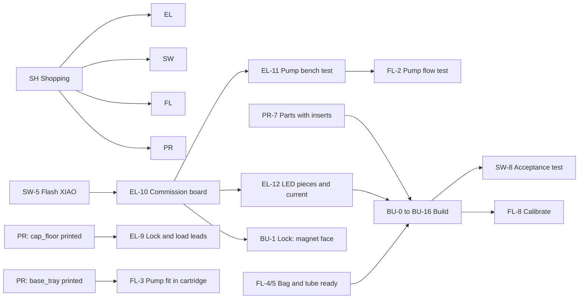

# Green Lantern Power Battery: design proposal and build plan

**Revision C.** Design complete, modelled and simulated. Parts are being procured and validated; the prop is not yet
assembled.

| | |
|---|---|
| **What** | A 3D-printed Green Lantern power battery that pours a shot when the wearer of the ring "charges" it. |
| **Size** | 45 cm tall to the lid (49 cm with the handle up), 22.4 cm across the sphere. No fastener shows from outside. |
| **Pour** | 30-37 mL (1-1.25 oz) into a 1.5 oz shot glass in about 11 s, about 20 pours per fill. |
| **Power** | 12 V rechargeable pack inside the top cap; charges in place in about 6 h. |
| **Source** | CAD `cad/` (CadQuery, all dimensions in `cad/params.py`), firmware `firmware/`, this document. |
| **Shopping** | The [shared Google Sheet](https://docs.google.com/spreadsheets/d/17pCjma48U2CBcsrsc3ZVFVb3nuV0KqnQlag0SO8B_yU/edit) is the single source for parts, prices and purchase status. |
| **Visuals** | [3D assembly viewer](https://raw.githack.com/TheRageKage12/drunk-lantern-power-battery/main/docs/assembly-viewer/index.html) · [step-by-step assembly video](videos/assembly-guide.mp4) · [exploded assembly video](videos/separate-and-assemble.mp4) · [service video](videos/service-access.mp4) |

## Contents

1. [Executive summary](#1-executive-summary)
2. [Requirements](#2-requirements)
3. [System design](#3-system-design)
4. [Delivery plan: tracks and dependencies](#4-delivery-plan-tracks-and-dependencies)
5. [Shopping track](#5-shopping-track)
6. [Electrical track](#6-electrical-track)
7. [Software track](#7-software-track)
8. [Fluids track](#8-fluids-track)
9. [Printing track](#9-printing-track)
10. [Build track](#10-build-track)
11. [Operating the prop](#11-operating-the-prop)
12. [Service, cleaning and storage](#12-service-cleaning-and-storage)
13. [Troubleshooting](#13-troubleshooting)
14. [Risks and open items](#14-risks-and-open-items)

---

## 1. Executive summary

We are building a prop that looks like the classic Green Lantern power battery and secretly pours a drink. The
performer punches through a frosted cover into the lantern, seats a printed ring in a hidden lock, twists it and holds
it through the oath. A pump hidden in the base pours a measured shot into a glass under the lock while the lantern's
light climbs; on the last word the light swells and goes dark, and the performer draws out a full glass.


**Why this design works:**

- **Safe by construction.** The pump can run only while the ring is in the lock *and* the twist is held, only once per
  insertion, and never for more than 20 s. The pump is off at every power-up. All of this is enforced in firmware and
  covered by 20 simulated scenarios that run on a laptop.
- **Food-safe liquid path.** The drink touches only a food-grade pouch, platinum-cured silicone tube and the glass. No
  printed part is wetted.
- **Serviceable.** Everything used day to day (power switch, charge socket, USB, battery gauge) is under a twist-off
  lid. The lantern lifts off its base cartridge for refills. Every joint opens with thumbscrews from inside.
- **Low risk to build.** Every printed part fits a 230 x 230 x 240 mm bed. The CAD is parametric and self-checking:
  `python3 build.py` regenerates every part and runs fit, collision and fastener checks. The battery, pump, shot glass
  and the performer's reach have been measured or validated against the model.
- **Off-the-shelf parts.** Amazon and one local electronics store (Vetco, Bellevue). No custom PCBs.

**What we need:** the parts on the Sheet, about 2-2.8 kg of PETG, and the six tracks below. The tracks run largely in
parallel; section 4 shows where one blocks another.

---

## 2. Requirements

Each requirement has a named verification step. A requirement is met when its step passes.

| # | Requirement | Verified by |
|---|---|---|
| R1 | Pours 30-37 mL into a 1.5 oz shot glass per activation, adjustable. | [FL-8](#fl-8-calibrate-the-pour) |
| R2 | Pump runs only with ring present **and** twist held; once per insertion; stops within ~60 ms if the ring is pulled; hard cap 20 s; off at boot. | [SW-3](#sw-3-run-the-firmware-simulation), [SW-8](#sw-8-system-acceptance-test) |
| R3 | Light: faint glow on ring insertion, climbs from 15 % to 90 % over the pour, swells to full and goes dark on release. | [SW-8](#sw-8-system-acceptance-test) |
| R4 | Liquid contacts only food-safe materials; no printed part in the liquid path. | [FL-1](#fl-1-validate-the-fluid-components) |
| R5 | No drips or leaks inside the lantern, including after carrying and tilting. | [FL-6](#fl-6-bench-test-the-liquid-path), [SW-8](#sw-8-system-acceptance-test) |
| R6 | Battery powered for a full evening; charges without disassembly; charge level visible. | [EL-1](#el-1-validate-the-circuit-on-paper), [SW-8](#sw-8-system-acceptance-test) |
| R7 | Refill of about 22 oz in a few minutes without tools. | [Operating: refilling](#refilling) |
| R8 | A fist with the ring reaches the lock through a 140 mm opening, about 16-17 cm deep, and withdraws a full glass. | Validated with a cardboard mock-up; re-checked in [SW-8](#sw-8-system-acceptance-test) |
| R9 | No fastener visible from outside. | [PR-2](#pr-2-verify-the-cad) (`test_inserts.py`), visual check at [BU-16](#step-16-lantern-on-the-cartridge) |
| R10 | Every printed part fits a 230 x 230 x 240 mm bed. | [PR-2](#pr-2-verify-the-cad) |

**Out of scope for this revision:** everything in [`docs/FUTURE.md`](FUTURE.md) (for example a tube quick-disconnect,
a removable fill bin, steel handle axles, a fuse, a PRIME button, more connectors, an addressable LED ring).

---

## 3. System design

### 3.1 Layout


 

**Directions used everywhere in this document:** "your side" is the hand bell, where the performer stands; "display
side" is the lens bell opposite, facing the audience. "Left" and "right" are as seen standing at the hand opening,
looking in, unless a step says otherwise.

| Module | What it is and what it carries |
|---|---|
| **Lid** | `halo_ring` (white) with the green `emblem_lid` on it. Twist 20 degrees to lock or remove, no tools. Two 12.5 cm LED strips inside the top cap light the emblem and halo from below. |
| **Top cap** | Holds the **cap floor**, a plate carrying the battery, the circuit board, the 5 V buck converter, power switch S1 and the charge socket. All day-to-day access is with the lid off. The battery lies LED-face-down over a slot so its charge dots are visible looking up through the hand opening. |
| **Sphere** (224 mm) | Two halves. Your side: the 140 mm **hand opening** and **hand bell**, closed by a one-piece frosted cover with 8 radial cuts that fold round the arm and spring back flat; a ~45 cm LED ring inside the bell. Display side: the **lens bell**, a frosted 118 mm lens with a 37.5 cm LED ring behind it. |
| **Inside the sphere** | The **lock wall**, 2.5 cm past centre toward the display side. On its face (toward you): the lock and a 5 cm LED column either side. Under the lock: the shot glass, in a slot. Behind the wall: the nozzle, over the back third of the glass. In front of that: the white **LED panel** (4 rows of strip facing the lens), which hides the nozzle, glass and wiring from the audience. On top: the white `wall_extension`, which braces the wall against the top cap and hides the wires running up. |
| **Foot** | Flared, hollow. The glass slot hangs into its neck; the tube and pump wires pass through it. |
| **Drum and cartridge** | The 80 mm drum is part of the lantern. The **cartridge** under it is one printed tray carrying the Kamoer pump and a 32 oz spouted pouch (filled to ~22 oz) under a cover. It twist-locks into the drum. Only the tube and the pump's two wires cross between lantern and cartridge. |
| **Handle** | A loop on two pivots at the sphere's sides, with printed axles. It swings freely to either side and rests down when not carried; stop tabs stop it just past level. |


### 3.2 How a pour works

```
 0. Push the empty glass in under the lock until it clicks over the ridge at the stop.
 1. Punch in, ring face first (6x2 mm magnet hidden in the ring) -> Hall sensor sees it -> light fades up to ~15 %.
 2. Twist 45 degrees counterclockwise and HOLD -> a cam clicks the microswitch -> pump starts, light starts climbing.
 3. Keep holding through the oath: the pump runs ~11 s while the light climbs to ~90 %.
 4. Let the ring turn back (spring) -> light swells to 100 % and goes dark.
 5. Grip the front of the glass, slide it 3 cm toward you, lift it ~5 cm out of its slot and bring it out.

 Let go early: the pump stops where it is, the light swells ~10 % and goes dark.
```


### 3.3 Subsystems

**Lock.** A 36 mm printed rotor in a housing screwed to the lock wall. The ring's raised emblem is the key: the rotor's
pocket is its negative, so the ring turns the rotor. The rotor has hard stops at 0 and 45 degrees, a cam that presses
a D2F-01L microswitch from about 30 degrees, and a ramp that a spring-loaded plunger pushes against to return it. An
A3144 Hall sensor on a post inside the rotor sits about 3 mm from the ring's magnet.


**Electrical.** One 12 V rail, switched by S1, feeds the pump and the LEDs through two logic-level MOSFETs; a buck
converter makes 5 V for the logic.


```
 TalentCell 12 V pack (9-12.6 V, 3 A max) --splitter--> charge socket (charger plugs in here)
        |
        S1 --> VLOAD (12 V rail) --+--> pump (+)      pump (-) --> Q1 IRLZ44N --> GND
                                   +--> LED strips (+) strips (-) --> Q2 IRLZ44N --> GND
                                   +--> C2 2200 uF
                                   +--> R1/R2 divider --> XIAO D0 (battery sense)
                                   +--> LM2596 buck, 5.0 V --> 74AHCT125 gate buffer, A3144 Hall sensor
                                                         \--> D1 diode --> JP1 jumper --> XIAO 5V
 XIAO RP2040: D1 Hall, D2 microswitch, D3 -> U1 -> Q1 (pump), D4 -> U1 -> Q2 (LEDs)
```

**Fluids.** One continuous piece of silicone tube runs from inside the pouch, through the pump's rollers, up through
the foot and the bay floor, and over a printed guide that bends it 45 degrees down above the glass. The pouch lies on a
floor that falls 2 degrees to a well; a clip holds the tube's notched tip in the well so the last of the drink is
drawn. The pouch collapses as it empties, so no vent is needed.


**Firmware.** A single Arduino sketch on a Seeed XIAO RP2040 implements the state machine above, the interlocks,
battery-compensated pump speed, perceived-brightness light curves and a serial console for calibration.

### 3.4 Key design parameters

| Parameter | Value | Why |
|---|---|---|
| Pump | Kamoer KPHM200 12 V peristaltic, ~70 % speed | Rated 200 mL/min minimum, so 1-1.25 oz in 10-15 s with margin; peristaltic keeps the drink in the tube only. |
| Tube | 1/8" ID x 1/4" OD platinum-cured silicone | The size the Kamoer head needs; thinner-walled tube will not pump. |
| Lighting | Green 12 V COB strip, ~158 cm in 10 pieces, one PWM channel | Smooth glow with no visible dots, same 12 V rail as the pump. |
| Battery | TalentCell YB1203000, 3000 mAh, 3 A max | 12 V direct for pump and LEDs; ~2.0 A estimated peak load leaves headroom. |
| Ring detection | A3144 Hall sensor, 6 x 2 mm magnet at ~3.7 mm | ~53 mT at the worst rotor position vs 35 mT maximum switch point. |
| Glass | 1.5 oz, ≤ 52 mm across the top, ≤ 62 mm tall | Fits the 54 mm slot; ~1.3 cm stands proud for the fingers. |
| Fasteners | 13 thumbscrews into 6-32 inserts, M3 elsewhere | Thumbscrews turn from inside; exposed M3 heads sit under flush green caps. |

### 3.5 Where every fastener is

| Joint | Fasteners | Turned from |
|---|---|---|
| Each bell to the sphere | 2 thumbscrews, parallel to the bell's axis, 45 degrees either side of the top of the opening | inside the sphere; heads hide behind the top edge of the opening |
| Top cap to sphere | 3 thumbscrews | inside the top cap's neck, with the lid and cap floor out |
| Cap floor | 3 thumbscrews, down into the cap's bosses | above, with the lid off |
| Foot to sphere | 3 thumbscrews | inside the foot's neck, reaching up through the open drum |
| Drum to foot | 3 M3x8 into the foot's spigot | outside, under green caps |
| Handle pivots | 2 M3x12 each | inside the sphere, under green caps |
| Handle laps | 3 M3x8 + nut per lap, 3 laps, plus epoxy | heads display side, nuts your side, all under green caps |
| Hand-cover clamp ring | 4 countersunk M3x8 into pilots in the hand bell's lip | inside the hand bell |
| Sphere halves | 4 M3x10 through the rear half's flange into the front half's inserts | inside the sphere |

---

## 4. Delivery plan: tracks and dependencies

The work is split into six tracks, each owned end to end by one person or pair. Each track is a numbered procedure
with its tests built in. Steps carry a **Blocked by** line naming the steps in other tracks that must be finished
first; anything without one can start as soon as its parts are in hand.

| Track | Owns | Delivers to |
|---|---|---|
| **SH** Shopping | Every bought part and tool; incoming validation against spec. | All tracks |
| **EL** Electrical | Circuit validation, the board, battery and switch wiring, lock wiring, pump and LED connections, bench commissioning. | Build (commissioned cap-floor electronics, lock cable, 10 LED pieces, pump with plug) |
| **SW** Software | Laptop setup, firmware source, simulation, flashing, configuration, the system acceptance test. | Electrical (flashed XIAO), Build (acceptance) |
| **FL** Fluids | Liquid-path components, pump bench test, bag rigging, nozzle, leak tests, pour calibration. | Build (rigged bag, prepared tube, pump fitted in the cartridge) |
| **PR** Printing | CAD verification, print plan, test prints, all parts, inspection, heat-set inserts, the hand-side cover. | Build (every printed part ready to assemble), Electrical, Fluids |
| **BU** Build | Assembly of the lantern from every track's outputs, in the order the viewer and video use. | Software and Fluids for final test and calibration |

### 4.1 Dependency map



### 4.2 Blocking points

| Step | Blocked by | Why |
|---|---|---|
| EL-3 (board mounting holes) | PR: `cap_floor` printed (soft) | Check the drilled holes against the real standoffs. |
| EL-9 (lead soldering) | PR: `cap_floor` printed | Leads are threaded through the cap floor's wire hole before soldering. |
| EL-10 (commissioning) | SW-5 | Needs firmware on the XIAO to read `status`. |
| EL-11, FL-2 (pump bench test) | EL-10, SW-5 | Runs the pump from the board with `cal`. |
| FL-3 (pump fit) | PR: `base_tray` printed | Checks the measured pump in its saddles. |
| PR-7 (6-32 inserts) | PR-4 `thumb_test` result | Fixes the 6-32 insert hole size before the big parts print. |
| BU-0 | PR-7, EL-12, FL-5 | Inputs gate for assembly. |
| BU-1 (lock) | PR lock parts, EL-9, SW-5 | Finding the magnet's switching face needs the Hall sensor wired and `status`. |
| BU-10 (cap floor) | EL-12 | Installs the commissioned electronics. |
| BU-15 (cartridge) | FL-3, FL-4, EL-11 | Needs the fitted pump with its plug and the rigged bag. |
| SW-8, FL-8 | BU-16 | Need the complete prop. |

**Critical path:** `thumb_test` → large prints (sphere halves, top cap, foot, drum: the longest prints) → BU-5 to BU-11
→ bells and handle → SW-8 and FL-8. Start the large prints as soon as the insert hole is confirmed; electrical,
software and fluids work fits alongside them.

---

## 5. Shopping track

**Goal:** every part and tool on hand and verified against its specification before the track that needs it starts.

### SH-1. Manage the list in the Sheet

The [shared Google Sheet](https://docs.google.com/spreadsheets/d/17pCjma48U2CBcsrsc3ZVFVb3nuV0KqnQlag0SO8B_yU/edit) is
the only shopping list; there is no copy in the repository. Edit it in place.

- Columns: **Status**, **Have**, **Still to get**, **Who has it**, **Category**, plus link and price.
- When a part arrives or is found, update Status and Who has it the same day, so other tracks know they are unblocked.
- Links are exact product pages (Amazon `/dp/<ASIN>`), never search pages. Before ordering, confirm the delivery
  date is before Oct 31, ideally with Prime.
- Small parts sold in large packs (springs, screws) come from a local store by the piece (SH-4).

### SH-2. Bought parts

**Amazon:**

- Pump: [Kamoer KPHM200, 12 V](https://www.amazon.com/dp/B09HGVLHFV).
- Tube: [AUBER 1/8" ID x 1/4" OD platinum-cured silicone, 10 ft](https://www.amazon.com/dp/B0DKB1NKB4). One continuous
  piece is used; the rest is spare (the tube is the wear part).
- Drink bag: [32 oz spouted pouch](https://www.amazon.com/dp/B09WR13XDT). A smaller pouch limits the fill to its size.
- LED strip: [HAMRVL COB LED strip, green, 12 V, 8 mm, 5 m](https://www.amazon.com/dp/B0CKYFLZFQ). Cuts every 25 mm;
  ~158 cm used.
- Buck converter: [LM2596 step-down module, 5-pack](https://www.amazon.com/dp/B0DBVYP91F).
- Magnets: [6 x 2 mm neodymium, 45-pack](https://www.amazon.com/dp/B0CBRVF4PN). One per ring.
- Microcontroller: [Seeed XIAO RP2040, pre-soldered](https://www.amazon.com/dp/B0DRNTQ338).
- Battery: [TalentCell YB1203000 with charger](https://www.amazon.com/dp/B00MHNQIR2). Its 12.6 V charger and its
  1-female-to-2-male DC splitter are both used (the splitter becomes the battery lead and the charge socket).
- Microswitch: [D2F-01L lever microswitch, 4-pack](https://www.amazon.com/dp/B0DBV9JX6L).
- M3 heat-set inserts: [ruthex RX-M3x5.7, 100-pack](https://www.amazon.com/dp/B08BCRZZS3). 17 used.
- 6-32 heat-set inserts: [initeq #6-32 long, 20-pack](https://www.amazon.com/dp/B076QY9858). 13 used.

**Vetco Electronics (Bellevue):**

- Hall sensor: [A3144, VUPN6596](https://vetco.net/products/vupn6596_hall-effect_sensor_-_allegro_a3144eua_d63).
- Gate buffer: [74AHCT125, DIP-14, VUPN524](https://vetco.net/products/vupn524_quad_level-shifter_-_74ahct125_-_3v_to_5v_d96).
- 2 MOSFETs: [IRLZ44NPBF, VUPN1682](https://vetco.net/products/vupn1682_mosfet_mosft_for_micro_controllers_-_30v_-_60a_-_irlb8721pbf_d151)
  (the page's URL and title are out of date; its detail table names the IRLZ44NPBF).
- Power switch S1: [30-10005 SPST mini toggle with leads](https://vetco.net/products/30-10005_spst_miniature_toggle_switch_w-wire_leads_on-off_6a)
  (6.5 mm panel hole).
- Connectors: one [JST PH 4-pin pair](https://vetco.net/products/jst-ph-2-0-4-pin-connector-male-female-pair-pre-wired)
  (lock cable, at the cap floor) and one [JST SM 2-pin pair](https://vetco.net/products/vupn1054_jst_sm_2_pin_m-f_pair_locking_connector)
  (pump, at the cartridge). All other leads are soldered with slack.
- Small parts: 2 x NTE585 and 1 x NTE586 (3 A/40 V) diodes; resistors 2 x 10 kΩ, 2 x 4.7 kΩ, 1 x 3.3 kΩ,
  1 x 100 kΩ, 1 x 22 kΩ; 3 x 0.1 µF ceramic and 1 x 2200 µF/25 V capacitors; a DIP-14 socket; a breakaway header and
  shunt for JP1; a 5 x 7 cm protoboard; 22 AWG stranded wire; 1/8" heat-shrink.

**Local or on hand:**

- Lock spring: compression spring, 0.4-0.5 mm wire, ≤ 5 mm outside diameter, about 10 mm long (hardware-store spring
  drawer). A retractable pen's spring also works if it passes the check in SH-3.
- VELCRO One-Wrap 3/4": 2 straps (battery, pump motor).
- About 10 small zip ties (2.5 mm wide).
- Frosted polypropylene binder divider, 0.3-0.5 mm, for the hand-side cover. Not PVC or vinyl (they crack at folds).
- Shot glass, 1.5 oz, ≤ 52 mm across the top and ≤ 62 mm tall; a heavy base helps.
- Super glue, and a small two-part epoxy for the three handle joints.
- PETG filament, green and white (quantity from PR-3).

**Hardware counts:**

| Hardware | Used | Where |
|---|---:|---|
| Knurled thumbscrews (6-32, PC-case) | 13 | bells 4 (2 each), top cap to sphere 3, foot to sphere 3, cap floor 3 |
| 6-32 heat-set inserts (initeq) | 13 | one under each thumbscrew |
| M3 heat-set inserts (ruthex) | 17 | sphere flange 4, handle pivots 4, foot spigot 3, board standoffs 4, guide boss 1, lock housing 1 |
| M3x6 socket | 4 | board on its standoffs |
| M3x8 socket | 13 | drum to foot 3, handle laps 9, nozzle guide 1 |
| M3x8 flat-head (countersunk) | 8 | lock base plate 3, switch bracket 1, cover clamp ring 4 |
| M3x10 socket | 6 | sphere halves 4, lock ears 2 |
| M3x12 socket | 4 | handle pivots |
| M3 nuts | 14 | lock 5, handle laps 9 |
| Green screw caps (printed) | 25 | drum 3, handle laps 18, pivots 4 |

**Tools:** soldering iron (with a heat-set insert tip if available), multimeter with a fused 10 A range, calipers,
wire strippers, heat gun or lighter; drill with 3.2 mm and 6 mm bits; flush cutters; pliers or small wrench; 2.5 mm
hex key (long or ball-end) and 2 mm hex key; small flat screwdriver; sharp hobby knife; ruler; 3 mm hole punch (or a
nail you can heat); USB-C **data** cable; a laptop; kitchen scale or measuring cup.

**Supplies:** silicone grease or petroleum jelly, a few cm of 1.75 mm filament, ~220 grit sandpaper, a small funnel.

### SH-3. Validate incoming parts against spec

Check each part on arrival, record the result in the Sheet's Status, and return or replace anything that fails.

| Part | Check | Pass |
|---|---|---|
| 74AHCT125 | Read the marking. | **AHCT**, not HC (HC will not switch reliably from 3.3 V). |
| IRLZ44N (x2) | Read the marking. | IRLZ44N (logic-level), not IRFZ44N. |
| NTE586 | Read the marking. | NTE586 (3 A) for the pump flyback; the two NTE585 are 1 A. |
| D2F-01L | Marking; press the lever 50 times with the meter on continuity; peg spacing against a printed `switch_bracket` when available. | Clicks every time; 0.1 A hinge-lever version. |
| A3144 | Read the marking. | A3144 (unipolar, 4.5-24 V). |
| Capacitor C2 | Read the can. | 2200 µF, ≥ 25 V. |
| Resistors | Measure each. | Within 5 % of value. |
| Battery | Charge fully; measure the output with the pack switch ON. | 12.0-12.6 V; charger LED goes green. |
| Buck module | Visual: trimmer present, no damage. | Set to 5.0 V in EL-6. |
| LED strip | Light a 25 mm segment from the battery for a second (+ to +). | Even green light. |
| Pump | Touch its leads to the battery for one second. | Rollers turn. Head and motor match the measured 63.5 mm square head, 40 mm motor. |
| Tube | Calipers. | ~3.2 mm ID, ~6.35 mm OD; labelled platinum-cured. |
| Pouch | Visual. | 32 oz, spouted, screw cap, food-grade. |
| Shot glass | Calipers. | ≤ 52 mm across the top, ≤ 62 mm tall. |
| Inserts | Calipers. | M3: 5.7 mm long, 4.6 mm across (a 5 mm-wide insert does not fit). 6-32: initeq long, tapered. |
| Thumbscrews | Thread into a 6-32 insert. | Turns freely by hand. |
| Magnet | Calipers. | 6 mm x 2 mm. |
| Cover sheet | Bend it double and release. | Polypropylene, does not crack or whiten. |

**Evaluating the lock spring (including a pen spring).** The spring sits in a 5.6 mm pocket, is cut to 10 mm, and is
compressed by up to 5.2 mm at full twist. It must pass three checks:

1. **Fits the pocket:** outside diameter ≤ 5 mm (calipers).
2. **Length:** cut it to 10 mm free length (it then rests 1.2 mm compressed in the lock).
3. **Does not go solid:** squeeze the cut piece fully closed in the calipers. The solid length must be **under
   4.5 mm** (at full twist it is squeezed to 4.8 mm). Rough check: coils in the 10 mm piece x wire diameter, plus one
   wire diameter, must be under 4.5 mm. A spring that goes solid locks the rotor before 45 degrees.

Stiffness does not decide whether the rotor returns. The ramp turns the spring's force into return torque, and the
friction it has to beat is set by that same force, so a softer spring scales both equally. Grease decides the return;
a softer spring (a pen spring is roughly a third as stiff) only makes the twist lighter and the rest position hold less
firmly. The final proof is the test in [BU-1, step 4](#step-1-the-lock): greased, twist to 45 degrees and release
20 times; the rotor must return each time, the switch must open, and the ring must drop into the pocket at rest.

### SH-4. Local stores

Call before driving for specific stock.

| Store | Address, hours | Buy here |
|---|---|---|
| [Vetco Electronics](https://vetco.net) | 12718 Northup Way STE 100, Bellevue 98005, (425) 641-7275. Mon-Fri 9-6, Sat 10-3:30 | Hall sensor, MOSFETs, diodes, resistors, capacitors, protoboard, IC socket, wire, heat-shrink, S1, JST connectors. Not stocked: XIAO, magnets. |
| [Tacoma Screw Products, Ballard](https://www.tacomascrew.com/LocationFinder) | 3930 Leary Way NW, Seattle 98107, (206) 632-7565. Mon-Fri 7-5, Sat 9-1 | M3 screws and nuts by the piece, springs. Georgetown branch: 1121 S Bailey St, Mon-Fri 7-5. |
| [McLendon Hardware](https://www.mclendons.com/locations) | White Center: 10210 16th Ave SW, Seattle 98146. Renton: 440 Rainier Ave S | Spring drawers, metric screws. |
| Ace Hardware (Magnolia, Maple Leaf, West Seattle Junction), Stoneway Hardware | Seattle | Lock spring (Hillman spring drawer), fasteners by the piece. |
| Target, Fred Meyer, Office Depot/OfficeMax | Several | Frosted polypropylene folder or divider (school aisle). |
| [Bargreen Ellingson](https://www.bargreen.com/locations/seattle) | SoDo showroom, Mon-Fri 10-3 | 1.5 oz shot glasses. |

**Track done when:** every Sheet row needed by the build reads as had, and every part has passed SH-3.

---

## 6. Electrical track

**Goal:** a commissioned cap-floor electronics set, a lock cable, 10 tested LED pieces with leads, and a pump fitted
with its flyback diode and plug, all verified on the bench before anything goes into the lantern.

**References:** [two-sided perfboard layout](review/protoboard/README.md) and its
[wire-by-wire solder schedule](review/protoboard/WIRE_SCHEDULE.md) (the rear view is mirrored; pad names stay the
same). Read [SW-6, USB power modes](#sw-6-connect-the-laptop-safely-usb-power-modes) before any USB connection.

### EL-1. Validate the circuit on paper

Confirm these numbers before buying anything extra or building. They are the design margins.

| Check | Calculation | Result |
|---|---|---|
| Peak load vs battery | LEDs ~0.8 A/m x 1.58 m ≈ 1.25 A at full; with the pump running, ~2.0 A peak (estimate). Logic < 0.1 A. | ~2.0 A against the pack's 3 A limit: ~33 % headroom. Measured in EL-12. |
| MOSFETs | IRLZ44N driven at 5 V gate by the 74AHCT125, R<sub>DS(on)</sub> ≈ 25 mΩ. At 1.25 A: ~40 mW. | No heatsink needed. |
| Gate drive | XIAO outputs are 3.3 V; the AHCT125 reads ≥ 2 V as high and drives 5 V. R3/R4 10 kΩ hold the gates low while the XIAO boots. | Pump and LEDs off at power-up. |
| Buck | LM2596, 3 A rated; load is the XIAO, U1 and Hall sensor, < 0.1 A. | Large margin. |
| Pump flyback | NTE586, 3 A/40 V, straight across the pump terminals. | Clamps the motor's turn-off spike at the source; the 1 A NTE585 is not used here. |
| Battery sense | R1 100 kΩ / R2 22 kΩ: 12.6 V x 22/122 = 2.27 V at D0. | Below the RP2040's 3.3 V limit. |
| Hall sensor | A3144 needs ≥ 4.5 V: powered from 5 V. Open-collector output pulled up to 3.3 V (R5 4.7 kΩ). | Safe for the 3.3 V GPIO; no level shifting. |
| Microswitch wetting | R7 3.3 kΩ from 5 V: ~1.5 mA through the contacts; D2F-01L needs ≥ 1 mA. D3 isolates the 5 V side from the 3.3 V GPIO. | Reliable contact; GPIO protected. |
| USB backfeed | D1 stops current flowing back into the buck; JP1 isolates the XIAO's 5 V from the rail so a laptop is never back-powered. | Remove JP1 before USB (SW-6). |
| Runtime | A pour draws ~2.0 A for ~13 s ≈ 7 mAh; the lights are off between pours. 3000 mAh pack. | Hundreds of pours per charge. |
| Wire | 22 AWG stranded, short runs, ≤ 2 A. | Adequate. |

Accepted behaviour: the strip dims as the pack drains (about 70 % current at half charge). Charge at half (section 11).

### EL-2. Prepare the battery lead and charge socket

The TalentCell splitter is "1 female to 2 male" with all three ends joined. Do not cut or open the pack.

1. Keep one **male** plug as is: it goes in the battery's port.
2. Cut the other **male** plug off, leaving its lead long: this is the battery lead to the board.
3. Keep the **female** end as is: this is the **charge socket**. The charger plugs in here and charges the pack
   through the splitter.
4. Find centre-positive and sleeve-negative with the meter's continuity setting; do not trust wire colours.
5. **Test:** splitter in the pack, pack switch ON: the cut lead and the female end read 9-12.6 V with the polarity you
   marked. Unplug before soldering.

### EL-3. Prepare the board

1. Orient the perfboard 70 mm across and 50 mm tall.
2. Drill four 3.2 mm holes at (x, y) = (18, 17), (55, 15), (15, 45) and (58, 45) mm from the component-side top-left
   corner. Keep each 9 x 9 mm mounting area clear; rear wires must fit in the 10 mm under the board, outside those
   areas. *Soft block: check the holes against the printed `cap_floor`'s standoffs when it exists.*
3. Fit the XIAO (flashed in SW-5, or flash it later in USB-only mode) and a **DIP-14 socket** for U1. Leave U1 out
   until EL-7's power-off check.
4. Fit a 2-pin header for JP1 and label it **REMOVE FOR USB**.

### EL-4. Power input, S1 and C2

1. Battery lead positive to S1; S1's other terminal is **VLOAD**, the switched rail. Negative to the common ground.
   S1 sits in its own box on the cap floor: leave its leads long enough to reach the board.
2. Solder **C2 2200 µF/25 V** from VLOAD to ground, positive to VLOAD. It smooths short dips; it cannot carry a
   stalled motor.

### EL-5. Battery sense

R1 100 kΩ from VLOAD to D0; R2 22 kΩ and C1 0.1 µF from D0 to ground. Keep this wire away from the motor wiring.
**Test** (pack on, S1 on): D0 reads VLOAD x 0.18 (2.27 V at a full 12.6 V).

### EL-6. Buck converter (set its output before connecting anything)

1. Connect only LM2596 IN+ to VLOAD and IN− to ground; leave OUT unloaded.
2. Pack and S1 on. Meter on DC volts across OUT+/OUT−; turn the trimmer until it reads **5.0 V**. Switch off.
3. OUT+ is **+5V_REG**: U1 and the Hall sensor connect straight to it.
4. The XIAO's 5V pin is fed through **D1 NTE585** (stripe toward the XIAO), then **JP1** in series. Grounds stay
   connected with JP1 removed.

### EL-7. Gate buffer U1 (74AHCT125)

1. Pin 14 to +5V_REG, pin 7 to ground; solder **C3 0.1 µF** straight across those pins with short leads.
2. Ground all four output-enable pins (1, 4, 10, 13) and the unused inputs (9, 12); leave outputs 8 and 11 open.
3. XIAO D3 to pin 2 (pump); D4 to pin 5 (light). R3 and R4, **10 kΩ**, from those two inputs to ground.
4. **Test, all power off:** check the socket notch against the
   [DIP-14 pinout](https://www.ti.com/lit/ds/symlink/sn74ahct125.pdf), and continuity of pins 1, 4, 7, 10, 13 to
   ground. Then insert U1.

### EL-8. MOSFETs Q1 (pump) and Q2 (light)

IRLZ44N, label facing you, leads down: pin 1 gate, pin 2 drain (also the tab), pin 3 source.

1. U1 pin 3 straight to Q1's gate; U1 pin 6 straight to Q2's gate. Both sources to ground.
2. Pump negative goes to Q1's drain and strip negative to Q2's drain; both positives to VLOAD (via the leads in EL-9).
3. Run the pump and strip returns separately to the common power ground; keep their current out of the Hall/XIAO
   ground wiring.

### EL-9. Leads off the cap floor and lock wiring

**Blocked by:** PR: `cap_floor` printed. Thread each lead through the cap floor's wire hole **before** soldering it or
fitting the lock cable's plug housing. Only three leads leave the cap floor:

| Lead | Wires | At the cap floor | Far end |
|---|---|---|---|
| Lock cable | +5V_REG, HALL, SW, GND | JST PH 4-pin plug just above the wire hole | Hall sensor and microswitch at the lock |
| LED lead | VLOAD (+), Q2 drain (−) | Soldered to the board, ~15 cm slack coiled on the plate | The LED harness (BU steps 3, 9, 12, 13) |
| Pump lead | VLOAD (+), Q1 drain (−) | Soldered to the board, ~15 cm slack | Joined in BU-10 to the lantern-side run (EL-11), which ends in the JST SM 2-pin plug at the cartridge |

The slack lets the cap floor lift out and rest on the cap's rim still connected. Mark every + wire with paint or red
heat-shrink.

1. **Hall sensor (A3144),** printed face toward you, leads down: pin 1 to +5V_REG, pin 2 to ground, pin 3 to XIAO D1.
   On the board, R5 **4.7 kΩ from D1 to XIAO 3V3** (never to 5 V). Fit **C4 0.1 µF across sensor pins 1 and 2, at the
   sensor**, with insulated leads. **Do not solder the sensor to the cable yet:** its leads pass through the sensor
   post's slot first (BU-1). Clip it on temporarily for bench tests.
2. **Microswitch (D2F-01L):** COM to ground, NO to the SW wire, NC unused. Solder the switch wires now (before the
   switch is mounted).
3. On the board: R7 **3.3 kΩ** from +5V_REG to SW; R6 **4.7 kΩ** from XIAO 3V3 to D2; **D3 NTE585, anode to D2,
   stripe to SW**. Closed contacts pull D2 low; open, D2 sits at 3.3 V while the switch side rises to 5 V.
4. **Lock cable length:** the lantern side runs from the lock up behind the wall to the top cap's neck. Leave it long
   now; trim it in BU-10 with slack to lift the cap floor out.

### EL-10. Commission the board without loads

**Blocked by:** SW-5 (firmware on the XIAO). Use SW-6's **USB calibration and testing** mode. Pump and strip
disconnected.

| Check | Pass |
|---|---|
| +5V_REG at U1 pin 14 and at the Hall sensor | 5.0 V |
| GPIO D1 and D2 | ~3.3 V open, < 0.8 V active |
| `status` with a magnet at the sensor and the switch pressed | Follows the magnet and switch every time, including with the cable moved |
| Battery reading after `vcal <meter reading>` | Within 0.2 V of the meter |
| Both MOSFET gates at idle | Low |
| Power-up | Pump output off; a brief LED blink at boot is intentional |

### EL-11. Connect and test the pump

**Blocked by:** EL-10. Do this together with FL-2.

1. Solder the cartridge half of the JST SM 2-pin plug to the pump's terminals. Solder the lantern half to a 2-wire
   lantern-side run long enough to reach from the cap floor's wire hole down to the cartridge with slack (it is laid
   in at BU-6 and joined to the board's pump lead at BU-10). For the bench test, join it to the board's pump lead
   temporarily.
2. Solder **D2 NTE586** straight across the pump's own terminals: stripe (cathode) to + (VLOAD), anode to − (Q1 drain).
   Never use the 1 A NTE585 here.
3. Twist the pump wires together and keep them away from the Hall and switch wires.
4. **Test** (power off to connect, then SW-6 calibration mode): `cal 2000` runs the pump for 2 s and stops; the XIAO does
   not reset; Q1 stays cool. With water in the tube (FL-2), run three 11 s pours.

### EL-12. Prepare, test and connect the LEDs

1. Cut the COB strip **only on its marked cut lines** (every 25 mm) into 10 pieces:

   | Pieces | Length | Goes to (Build step) |
   |---|---|---|
   | 2 | 5 cm | lock-face columns (BU-2) |
   | 4 | 10 cm | LED panel rows (BU-3) |
   | 2 | 12.5 cm | inside the top cap (BU-9) |
   | 1 | 37.5 cm | front bell ring (BU-12) |
   | 1 | ~45 cm | rear bell ring (BU-13) |

2. Solder a pair of 22 AWG leads to each piece, + marked. Direction doesn't matter on a single-colour strip.
3. **Test each piece** on the battery: lights evenly along its length.
4. **Current test:** connect all 10 pieces temporarily in parallel to the LED lead. With a fully charged pack, the meter
   on its fused 10 A range **in series** with the LED lead (never across the battery), run `leds 255` and `idle 255`:
   expect about 1.25 A, and under ~1.5 A. If higher, cap brightness with `leds` (for example `leds 200`) and `save`.
   Then `idle 0`, `save`.
5. **Combined test:** with the pump connected, run `cal 11000` with the LEDs at full: watch for resets, pack
   protection trips and hot wiring or MOSFETs. Expect about 2.0 A peak; a normal meter may miss start-up peaks. Stop
   and investigate any overheating, stall or trip; never stall the pump on purpose.
6. Disconnect the pieces for installation; they are joined permanently in the build (see
   [The light harness](#the-light-harness)).

**Track done when:** EL-10 to EL-12 pass, and the board, battery lead, S1, charge socket, buck, lock cable, pump with
plug and 10 LED pieces are handed to Build.

---

## 7. Software track

**Goal:** starting from a laptop and this document, get the firmware, prove it in simulation, load it onto the XIAO,
configure it, and run the final acceptance test on the finished prop.

### SW-1. Install the tools

| Tool | Get it | Used for |
|---|---|---|
| Git | [git-scm.com/downloads](https://git-scm.com/downloads) (macOS: included with Xcode command-line tools) | Getting the source |
| A C++17 compiler and `make` | macOS: `xcode-select --install`. Linux: `sudo apt install build-essential`. Windows: use WSL (Ubuntu) | The firmware simulation |
| Arduino IDE 2 **or** arduino-cli | [arduino.cc/en/software](https://www.arduino.cc/en/software) or [arduino-cli install](https://arduino.github.io/arduino-cli/latest/installation/) | Compiling and flashing |
| RP2040 board package | In the IDE: File > Preferences > Additional boards manager URLs: `https://github.com/earlephilhower/arduino-pico/releases/download/global/package_rp2040_index.json`, then Boards Manager: install "Raspberry Pi Pico/RP2040" by Earle Philhower | XIAO RP2040 support |
| A USB-C **data** cable | | Charge-only cables show no port |

No extra Arduino libraries are needed.

### SW-2. Get the source

```bash
git clone https://github.com/TheRageKage12/drunk-lantern-power-battery.git
cd drunk-lantern-power-battery
```

The sketch is `firmware/green_lantern/green_lantern.ino`; the host simulation is `firmware/test/`.

### SW-3. Run the firmware simulation

```bash
cd firmware/test
make test
```

**Pass:** all 20 scenarios report PASS. They cover: pump off at boot; the switch alone and the ring alone never pump;
the pump runs only while the twist is held; one pour per insertion; letting go early does not resume; pulling the ring
mid-pour stops the pump within ~60 ms; a switch already pressed at boot or insertion is ignored until released; the
20 s hard cap. Re-run after any firmware change.

### SW-4. Compile

Arduino IDE: open the sketch, select board "Seeed XIAO RP2040", Verify. Or:

```bash
cd firmware
arduino-cli core install rp2040:rp2040 --additional-urls https://github.com/earlephilhower/arduino-pico/releases/download/global/package_rp2040_index.json
arduino-cli compile --fqbn rp2040:rp2040:seeed_xiao_rp2040 green_lantern
```

**Pass:** compiles with no errors.

### SW-5. Flash the XIAO

The simplest way is on the **bare XIAO, before EL-3 solders it to the board**: nothing is connected, so USB is safe. If
the XIAO is already on the board, use SW-6's **USB-only flashing** mode.

```bash
arduino-cli upload --fqbn rp2040:rp2040:seeed_xiao_rp2040 -p /dev/ttyACM0 green_lantern   # port: COMx on Windows, /dev/cu.usbmodem* on macOS
```

If no port appears, hold the XIAO's BOOT button while plugging it in. **Test:** open the serial monitor at 115200 baud,
type `status`, press Enter: it prints the state, settings and battery (`not sensed` on a bare XIAO).

**Unblocks:** EL-10.

### SW-6. Connect the laptop safely (USB power modes)

Normal operation is battery-only. All USB work happens on the cap floor with the lid off. Two rules always apply:

- **Never attach USB with JP1 fitted.**
- **Never move JP1 or insert or remove U1 with power connected.**

| Mode | When | Sequence |
|---|---|---|
| **USB-only flashing** | Flashing a XIAO already on the board, before the buck is set | S1 OFF, pack unplugged, JP1 removed, **U1 out of its socket**. Connect USB, upload, unplug USB, refit U1. No load tests in this mode. |
| **USB calibration and testing** | `status`, `cal`, `vcal`, priming, cleaning | All power off, remove JP1. Pack and S1 ON, check +5V_REG, then connect USB: USB powers only the XIAO; the buck powers U1 and the Hall sensor. To attach loads, power down (USB out first, then S1 OFF), connect, repeat. Finish with `stop`, unplug USB, then S1 OFF. Refit JP1 only with USB unplugged and power off. |
| **Battery operation** | Normal use | USB unplugged, U1 in, JP1 fitted. Pack switch ON, then S1 ON. |

If the pack trips or +5V_REG fails during USB testing, unplug USB at once and find the cause before retrying.

### SW-7. Configure

Serial console at 115200 baud; type a command and press Enter.

| Command | Effect |
|---|---|
| `status` | State, ring, switch, pump, pour time, speed, brightness, idle glow, battery voltage. |
| `cal 10000` | Runs the pump 10 s with no ring, for calibration and priming (refused during a pour). |
| `pour 11000` | Pour time in ms (500-20000): the length of the light build-up. Default 11000. |
| `speed 70` | Pump speed in percent (30-100): sets the volume poured in that time. Default 70. |
| `leds 255` | Maximum LED brightness, 0-255. Default 255. |
| `idle 0` | Glow when idle, 0-255. Default 0 (dark). |
| `vcal 12.31` | Calibrates the battery reading to your meter's reading across the pack. |
| `save` | Stores pour time, speed, brightness, idle glow and `vcal` across power cycles. |
| `stop` | Stops the pump now. |

| Pin | Function |
|---|---|
| D0 | Battery sense (100 k / 22 k divider from VLOAD) |
| D1 | Hall sensor (LOW = ring present) |
| D2 | Microswitch NO (COM to GND) |
| D3 | Pump, through U1 to Q1 |
| D4 | LED strip, through U1 to Q2 |
| D6 | Optional PRIME button to GND (not fitted) |

Light levels are constants near the top of the sketch: `ARMED_LEVEL` (15 %), `POUR_PEAK` (90 %), `EARLY_BUMP` (10 %),
and the finale (0.4 s swell, 0.3 s hold, 1.2 s fade). They are perceived brightness, so the climb looks steady.
Pump speed is compensated for battery voltage. With the ring inserted below 10.5 V the light double-blinks before the
glow: a low-battery warning.

Set `vcal` once against the meter (EL-10) and `save`. Pour time and speed are set in FL-8.

### SW-8. System acceptance test

**Blocked by:** BU-16. Run with water in the bag; Fluids runs FL-8 in the same session. Every box must pass.

- [ ] Power on: dark, pump silent.
- [ ] Twist the empty lock: nothing.
- [ ] Insert the ring: the light fades up to a faint glow, no pump.
- [ ] Twist and hold: the pump runs the set time while the light climbs; it stays bright after the pump stops.
- [ ] Let go: the rotor returns, the light swells to full and goes dark.
- [ ] Twist and hold again with the ring still in: nothing.
- [ ] New insertion, twist, let go after 3 s: the pump stops at once, the light swells a little and goes dark.
- [ ] Remove and reinsert the ring, twist: one new pour.
- [ ] Pull the ring out mid-pour: the pump stops at once.
- [ ] 20 water pours in a row: every pour lands in the glass, no drips anywhere.
- [ ] Carry and tilt the lantern with water in the bag, leave it 30 minutes: dry inside, nothing pooled in the
      cartridge.
- [ ] Run the bag nearly empty: the last pours still come.
- [ ] `status` shows the battery voltage. With a pack below 10.5 V (or a bench supply at 10 V), inserting the ring
      double-blinks before the glow.
- [ ] Lid off, S1 OFF, pack switch ON, charger in the charge socket: the charger LED shows charging; the battery's LEDs
      show through the cap floor's slot, seen through the hand opening.
- [ ] Push the empty glass in until it clicks, pour, take it out (grip, slide 3 cm toward you, lift, out through the
      cover) without spilling.
- [ ] The fist goes through the cover into the lock and back out without catching; the flaps close flat again.
- [ ] In a dim room, the lens, hand cover and emblem all glow, the hand side a little dimmer than the lens; the nozzle
      and glass are not visible through the lens.
- [ ] Running current with all strips lit and the pump running is within EL-12's result.
- [ ] Lift the lantern off and put it back: the lugs drop in and click; the pump plug and tube are not pulled.
- [ ] No fastener visible from outside.

**Track done when:** SW-8 passes with settings saved.

---

## 8. Fluids track

**Goal:** a food-safe, leak-free liquid path that pours a calibrated 30-37 mL.

### FL-1. Validate the fluid components

| Component | Check | Pass |
|---|---|---|
| Tube | Label and calipers (SH-3) | Platinum-cured silicone, 1/8" ID x 1/4" OD. |
| Pouch | Label | Food-grade 32 oz spouted pouch with screw cap. |
| Liquid path | Trace it on [the fluid diagram](images/fluid-path.png) | Pouch → tube → glass only; no printed part, no joint. |
| Shot glass | Calipers (validated) | ≤ 52 mm top, ≤ 62 mm tall. |
| Cleanliness | Wash pouch and tube with warm soapy water, rinse well, air-dry | Before first use. |

### FL-2. Bench-test the pump with water

**Blocked by:** EL-11 (pump on the board), SW-5.

1. Open the Kamoer's head cap, lay the tube round the rollers and close the cap. Tube ends in a cup of water and in the
   shot glass.
2. `cal 8000` to prime, then empty the glass.
3. `cal 11000` at the default speed 70: measure the volume (kitchen scale, 1 g = 1 mL). **Pass:** roughly 30-37 mL, steady flow,
   no leaks at the head. The exact value is set in FL-8 once the real nozzle height is in place.

### FL-3. Fit the pump in the cartridge

**Blocked by:** PR: `base_tray` printed.

1. Seat the pump in its saddles, head face (the tube ports) toward your side, head in the U-saddle and the motor in its
   round saddle. Strap the motor with one VELCRO strap through the floor slots; the head's saddle holds the head.
2. **Check:** the head sits clear of the cartridge rim (the model leaves 0.5 mm), and `base_tray` still twists into a
   printed `base` (drum) to its click with the pump in place. If the head touches, sand the saddle; report a larger
   interference to the Printing track (`PUMP_X` in `cad/params.py`).

### FL-4. Rig the bag

1. Drill a 6 mm hole in the pouch's cap and push the tube (1/4" OD) through; it should be snug.
2. Leave enough tube inside the bag to reach from the spout to the clip and the well.
3. Cut one or two small V-notches (~3 mm) in the tube's tip so the bag film can't seal over the end.

### FL-5. Prepare the nozzle end

1. Cut the other end of the tube square with a sharp blade. Keep the tube in one continuous piece from the bag through
   the pump to the nozzle; it is cut to length in BU-15.
2. Hand the tube (with the rigged bag) to Build for BU-4.

### FL-6. Bench-test the liquid path

**Blocked by:** FL-2, FL-4.

1. Fill the bag with water, cap on, air squeezed out; tube through the pump head; nozzle end over the glass.
2. Run 10 pours of `cal 11000`. **Pass:** no drips at the cap, along the tube or at the head; consistent volume
   (within ~3 mL).
3. Run the bag nearly empty: the last pours still come.

### FL-7. Liquid path in the lantern

Done in Build: nozzle in BU-4, tube and bag in BU-15. Then the in-lantern checks in SW-8 (drips, tilt test, empty-bag
pours).

### FL-8. Calibrate the pour

**Blocked by:** BU-16, SW-6. Done with SW-8.

1. Lid off; SW-6 calibration mode. Water in the bag, shot glass in its slot.
2. Battery reading first if not yet done: `vcal <meter reading>`, `save`.
3. Set the pour time first (it is the length of the show), then adjust speed until that time pours the target:

   ```
   pour 11000       the build-up lasts 11 s (match it to how long the twist is held)
   cal 11000        pours for 11 s at the current speed: measure the volume
   speed 60         too much? lower the speed (too little? raise it), run cal 11000 again
   save             when it pours 30-37 mL (1-1.25 oz)
   ```

4. Repeat with the real drink: liqueur is thicker than water and the nozzle is well above the pump, so expect a little
   less. 30-37 mL in a 1.5 oz glass carries without spilling.

**Track done when:** FL-8 passes with settings saved and SW-8's liquid checks pass.

---

## 9. Printing track

**Goal:** every printed part, inspected, with inserts installed, plus the hand-side cover.

### PR-1. Get the CAD

All ready-to-slice files are in `cad/output/` (STL for slicing, STEP for editing) in the repository (SW-2 for
cloning). To regenerate after a parameter change:

```bash
pip install cadquery trimesh manifold3d numpy pillow networkx scipy shapely
cd cad && python3 build.py
```

`assembly.stl` and the `*_envelope.stl` files are size allowances for bought parts, not parts to print.

### PR-2. Verify the CAD

```bash
cd cad
python3 build.py              # pass: 0 problems (fit, collision, envelope and hardware checks)
python3 tests/test_socket.py  # pass: SOCKET MECHANISM OK (rotor sweep, stops, lever contact)
python3 tests/test_inserts.py # every insert bore and screw shank; every thumbscrew head hidden
python3 tests/test_electronics.py
```

Every part fits the 230 x 230 x 240 mm bed: the widest are the handle end pieces (227 mm) and the sphere halves
(224 mm); the tallest is `top_cap` (145 mm). The [3D viewer](https://raw.githack.com/TheRageKage12/drunk-lantern-power-battery/main/docs/assembly-viewer/index.html)
shows every part in place.

### PR-3. Slicer settings and filament plan

PETG, 0.4 mm nozzle:

| Setting | Value |
|---|---|
| Layer height | 0.2 mm |
| Nozzle / bed | 235-245 °C / 75-85 °C |
| Walls | 4 perimeters, 5 top and 5 bottom layers |
| Infill | 25-30 % gyroid; **100 %** for the four handle pieces, the two pivots and the lens |
| Outer wall speed | 40-60 mm/s |
| Fan | off for the first 3 layers, then 30-50 % |
| Bed surface | textured PEI, or glue stick on smooth PEI |
| Elephant-foot compensation | 0.2 mm (Cura: Initial Layer Horizontal Expansion −0.2) |
| Adhesion | skirt; a 6 mm brim for the two sphere halves and the two bells |

- The foot's spigot, the top cap's plug and the cartridge's collar mate with 0.3 mm clearance a side; a flared first
  layer eats that, hence the elephant-foot setting.
- Turn "print thin walls" on for `socket_base` (the sensor post).
- Do not anneal.

**Filament:** about 2.8 kg of PETG if printed solid (about 2.6 kg green; the rest white), less at these settings.
Slice everything and record the total and the green/white split in the Sheet. If green runs short, print the hidden
parts in white: `cap_floor`, `base_tray`, `bag_cover`, `bay_floor`, `guide_boss`, `glass_well` and `nozzle_guide`.

### PR-4. Test prints (before any big part)

1. **6-32 insert hole (blocks PR-7 and the big prints).** Print `cad/output/thumb_test.stl` (~8 g): holes of 4.6, 4.8
   and 5.0 mm and a 2 mm plate like the one each thumbscrew clamps. Melt an initeq insert into each, top flush. Pick
   the hole where the insert goes in straight, sits flush, and doesn't spin when a thumbscrew is tightened through the
   plate. 4.8 mm is the default; if another wins, set `THUMB_INSERT_HOLE` in `cad/params.py` and re-run PR-2.
2. **Ring size.** Print `ring_sizer.stl` (ten labelled bands, 18.5-23 mm, ~12 g). The band that slides over the
   wearer's left middle knuckle with slight resistance, **plus 0.5 mm**, is `RING_ID` in `cad/params.py`. Re-run
   `build.py` and print `key_ring` (PR-8). One ring per wearer; each may need its own size.
3. **Lock:** `socket_housing`, `rotor`, `socket_base`, `plunger`. The rotor turns 45 degrees with slight drag and the
   plunger returns it (greased). If it binds, raise `FIT` in `cad/params.py` by 0.05 and reprint the rotor.
4. **Glass:** `glass_well` with the real shot glass: it slides the slot, clicks over the ridge, and comes back out.
   (Validated.)

### PR-5. Print the parts

Print in this order so the parts that unblock other tracks come first:

1. Tool and test prints (PR-4), then `cap_floor` (unblocks EL-9) and `base_tray` (unblocks FL-3).
2. Lock parts, `switch_bracket`, `lock_wall`, `led_panel`, `bay_floor`, `guide_boss`, `glass_well`, `nozzle_guide`.
3. The long prints: `sphere_front`, `sphere_rear`, `top_cap`, `foot`, `base`.
4. `handle_pivot_left/right`, `wall_extension`, lid parts, bells, `diffuser`, `curtain_clamp`, handle pieces, 25
   `screw_cap`, `bag_cover`, `emblem_jig`, `curtain_stencil`.


Sizes as printed (mm). "Any" means the part is hidden.

| Part | Size | Orientation on the bed | Supports | Colour |
|---|---|---|---|---|
| `sphere_front` (display side, lens opening) | 224 x 177 x 104 | split face down, dome up | tree supports, inside only: the dome round the opening and the pads under the collar | green |
| `sphere_rear` (your side, hand opening) | 224 x 177 x 95 | split face down, dome up | as `sphere_front` | green |
| `foot` | 190 x 190 x 96 | spigot down | no | green |
| `base` (drum) | 190 x 190 x 80 | upright | no | green |
| `top_cap` | 190 x 190 x 145 | plug down | no | green |
| `bell_front` | 168 x 168 x 73 | mouth down | no | green |
| `bell_rear` | 180 x 180 x 73 | mouth down | no | green |
| `emblem_lid` | 182 x 182 x 2 | flat | no | green |
| `emblem_centre` | 51 x 51 x 2 | flat | no | green |
| `curtain_clamp` | 173 x 173 x 4 | flat, cover face down | no | green |
| `handle_end_left`, `handle_end_right` | 128 x 227 x 13 | flat, lap's cut side up, **100 % infill** | no | green |
| `handle_arc_1`, `handle_arc_2` | 205 x 95 x 13 | flat, lap's cut side up, **100 % infill** | no | green |
| `handle_pivot_left`, `handle_pivot_right` | 44 x 44 x 18 | outer face down, **100 % infill** | no | green |
| `screw_cap` (**print 25**) | 6.5 x 6.5 x 1 | flat | no | green |
| `diffuser` (front lens, 118 mm disc) | 118 x 118 x 1 | flat, **100 % infill** | no | white |
| `led_panel` | 172 x 122 x 7 | LED face down | no | white |
| `halo_ring` | 190 x 190 x 14 | top (the 1.2 mm skin) down | no | white |
| `lock_wall` | 120 x 102 x 36 | front face down, posts up | no | white |
| `wall_extension` | 119 x 6 x 39 | standing on its legs | no | white |
| `bay_floor` | 131 x 131 x 4 | floor down, drip lip up | no | any |
| `guide_boss` | 8 x 8 x 6 | bore up | no | any |
| `glass_well` | 64 x 93 x 52 | floor down, flange up | no | any |
| `nozzle_guide` | 47 x 17 x 34 | foot down | small tree support under the end of the bend | any |
| `cap_floor` | 185 x 185 x 25 | plate down | no | any |
| `base_tray` (cartridge) | 179 x 179 x 66 | floor down | no | any |
| `bag_cover` | 91 x 178 x 5 | top down | no | any |
| `socket_housing` | 76 x 76 x 10 | ring face down | no | green |
| `rotor` | 44 x 37 x 8 | bottom face down (key pocket up) | no | green |
| `socket_base` | 95 x 79 x 7 | bottom face down, sensor post up | no | any |
| `switch_bracket` | 23 x 10 x 6 | flat, pegs up | no | any |
| `plunger` | 5 x 5 x 4 | nose up | no | any |
| `key_ring` | 27 x 27 x 34 | emblem down | under the head and inside the finger hole | white for 3 layers, then green (PR-8) |
| `key_cap` (only for a bought ring) | 24 x 24 x 6 | glue face down | no | green |

**Tool prints** (any colour, no supports):

| Tool | ~g | Purpose |
|---|---:|---|
| `thumb_test` | 8 | picks the 6-32 insert hole (PR-4) |
| `ring_sizer` | 12 | picks `RING_ID` (PR-4) |
| `emblem_jig` | 14 | centres `emblem_centre` in the lid while glue sets (BU-11) |
| `curtain_stencil` | 14 | cutting stencil for the hand-side cover (PR-9) |

### PR-6. Inspect and fit-check

For every part: no layer shifts, stringing cleared from holes and slots, first layer not flared. Then test each
sliding fit as soon as both parts exist; sand the smaller part if it binds:

- [ ] the foot's spigot into the top of `base` (the tightest joint);
- [ ] `base_tray` up into `base`, twisted to its click (sand the tray's collar, not the drum);
- [ ] `top_cap`'s plug into a sphere half's top collar;
- [ ] each bell over its collar on the sphere;
- [ ] `halo_ring` into the cap rim, twisted to its click;
- [ ] `glass_well` into `bay_floor`'s slot;
- [ ] each handle end piece's axle in its pivot.

### PR-7. Install the heat-set inserts

**Blocked by:** PR-4 step 1 (the 6-32 hole size).

Use the soldering iron at the insert supplier's temperature. Fit each insert flush with its entry face and square to
the hole, let it cool, and check that a screw turns freely. Try one in a scrap print first.

- **M3 (17):** ruthex RX-M3x5.7 into **4.0 mm x 6.5 mm deep** holes.
- **6-32 (13):** initeq #6-32 long into **4.8 mm x 7.0 mm deep** holes (or the size from `thumb_test`).
- Clearance holes (3.4 mm), countersinks, hex nut pockets and the four pilots in the hand bell's lip take no inserts.

| Printed part | M3 | 6-32 | Where, and which way in |
|---|---:|---:|---|
| `sphere_front` | 4 | | the 4 bosses inside, at the split face |
| `sphere_rear` | | 6 | 3 round the top collar, 3 round the bottom collar, all on your side: from inside the collar's bore, pointing outward |
| `bell_front` | | 2 | throat end, up into the thick throat wall at the top, pointing toward the mouth |
| `bell_rear` | | 2 | as `bell_front` |
| `top_cap` | | 3 | tops of the 3 bosses inside the cap, under the cap floor's ledge, from above |
| `foot` | 3 | | the spigot's 3 bosses, from outside |
| `handle_pivot_left`, `_right` | 2 each | | the face against the sphere (curved: start square, press slowly) |
| `cap_floor` | 4 | | tops of the 4 board standoffs |
| `bay_floor` + `guide_boss` | 1 | | through the floor into the glued-on boss (below) |
| `socket_housing` | 1 | | open back, beside the switch cavity |
| **Total** | **17** | **13** | |

**Bay floor insert.** The 2 mm floor is too thin to hold an insert, so its bore continues into `guide_boss`:

1. Put a thin ring of super glue round the boss's bore face and press it onto the floor's underside (the side without
   the lip), over the insert hole near the tube hole.
2. Line the bores up with a 4 mm drill bit through both; hold until the glue sets; pull the bit out.
3. Stand the floor on the boss (prop the far edge level) and set the insert from the top, through the floor into the
   boss.

### PR-8. Print the ring with a white outline

`key_ring` prints emblem down; its first three 0.2 mm layers are only the faces of the emblem's circle and bars.

1. Start with **white** PETG loaded.
2. Add a filament change before **layer 4 (Z 0.8 mm)**: Cura, Extensions > Post Processing > Filament Change; PrusaSlicer
   or Orca, the "+" on the layer slider. Both insert `M600`; otherwise use "Pause at height".
3. When green goes in, purge until it runs clean, and wipe the nozzle: the first green layer is the visible centre.
4. Let the first ring run ~1.5 mm past the swap, cancel and inspect the emblem before printing the full ring (three
   white layers over green can look pale mint).

A plain green ring works the same in the lock. **Bought ring instead:** print `key_cap`, glue the magnet into its flat
top (switching face toward the emblem, BU-1), and glue it to a ring face at least 24 mm across, bars across the finger.


### PR-9. Cut the hand-side cover

One frosted polypropylene disc, 171 mm across, with 8 cuts 62 mm long from the centre, each ending in a 3 mm hole so it
can't tear further.


Use the paper template [`docs/images/curtain_template.pdf`](images/curtain_template.pdf) (print at 100 %, check the 50 mm
bar) or the printed `curtain_stencil`.

1. Tape the template or stencil flat on the divider.
2. **Punch the 8 small holes first** (3 mm punch or a heated nail), at the ends of the cut lines.
3. Cut the 8 lines with a sharp knife, from the centre out to each hole; never past the holes.
4. Punch the 4 clamp-screw holes (3.4 mm, near the edge; blue on the template).
5. Cut round the outside circle.

**Track done when:** every part is printed, inspected, fit-checked and has its inserts; the ring(s) and cover are
ready.


---

## 10. Build track

**Goal:** assemble the prop from every track's outputs. Steps 0-16 match the step numbers in the
[3D viewer](https://raw.githack.com/TheRageKage12/drunk-lantern-power-battery/main/docs/assembly-viewer/index.html) and the
[step-by-step video](videos/assembly-guide.mp4).


### Step 0. Inputs gate

**Blocked by:** PR-7 (all parts with inserts), EL-12 (commissioned electronics, LED pieces, pump with plug), FL-5
(rigged bag and tube), PR-9 (cover). Lay out the parts for each step before starting it.

### Step 1. The lock

**Blocked by:** PR lock parts, EL-9 (lock wiring), SW-5 (`status`).

Parts: `socket_housing`, `rotor`, `socket_base`, `switch_bracket`, `plunger`, `key_ring`; 3 M3x8 flat-head and 3 nuts
(base plate), 1 M3x8 flat-head (switch bracket); the spring, the microswitch, the A3144, one magnet; grease.

1. **Nuts.** Drop M3 nuts into the three hex pockets on the underside of `socket_housing`; a dab of super glue holds
   each.
2. **Magnet into the ring.**
   - The A3144 reacts to one magnet pole only. With the sensor clipped to the board and `status` running, hold each
     face of the magnet to the sensor's printed face. The face that gives `ring=present` goes **down**, toward the
     ring's face. Mark it.
   - Put a drop of super glue in the pocket from inside the band, push the magnet to the bottom with a hex key, and let
     it set. It sits under 0.6 mm of plastic, never visible.
   - The ring is worn on the left middle finger. In a punching fist, ring face forward and palm down, the emblem's bars
     lie level (the pocket's rest position) and the twist is counterclockwise as seen by the wearer.
3. **Hall sensor.** Bend the A3144's leads 90 degrees at the body toward its unprinted back, so that with the printed
   face up they point straight down. Feed them down the slot at the edge of the pocket on `socket_base`'s post and out
   through the plate, and lay the sensor in the pocket **printed face up**, flush; a dot of glue holds it. Cut the
   three leads to different lengths, solder the lock cable to them and sleeve each joint (staggered, the sleeves fit
   side by side in the wall's window). Fit C4 across pins 1 and 2 below the pocket, insulated, clear of the rotor and
   the cable slot.
4. **Rotor and plunger.** Turn `socket_housing` upside down. Grease the rotor's rim (ramp and cam), the plunger's nose
   and the bore: dry PETG friction (0.3-0.4) is close to the ramp's slope (0.26), greased (~0.1) it returns reliably.
   Lay the spring (checked per SH-3) in the radial trough, closed end outward, then the `plunger`, flat end on the
   spring, nose toward the bore. Hold it and lower the `rotor` in, stop lug down into its channel (one way only).
   **Test:** twist to 45 degrees and release 20 times: it returns every time. If it creeps, add grease. If it is too
   stiff to twist with a finger, use a softer spring.
5. **Switch.** Press the microswitch (wires already soldered, EL-9) onto `switch_bracket`'s two pegs, lever toward the
   rotor, and lay the bracket in its recess in `socket_base`, its round hole over the slot. Lead the wires out through
   the notch in the plate's rim.
6. **Close and tune.** Screw `socket_base` on: 3 M3x8 flat-head up into the nuts, and a 4th up through the slot and the
   bracket into the housing's insert, left loose. Twist slowly: the lever starts to move at ~30 degrees and clicks at
   ~40, before the 45 degree stop. To tune, slide the 4th screw along its slot (moves the bracket ±1 mm), then
   tighten. The switch must never be what stops the rotor.
7. **Test: cycle it 50 times** watching `status`: `switch=pressed` only near the end of the twist; `ring=present` for
   the whole twist; at rest the ring drops into the pocket.

### Step 2. Lock wall

Parts: `lock_wall`, the lock, 2 M3x10 and 2 nuts, the two 5 cm LED pieces.

1. Stick one 5 cm piece in each vertical channel beside the lock; pass the leads to the back through the hole at the
   bottom of each channel.
2. Mount the lock on the wall's face: ears down, one M3x10 through each ear and the wall, nut on the back. The
   sensor's three joints pass through the rectangular window behind the lock, the switch wires through the small
   window under it.
3. The 4 LED channels on the back of the wall stay empty (the rows are on the LED panel).

### Step 3. LED panel

Parts: `led_panel`, the four 10 cm LED pieces.

1. Stick one piece in each of the 4 channels on the panel's flat front, LEDs out; pass the leads through the hole at
   the end of each row.
2. Slip the panel's 4 collars over the 4 posts on the back of the lock wall, LED face toward the lens, a dot of super
   glue in each collar.
3. Join the 4 rows' and 2 columns' leads behind the wall ([light harness](#the-light-harness)).

### Step 4. Bay floor, glass well, nozzle

Parts: `bay_floor` with `guide_boss`, `glass_well`, `nozzle_guide`, 1 M3x8, the tube (FL-5), the lock wall assembly.

1. **Glass well.** Drop `glass_well` into the floor's long slot, ridge end toward the display side; it hangs from its
   flange. Tube hole on the right, 7 mm cable hole on the left, both beyond the wall line.
2. **Nozzle.** Push the square-cut tube end up through the hole in `nozzle_guide`'s foot and along the channel,
   pressing it in through the open side, until 5 mm sticks out past the end, pointing down.
3. Feed the tube's long end down through the tube hole in `bay_floor`, and screw the guide's foot to the insert
   (M3x8), open side toward your side. The guide bends the tube up, over and 45 degrees down: the tip sits ~7 mm above
   the glass rim over the back third of the glass.
4. **Lock wall.** Stand the wall's two tabs in the floor's two short slots, lock facing your side. Its back closes the
   nozzle guide's open side. **Check:** the tube sits in the channel and points down into the glass slot.

### Step 5. Drum and foot

Parts: `base`, `foot`, 3 M3x8, 3 green caps.

Push the foot's spigot into the top of the drum. Drive 3 M3x8 from outside through the drum's top band into the
spigot's inserts; press a green `screw_cap` into each counterbore (a dot of glue if loose). These stay together.

### Step 6. Sphere

Parts: `sphere_front`, `sphere_rear`, 4 M3x10, 3 thumbscrews, the bay floor assembly, the drum and foot.

1. **Pump lead.** Feed the lantern side of the pump lead (EL-9) down through the bay floor's cable hole so its plug
   will hang out of the bottom of the foot. Keep the lock cable and LED harness ends free behind the wall: they go up.
2. **Bay floor on the foot.** Set the bay floor assembly on the foot's riser; the boss drops into a notch, so it sits
   one way only, lock facing your side. Tube and pump lead go down the middle and out of the drum.
3. **Close the sphere.** Bring `sphere_front` in from the display side and `sphere_rear` from your side so their bottom
   collars close round the riser. Drive 4 M3x10 through the rear half's internal flange into the front half's inserts,
   reaching in through the hand opening and the open top with the long 2.5 mm key.
4. **Foot to sphere.** Lay the lantern on its side on a towel, reach up through the drum into the foot's neck, and drive
   3 thumbscrews out into the inserts in the sphere's bottom collar (one way only). Finger-tight.

### Step 7. Pivots

Parts: `handle_pivot_left`, `handle_pivot_right`, 4 M3x12, 4 green caps.

The `_right` parts go on the audience's right, which is your **left** at the hand opening. Hold each pivot on its seat
over the seam and drive 2 M3x12 from inside the sphere into its inserts. Press a green cap over each head.

### Step 8. Wall extension

Stand `wall_extension` on the lock wall's top edge, legs over the wall. The top cap's plug catches its two tabs in
step 9. Lead the lock cable and LED harness up behind it (display side of the wall).

### Step 9. Top cap

Parts: `top_cap`, 3 thumbscrews, the two 12.5 cm LED pieces.

1. Stick the two pieces inside the cap wall just under the rim, one display side and one your side, LEDs facing in.
   Run their leads down to the neck; they join the LED harness below the cap floor.
2. Thread the lock cable, LED harness and pump lead up through the neck as you lower the cap.
3. Push the plug into the sphere's top collar, its notches over the wall extension's tabs.
4. Reach down through the open cap and drive 3 thumbscrews from inside the plug into the top collar's inserts.

### Step 10. Cap floor

**Blocked by:** EL-12.

Parts: `cap_floor` with the board, the battery, the buck, S1, the charge socket, 1 VELCRO strap, 4 M3x6, zip ties,
3 thumbscrews.


Assemble on the bench, then drop the plate in. S1's box and the charge socket are on your side, the buck on the display
side.

1. **Strap.** Thread the strap through both battery slots first; its lower run sits in the recess under the plate (≤ 2
   mm).
2. **Battery.** Splitter's male plug in the battery's port. Lay the pack on its bed between the rails: **LED face
   down** over the slot, **port end toward your side** against the low end stop, the plug's cord folded back in a
   U-turn. Pack switch ON (it stays ON). Tighten the strap.
3. **Board.** Screw it to the 4 standoffs, component face up, USB end toward the display side (4 M3x6). Rear wiring
   stays within the 10 mm gap.
4. **Buck.** On its four 2 mm corner supports, zip-tied through the slots. No solder joint may rest on a support.
5. **S1.** Hangs inside its box, lever up through the roof hole, nut tight on top.
6. **Charge socket.** Tie the splitter's female end loosely in its spot, so it lifts out on its cord to charge.
7. **Drop it in.** Lower the plate in, S1 and charge socket toward your side. Bring the lock cable, LED lead and pump
   lead up through the wire hole and connect: lock cable plug, and solder the LED harness and pump lead to their board
   leads with sleeved joints. Coil ~15 cm of slack. Rest the plate on its ledge and drive 3 thumbscrews down into the
   cap's bosses.
8. **Check:** looking up through the hand opening (before the hand bell goes on), the battery's LEDs show through the
   slot.

### Step 11. Lid

Parts: `halo_ring`, `emblem_lid`, `emblem_centre`, `emblem_jig`, two short pieces of 1.75 mm filament.

1. Push a short piece of filament into each of the two pin holes in the halo ring's flange top (they fit the lid one
   way only).
2. Glue `emblem_lid` onto the halo ring over the pins.
3. Drop `emblem_jig` into the lid's round cut-out, put a little glue on `emblem_centre`'s underside, drop it into the
   jig's bore and press down. Lift the jig off after half a minute.
4. **Fit:** turn the lid until its 3 lugs drop into the cap rim's grooves, push down and twist clockwise (seen from
   above) ~20 degrees to the click. Locked, the emblem's bars run left to right seen from the front. To open: twist
   anticlockwise and lift.

### Step 12. Front bell (lens)

Parts: `bell_front`, `diffuser`, the 37.5 cm LED piece, 2 thumbscrews.

1. Stick the LED piece round the inside of the collar band behind the lens ledge, LEDs facing the axis.
2. Press `diffuser` into its pocket onto the ledge; a few dots of glue hold it.
3. Lead the ring's wires in through the lens opening, round the top of the LED panel to the back of the wall, and
   solder them into the harness with ~20 cm of slack, so the bell can slide off and rest beside the lantern.
4. Slide the bell onto the front collar (the throat bosses fill the flats, so one way only).
5. Reach in through the hand opening, past the end of the lock wall to the top of the lens opening, and drive 2
   thumbscrews parallel to the bell's axis into its throat inserts.

### Step 13. Rear bell (hand side)

Parts: `bell_rear`, the ~45 cm LED piece, the cover (PR-9), `curtain_clamp`, 4 M3x8 flat-head, 2 thumbscrews.

1. Stick the LED piece all the way round the band inside the bell's throat, LEDs facing the axis.
2. **Clamp the cover.** Stand the bell mouth down. From the throat side, lay the cover on the inside of the mouth lip,
   then `curtain_clamp` on it, countersinks facing you, holes aligned with the cover's holes and the lip's pilots.
   Drive 4 countersunk M3x8 into the pilots until snug (they cut their own thread). Use M3x8, not longer: only 0.8 mm of
   plastic remains on the mouth's face.
3. Lead the ring's wires in through the hand opening along the inside top of the shell to the back of the wall, and
   solder them into the harness with ~20 cm of slack. Hold the run tight to the shell with dots of glue; tuck the slack
   behind the wall.
4. Slide the bell onto the hand-opening collar.
5. Reach in through the cover's flaps to the top of the opening and drive 2 thumbscrews into the throat inserts.

### Step 14. Handle

Parts: `handle_end_left`, `handle_end_right`, `handle_arc_1`, `handle_arc_2`, 9 M3x8, 9 nuts, epoxy, 18 green caps.

1. Push each end piece's printed axle into its pivot (`_right` into `handle_pivot_right`), the stop tab in the pivot's
   arc groove. The spokes face each other, so the finished loop can't pull off.
2. `handle_arc_1` joins `handle_end_right`, `handle_arc_2` joins `handle_end_left`, and the arcs join at the top; each
   joint is a 40 mm half-thickness lap.
3. Dry-fit all three laps. Then one lap at a time: epoxy on both faces, 3 M3x8 from the display-side face (heads in
   their counterbores), a nut in each hex pocket on your side, tightened.
4. Press a green cap over every head and nut (18), flush.
5. Support the handle level while the epoxy cures.

**Check:** the handle swings to either side and rests down; the stop tabs stop it just past level. The printed axles
are fine for carrying; don't swing the lantern by the handle.

### Step 15. Cartridge

**Blocked by:** FL-3 (pump fitted), FL-4 (rigged bag), EL-11 (pump plug and D2).

Parts: `base_tray` with the pump, `bag_cover`, the tube and bag.


1. **Tube to the pump.** Open the head cap, lay the tube round the rollers, close the cap. Leave ~30 cm of tube between
   the pump and the bay floor so the lantern can be lifted off and set down beside the cartridge; coil it loosely (no
   tighter than a 5 cm circle) above the cartridge.
2. **Bag.** Fill the bag to ~22 oz (water for testing), cap on, air out. Lay it flat in the bay with its spout in the
   back corner by the splash wall, at the well. Press the tube, still inside the bag, down into the clip, bag film and
   all, so the notched tip lies in the well. Lead the tube over the splash wall through its notch to the pump's inlet.
3. **Cover.** Lay `bag_cover` on the splash wall and raised rim, lip down, covering the whole bag and spout.

### Step 16. Lantern on the cartridge

1. Connect the pump plug (it sits by the pump's motor end).
2. Lower the lantern over the cartridge, hand opening over the pump's head end; the 3 lugs inside the drum drop into
   the L-slots in the cartridge's collar.
3. Twist clockwise (seen from above) ~20 degrees to the click.

**Unblocks:** SW-8 and FL-8.

### The light harness

All 10 LED pieces are in parallel on one channel (Q2), on the one LED lead to the board:

- **Behind the lock wall:** the 2 columns, 4 panel rows and both bells' leads join into one pair that runs up behind
  the wall extension and the top cap's neck.
- **In the top cap:** the two 12.5 cm pieces join that pair below the cap floor; it then goes up through the wire hole
  to the board.
- Join every + to +, every − to −, with sleeved solder joints. A star or a chain both work.

**Track done when:** BU-16 is complete and handed to SW-8 and FL-8.

---

## 11. Operating the prop

### On the day

1. Charge if `status` reads below about 11.5 V.
2. Fill the bag with the real drink ([Refilling](#refilling)).
3. Lid off, SW-6 calibration mode: prime with `cal 8000` into the shot glass until the drink reaches the nozzle (the
   line is empty after cleaning); empty the glass as needed. Refit JP1 with the power off, then the lid.
4. Do one full test pour, so the first pour of the night is not in front of a guest.

### The performance

Set the lantern on a table, hand opening toward you. Reach in through the cover, lower the empty glass into the near
end of its slot and push it back until it clicks over the ridge.

1. Make a fist (ring on the left middle finger) and punch in through the cover, ring face first, until the ring seats
   in the lock. The lantern glows faintly.
2. Twist 45 degrees counterclockwise and hold as the oath starts. The pump starts and the light climbs.
3. Keep holding. After about 11 s the pour is done; the light holds at 90 % until you turn back, so a longer oath is
   fine.
4. On the last word, turn back. The light swells to full and goes dark.
5. Draw the fist back a little and open the hand: the front of the glass is under the lock. Grip it, slide it ~3 cm
   toward you, lift it straight up out of the slot and bring it out through the cover.

### Charging

Nothing needs unplugging and the lantern stays on its cartridge.

1. Twist the lid anticlockwise and lift it off. S1 OFF, USB unplugged.
2. Lift the charge socket out on its cord and plug in the TalentCell 12.6 V charger. The pack's own switch must be ON
   (it stays ON).
3. The charger LED is red while charging and green when done; a full charge takes about 6 h at 0.5 A.
4. Tuck the socket back and refit the lid.

**When:** after every event, or whenever `status` reads below about 11.5 V (roughly half); the strip dims as the pack
drains. The battery's charge LEDs show through the cap floor's slot (look up through the hand opening). The double
blink on ring insertion (below 10.5 V) is a late warning. 11.5 V is a rough guide, not a precise fuel gauge.

### Refilling

**Recommended: fill in place.** The bay shapes the bag, so it holds the most.

1. Switch off (lid off, S1 OFF, lid on).
2. Twist the lantern a little anticlockwise and lift it off by the handle; set it beside the cartridge (the tube runs
   between them). Unplug the pump plug if you want it free.
3. Lift the bag cover by its finger hole. Pull the tube, bag film and all, up out of the clip.
4. Leave the bag in the bay, spout at the well. Unscrew the cap; the tube turns with it, so hold the cap while it's off
   (screwing it back undoes the twist). Fill through a small funnel until the bag fills the bay to the cover's height,
   screw the cap on and squeeze out any air.
5. Press the tube into the clip and put the cover on.
6. Plug the pump in, coil the tube's slack, lower the lantern on and twist clockwise to the click.

**Alternative: fill at the sink.** After step 3, lift the bag out by its spout. Hold the cap still and unscrew the bag
from it, turning the bag, so the tube doesn't twist; fill to ~22 oz, screw it back on, squeeze the air out, lay it back
with the spout at the well, then steps 5-6.

---

## 12. Service, cleaning and storage

### Opening it up

The [service video](videos/service-access.mp4) shows these.

| To reach | How |
|---|---|
| Power switch, charge socket, USB, JP1 | Twist the lid anticlockwise and lift it off. |
| The drink | [Refilling](#refilling). |
| A bell | Reach in from inside the sphere (hand bell: through the cover's flaps; lens bell: through the hand opening, past the end of the lock wall) and undo its 2 thumbscrews at the top of the opening. Slide the bell off and rest it beside the lantern on its lead's slack (desolder the lead to remove it fully). |
| The cap floor | Lid off, undo the 3 thumbscrews, lift the plate out onto the cap's rim, still connected (unplug the lock cable for more room). |
| The top cap | Lid off, cap floor out, reach down the neck and undo the 3 thumbscrews; lift the cap off (the wall extension stays on the lock wall). |
| Foot and drum from the sphere | Lift the lantern off the cartridge, lay it on its side, reach up through the drum into the foot's neck and undo the 3 thumbscrews. The drum and foot stay together. |
| The pump head or tube | Lift the lantern off the cartridge; the pump head faces your side. |

### Cleaning (same night, before the sugar dries)

1. Lid off; connect USB in SW-6 calibration mode.
2. Empty the bag, half-fill it with warm water and refit it with the tube in the clip. Glass in its slot, lantern back
   on.
3. `cal 8000` pours ~22 mL into the glass. Empty the glass and repeat 4 or 5 times. Keep runs short: only the shot glass
   fits under the nozzle, and `cal 20000` (~55 mL) would overflow it.
4. Lift the lantern off, unscrew the bag from the cap so the tube's tip is in the air, put the lantern back and run
   `cal 8000` twice more to push the line empty.
5. Rinse the bag and cap. Open the pump head and lift the tube off the rollers. Air-dry with the bag and tube ends open.

**Never leave liqueur in the tube overnight:** sugar gums up the bore and the rollers.

### Storage

S1 and the pack switch OFF, USB unplugged, pump head open so the tube isn't crushed. Replace the pump tube when it looks
cloudy or flattened (the spare tube is on the reel).

---

## 13. Troubleshooting

| Symptom | Check |
|---|---|
| Ring not detected | Lock cable plug on the cap floor connected? `status` with the ring in. A3144 printed face up on its post? Magnet's switching face toward the ring's face (BU-1)? Sensor pin 1 on 5 V? |
| Ring won't seat in the pocket | The rotor is not at rest: turn it back by hand and grease it (BU-1). The emblem's bars must be level to drop in. |
| Nothing lights, no response | JP1 fitted with USB unplugged? Pack switch and S1 on? Pack flat (`status` over USB or the meter on the rail)? LED joints at the board and behind the wall intact? |
| One bell stays dark | Its lead's joint at the harness broke (check with the bell off). |
| Pump won't stop | Switch S1 off. Every run is capped at 20 s; if it restarts on its own, the switch lever is stuck pressed (bracket too far toward the cam, BU-1 step 6) or D2 is shorted to ground. |
| No pour on the twist | `status` while twisting: `switch=pressed` must appear before the hard stop. Slide the switch bracket toward the cam. |
| Pump doesn't run at all | Pump plug at the cartridge connected (easy to forget after a refill)? S1 on? Rail 9-12.6 V? Q1's pins and the 10 k on D3? |
| Pump hums, no flow | Tube not seated under the rollers, head cap open, tube slack kinked when the lantern went back on, or the wrong (thin-walled) tube. |
| Pours shrink, or stop before the bag is empty | Bag film sealed over the tube tip: check the V-notches, the tip in the well, the tube pressed into the clip. |
| Pours shrink as the night goes on | Battery reading off or not connected (`status` says `not sensed`): check the D0 divider, then `vcal`. |
| XIAO resets when the pump starts | 12 V sagging: C2 missing, or the pack nearly empty. |
| LEDs stay dark or stay on | Q2 wiring, U1 supply/input/output wiring, or U1's output-enable pins not grounded. |
| Double blink when the ring goes in | Below 10.5 V: charge. If the pack is full, check against the meter and run `vcal`. |
| Rotor sticks | Clear PETG strings from the bore, sand lightly, or reprint the rotor with `FIT` + 0.05. |
| Rotor doesn't return on its own | Grease the ramp, plunger nose and bore. A stiffer spring doesn't help (see SH-3). Turning the ring back by hand works the same for the firmware. |
| Drips after the pour | Trim the tube end square; 5 mm must stick out of the guide. |
| Pour misses the glass | The glass wasn't pushed fully back: it must click over the ridge. |
| Glass catches on the way out | Slide it toward you the full 3 cm before lifting. |
| Hand catches on the cover | Cuts must reach the holes; use a thinner sheet (0.3 mm). |
| Lid or lantern won't click | Turn it back, lift slightly, find where the lugs drop in, twist clockwise again. |

---

## 14. Risks and open items

| Item | Current state | Owner | Resolved at |
|---|---|---|---|
| 6-32 insert hole size | 4.8 mm designed in; not yet confirmed on the printer. Blocks the inserts and big prints. | PR | PR-4 step 1 |
| Ring size(s) | One ring per wearer; sizes not yet chosen. Blocks only `key_ring`. | PR | PR-4 step 2 |
| Filament quantity | ~2.8 kg if solid; real total pending a full slice. Hidden parts can be white. | PR, SH | PR-3 |
| LED current | ~1.25 A full, ~2.0 A peak with the pump: estimates. | EL | EL-12 |
| Pump head in the cartridge | Pump measured; the model leaves 0.5 mm at the rim. | FL | FL-3 |
| Lock return when dry | Marginal unlubricated; reliable greased. The performer turns the ring back anyway, and the firmware only watches the switch. | BU | BU-1 step 4 |
| LED dimming as the pack drains | Accepted: ~70 % current at half charge. Charge at half. | Ops | Section 11 |
| Printed handle axles | Fine for carrying; weakest point if the lantern is yanked or swung. | Ops | Handle with care |
| Voltage-to-runtime mapping | 11.5 V "charge now" is a rule of thumb. | SW | Observe in SW-8 and first use |
| Reach and shot glass | Validated (cardboard mock-up with a 14 cm opening; real glass in `glass_well`). | — | Closed |

Future improvements are tracked in [`docs/FUTURE.md`](FUTURE.md), not here. The design's history and the reasoning
behind each choice are in `docs/review/CONTEXT.md`; the numbers in this document and `cad/params.py` are current.
