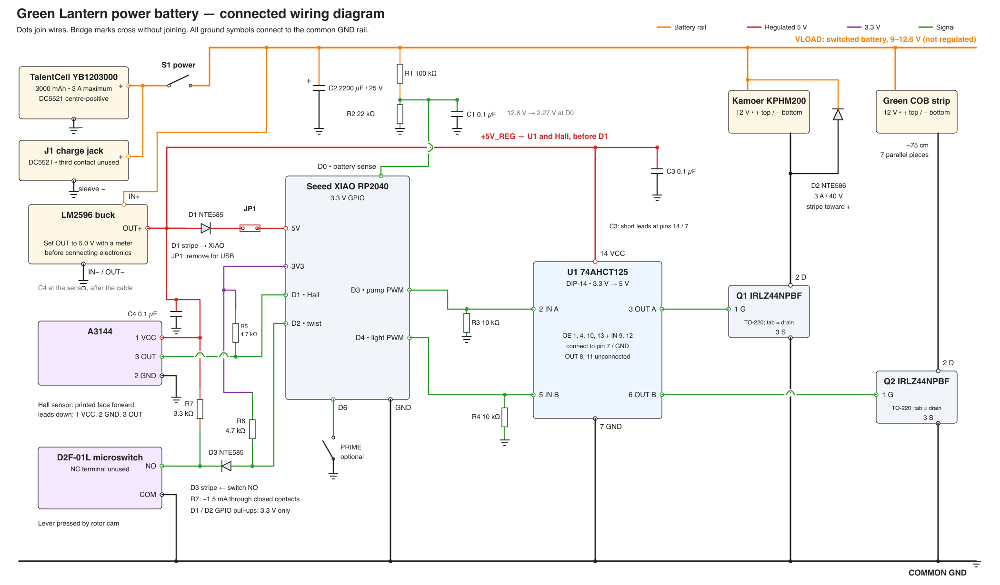

# Revise the battery, protection and sensor circuits

Revise the power and control circuit to give the pump and lighting more current headroom and make
ring/twist detection more reliable. Update the connected circuit diagram
and [build instructions](../BUILD_GUIDE.md#4-electronics-build-it-on-the-bench-first) to match.

## Circuit changes and why

| Circuit | Change | Why |
|---|---|---|
| Battery | KBT 2400 mAh / 2 A → TalentCell YB1203000, 3000 mAh / 3 A. | More current headroom and capacity. |
| 5 V supply | Move driver and Hall feeds ahead of the XIAO supply diode in the diagram. | Give both the full regulated 5 V without the diode's voltage drop. |
| Hall sensor | Remove the output diode; add a 4.7 kΩ pull-up to 3.3 V and a 0.1 µF capacitor at the sensor. | Make ring detection less sensitive to electrical noise. The 3.3 V pull-up keeps the GPIO safe without the diode; the capacitor steadies sensor power. |
| Twist switch | Replace D2F-L with D2F-01L. Add 3.3 kΩ from 5 V to the contact, an isolating diode, and a 4.7 kΩ GPIO pull-up to 3.3 V. | [Omron’s specified minimum load](https://omronfs.omron.com/en_US/ecb/products/pdf/en-d2f.pdf) for the original switch is 100 mA at 5 V, far above what the GPIO supplies; a mechanical click may not produce a reliable electrical connection. D2F-01L is specified down to 1 mA at 5 V. The added circuit supplies that contact current while keeping 5 V off the GPIO. |
| Battery-rail capacitor | Replace the existing 2200 µF/16 V capacitor with 2200 µF/25 V. | Tolerates larger voltage spikes above the battery’s 12.6 V maximum; capacitance stays the same. |
| Pump protection diode | Replace the 1 A NTE585 across the pump with a 3 A/40 V NTE586. | Motor current continues briefly after its electronic switch turns off. This diode carries that current to prevent a damaging voltage spike. A 1 A diode leaves little allowance above the pump's listed 0.7 A running current for higher current during startup; 3 A provides more room. |
| USB power | Add removable JP1 in the XIAO battery feed; remove it during USB use. | Prevent the battery supply from feeding the USB connection. |

Battery CAD changes belong in a separate PR. Firmware behavior and GPIO assignments are unchanged.

[Full-size SVG](../images/wiring.svg) · [Generator](../images/src/gen_wiring.py)

## Spreadsheet edits after acceptance

The [shared Sheet](https://docs.google.com/spreadsheets/d/17pCjma48U2CBcsrsc3ZVFVb3nuV0KqnQlag0SO8B_yU/edit)
will be updated after PR acceptance and separate owner review. Each replacement or added item will get
its purchase link, quantity and current price, and the affected totals will be recalculated. Existing
purchase/ownership status will be preserved. Prices below are the October 13 estimates.

| Row / item | Planned edit | Notes |
|---|---|---|
| 33 — Battery | Replace with one [TalentCell YB1203000 kit](https://www.amazon.com/dp/B00MHNQIR2), $22.99. | 3000 mAh, 3 A; 105 × 65 × 25 mm. |
| 30 — Microswitch | Replace with [D2F-01L four-pack](https://www.amazon.com/dp/B0DBV9JX6L), $7.99; one used. | Seller’s claimed Omron origin unverified. |
| 4 — MOSFETs | Specify **IRLZ44NPBF**, quantity 2; keep Vetco link. | Remove “IRLB8721 also fine” note. |
| 5 — Diodes | NTE585: **3 → 2**. Add one [NTE586, 3 A/40 V](https://vetco.net/products/nte586_40_volt_3a_schottky_rectifier_do27_-_nte586), $2.02. | NTE586 replaces pump flyback diode. |
| New — Resistors | Add **2 × [4.7 kΩ](https://vetco.net/products/nte-qw247_4-7k_ohm_1-4_watt_resistor)** and **1 × [3.3 kΩ](https://vetco.net/products/nte-qw233_3-3k_ohm_1-4_watt_resistor)**; $0.29 each. | GPIO pull-ups and switch contact. |
| 9 — Ceramic capacitors | 0.1 µF: **2 → 3**, $0.25 each. | Add one at the Hall sensor. |
| 10 — Battery-rail capacitor | Replace 2200 µF/16 V with [2200 µF/25 V](https://vetco.net/products/2200uf25vdc_2200uf_25_volt_electrolytic_capacitor), $3.05. | Same capacitance, higher voltage rating. |
| New — JP1 | Add [header strip](https://vetco.net/products/40-pin-breakable-male-single-row-header-connector-pc-mount-0-1-spacing), $1.99, and [shunt](https://vetco.net/products/vupn8912_0-1_-_2-54mm_shunt_-_jumper), $0.25. | Two header pins used; REMOVE FOR USB. |

These changes add **$4.69 before tax and shipping**, using the October 13 prices above and the
existing Sheet prices. The original 74AHCT125, DIP-14 socket, two 10 kΩ resistors and driver capacitor
remain unchanged. Delivery must meet the October 20 cutoff.
