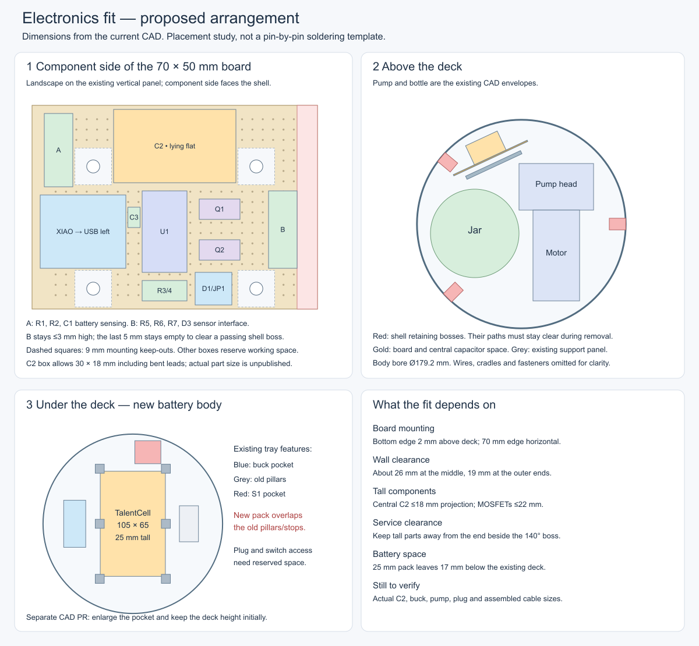

# Electronics and enclosure fit review

Review against local `circuit-review` electrical design and existing CAD, October 13, 2026.

**October 14 update:** the [full two-sided board layout](protoboard/README.md) now specifies every
component pad and all 52 wire links. It supersedes the approximate component boxes below. C2's
reserved case envelope is 25 mm long × 18 mm diameter; actual dimensions remain unverified.

**Plausible with the existing 70 × 50 mm perfboard and enclosure size, but not yet a verified assembly.**
The battery tray requires the already-planned CAD update. The board needs an explicit orientation,
mounting-hole position and component-height limits. This document proposes those details; it does
not change the CAD, shopping list or circuit.

[Full-size SVG](fit/placement-study.svg). Boxes reserve space; they are not exact footprints or a
pin-by-pin soldering plan. Hole-pattern offsets, lead bends, wiring and component heights need a
final layout check. No assembled hardware or full populated-board collision test has been performed.

## Circuit to perfboard

The Sheet's actual [Vetco VUPN2924 board](https://vetco.net/products/phenolic-protoboard-1-97-x-2-76-inch)
is approximately 70 × 50 × 1.2 mm, with 432 holes on 2.54 mm centres. Its product photo shows a
24-column × 18-row array of individual pads. Connections must be soldered with wire; adjacent holes
are not connected as they would be on a solderless breadboard.

| Location in the proposed layout | Components and wiring |
|---|---|
| Left | Pre-soldered XIAO RP2040, approximately 21 × 17.8 mm, USB connector toward the board edge. Solder its headers into the perfboard; no extra sockets are assumed. Access USB with the cartridge out, detaching the board if the plug needs more room. |
| Middle | U1 and DIP-14 socket, R3/R4 input pull-downs, and C3 close to U1's supply pins. Run short wires from XIAO D3/D4 to U1 inputs and U1 outputs to Q1/Q2 gates. |
| Beside U1 | Q1 and Q2 upright, with tops no more than 22 mm above the component-side board surface. Their tabs are separate drain connections: keep them apart and away from other wiring. |
| Upper middle | C2 laid on its side and mechanically secured, with insulated bent leads. Reserve 30 × 18 mm of board area and at most 18 mm projection toward the shell. These are proposed maximum dimensions, not verified dimensions of the listed capacitor. |
| Upper left, marked A | R1, R2 and C1 beside the XIAO battery-sense input; keep the D0 wiring away from pump-current wiring. |
| Right, marked B | R5/R6/R7 and D3, laid flat and no more than 3 mm above the board. Attach the four-wire lock pigtail nearby and route it clear of the shell boss. |
| Lower middle | D1 and removable JP1, accessible when the cartridge is out. Connections for switched battery power, buck input/output, pump and LED leads. Use soldered pigtails; this layout does not reserve space for screw terminals. |

Use the existing 22 AWG wire for VLOAD and load returns, with the pump/LED return wires joining the
power ground rather than running through the XIAO's ground connection. Route signal connections with
insulated jumpers on the solder side as needed. Clip leads and keep wiring below the available rear
clearance; keep all four mounting areas free of pads carrying signals and solder joints. Support
cables so pulling a connector does not pull on a solder pad. The JST connectors remain on flying
leads rather than occupying board area.

The [listed 2200 µF/25 V capacitor](https://vetco.net/products/2200uf25vdc_2200uf_25_volt_electrolytic_capacitor)
does not publish its case dimensions. A part fitting the reserved space makes this layout plausible.
If it is larger, it needs a different placement or a dimensioned replacement listing; do not assume
it will fit standing upright. The unused module pocket below the deck is a possible alternative
mounting area, but would require a secured insulated mounting arrangement and revised wiring placement.

## Board to enclosure

`cad/parts/base.py` defines a 52 mm wide, 44 mm high vertical panel at radius 56 mm and angle 115°.
Its four mounting pads have 40 × 30 mm spacing. They project 4.5 mm beyond the panel face, leaving
room behind the board for clipped leads and soldered wires; additional spacers would consume wall
clearance and are not assumed here.

Proposed mounting: **70 mm horizontally, 50 mm vertically, component side facing outward, bottom
edge 2 mm above the deck.** On a nominal 70 × 50 mm board, drill centres at x = 15 and 55 mm from
one side, and y = 5 and 35 mm from the bottom. This matches the current CAD's screw positions.
Reserve a 9 × 9 mm area at each hole for the printed pad and fastener. Transfer/check these centres
against the printed panel before drilling; the board's original corner holes do not match this grid.
Use the guide's M3 × 6 screws, without overtightening the phenolic board.

The guide currently gives only the 40 × 30 mm spacing; that is insufficient to determine a safe
placement. A centred hole pattern on the board would put its bottom into the deck. The offset above
puts the board at z = 49–99 mm, versus the current deck top at 47 mm and base top at 115 mm.

The base's straight inner bore is Ø179.2 mm. With the approximately 1.2 mm board on the pads, its
component surface lies at radial coordinate 63.2 mm. The available projection to the curved wall is:

- At board centre: 89.6 − 63.2 = **26.4 mm**.
- At either 35 mm-wide half-span: √(89.6² − 35²) − 63.2 = **19.3 mm**.

Those are raw geometric gaps, before tolerance and service clearance. The proposed central capacitor
and MOSFET height limits leave several millimetres to the wall at their proposed locations.

**Shell removal is tighter than the wall alone.** The retaining boss at 140° starts at radius
75.5 mm and is 10 mm wide. As the shell moves vertically, it passes the board's corresponding end.
At the extreme board edge, a component projecting only about 3.8 mm can meet that boss. Keep the
last 5 mm of that end empty, keep the adjacent sensor components at or below 3 mm, and route cables
away from its path. Tall components are placed centrally in the drawing for this reason. Include
the populated board and wiring in the cartridge-removal check in the CAD follow-up.

## Components off the board

| Item | Location and fit assessment |
|---|---|
| TalentCell battery | On the tray beneath the deck. The manufacturer's case is 105 × 65 × 25 mm. It fits within the base's overall bore, but intersects the existing pillars and end stops sized for 70 × 55 × 40 mm. Resize these in the separate CAD PR. |
| Battery lead and pack switch | Reserve the plugged-in barrel connector and cable bend, and access to the pack's own switch. With the pack centred and ports toward +Y, only 7.5 mm separates its end from the S1 pocket's near edge; depending on the port's lateral position, the plug may conflict. Turning the pack so its ports face −Y is a candidate for the CAD review, not an established solution. |
| LM2596 module | Existing left tray pocket, centred at x = −58 mm, has an inner opening of 22 × 47 mm. The CAD assumes a module approximately 21 × 43 mm; confirm the selected module's board, underside solder and tallest component before printing. It stays separate from the perfboard and connects with four wires. |
| Pump and flyback diode D2 | Pump straps into the deck saddles; D2 is soldered across the motor terminals and insulated, with its stripe toward pump positive. Its leads do not run back to the perfboard. Existing pump envelope is 118 mm long with a 64 × 63 mm head section, but the repo explicitly calls this an estimate. Tube fittings, bends and actual motor terminals need checking. |
| S1 and charge jack J1 | S1 is in the underfloor access pocket; J1 points up through the deck near its edge. The holes exist, but body, terminals, nut access and wire bends are not included as complete hardware envelopes. Retain these access routes when moving battery supports. The charger remains outside the lantern. |
| A3144 and C4 | Sensor sits in the lock's existing small post. Route its leads through the slot, and place the new 0.1 µF capacitor at the fixed end of those leads, outside the rotor's travel. The CAD has no capacitor envelope; do not try to cram it into the sensor-body pocket. Check the insulated solder joints and capacitor against the nearby lock wall. |
| D2F-01L | Uses the existing microswitch location at the lock cam. The specified D2F family body is compatible in principle, but confirm the supplied lever and terminal shape against the bracket. Its added resistors and diode are on the main board. |
| LED strips and cables | Strips attach in the upper lantern as already planned. The LED and four-wire lock cables use their existing inline connectors and service loops. Secure the loops to the fixed structure, clear of the rotor and the cartridge's sliding path. |

Keep the present deck underside at z = 44 mm initially. The new pack's top is z = 27 mm, leaving
**17 mm above the case**. Merely changing `POWERBANK_T` from 40 to 25 would automatically lower
the deck by 15 mm in the current code; separate the deck-height choice from pack thickness in the
CAD update. Keeping the deck height preserves the jar, pump and electronics positions and provides
wiring space. The wider pack requires moving the side pillars out by about 5 mm; check the updated
pillar/frame clearances rather than only replacing the battery's box dimensions.

## What this establishes

The circuit is a reasonable candidate for this board and enclosure. No larger board or larger shell
is justified by this review. The pad-level wiring layout is now recorded in the linked October 14
update. Before treating it as ready to build, check the few unpublished dimensions above and extend the separate CAD review to the populated
board, connectors and service motion. The existing CAD checks omit the populated board, buck,
complete jack/switch bodies and cable bends, so their passing result cannot establish these clearances.

Sources: [current base CAD](../../cad/parts/base.py), [parameters](../../cad/params.py),
[lock CAD](../../cad/parts/socket.py), [existing CAD-check coverage](../../cad/checks.py),
[Seeed XIAO documentation](https://wiki.seeedstudio.com/XIAO-RP2040/),
[TalentCell dimensions](https://www.talentcell.com/upload/download/12v-user-manual.pdf).
